# LAB: GPIO Digital InOut

**Date:** 2026-09-15 <br>
**Author:** Won Bitna / 22400462  <br>
**Demo Video:** https://youtu.be/HwuF476MeRU

---

## Introduction
In this lab, GPIO digital input and output were implemented using the
NUCLEO-F411RE and JKIT evaluation board. First, basic GPIO operation was
tested using Arduino functions. Then, GPIO functions were implemented in
the EC_HAL library using STM32 registers. Finally, the library was used
to control LEDs using a photodetector and a push button.

### Requirement
#### Hardware
- MCU (NUCLEO-F411RE)
- Evaluation Board

<table>
  <tr>
    <td align="center">
      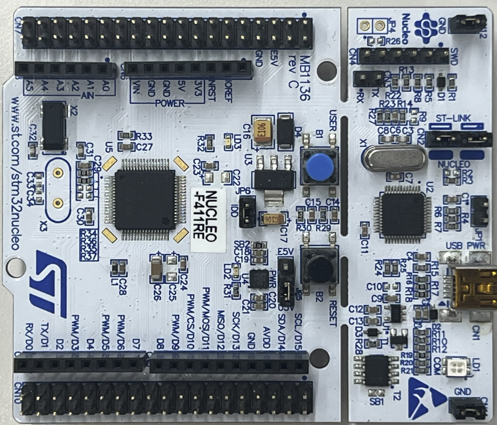<br>
	        <span style="font-size: 10px;">
			      (a) MCU_board
			</span>
    </td>
    <td align="center">
      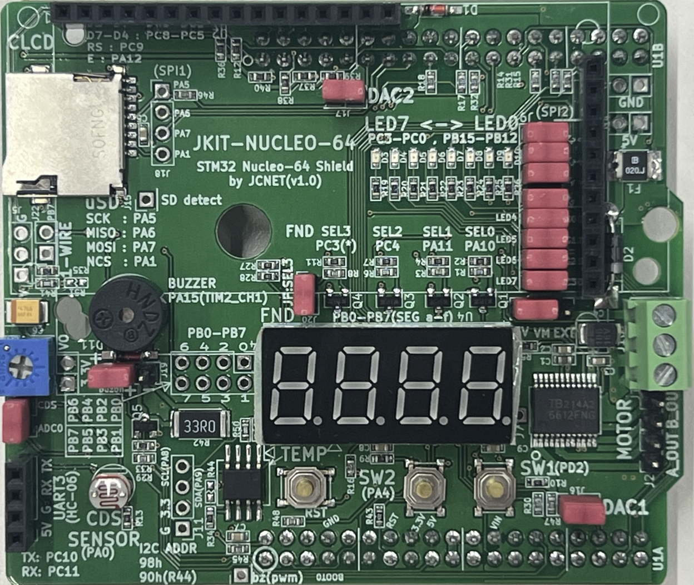<br>
			<span style="font-size: 10px;">
			 	  (b) eval_board
			</span>
    </td>
  </tr>
</table>

<p style="margin-left: 150px; font-size: 10px;">
Figure 1. Hardware Components
</p>

#### Software
- PlatformIO
- CMSIS
- EC_HAL Library

---

## Problem 0: STM-Arduino
This problem tests basic GPIO input and output using Arduino functions.

### Procedure
1. Connect PC13 and D3 on MCU board
2. Connect MCU board to PC
3. Upload the test code
<p align="left">
  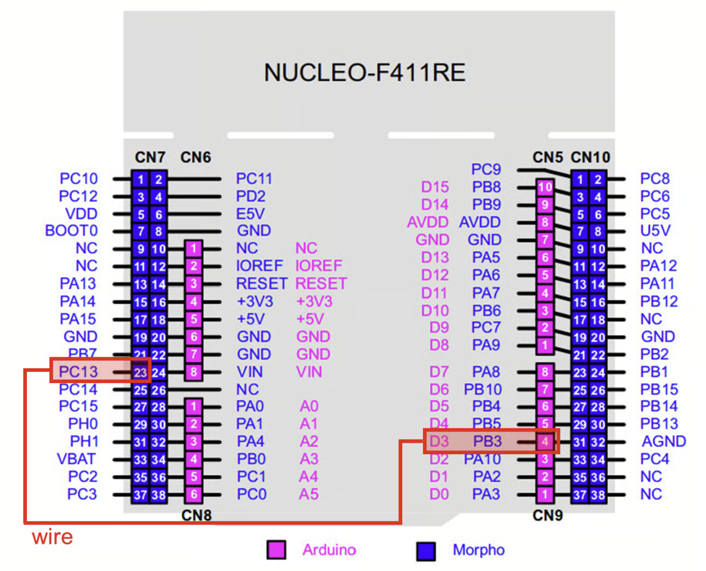<br>
</p>
<p style="margin-left: 60px; font-size: 12px;">
  <small>Figure 2. Button pin connection on MCU board</small>
</p>

### Main Functions
```cpp
pinMode(pin, mode): Set mode of a pin
digitalRead(pin): Read the digital input value of a pin
digitalWrite(pin, value): Write HIGH or LOW to a digital output pin
```

### Example Code
When the button connected to D3 is pressed, the LED connected to D13 turns on.
```cpp
// arduino code
const int btnPin = 3;       // button pin 3
const int ledPin = 13;      // LED pin 13
int btnState = HIGH;        // state of button pin3
// Set up the button pin and led pin as input and output mode each
void setup() {
    pinMode(btnPin, INPUT);
    pinMode(ledPin, OUTPUT);
}
void loop(){
    btnState = digitalRead(btnPin);
  if (btnState == HIGH) 
    digitalWrite(ledPin, LOW);
  else 
    digitalWrite(ledPin, HIGH);
}
```

### Result Image
<table>
  <tr>
    <td align="center">
      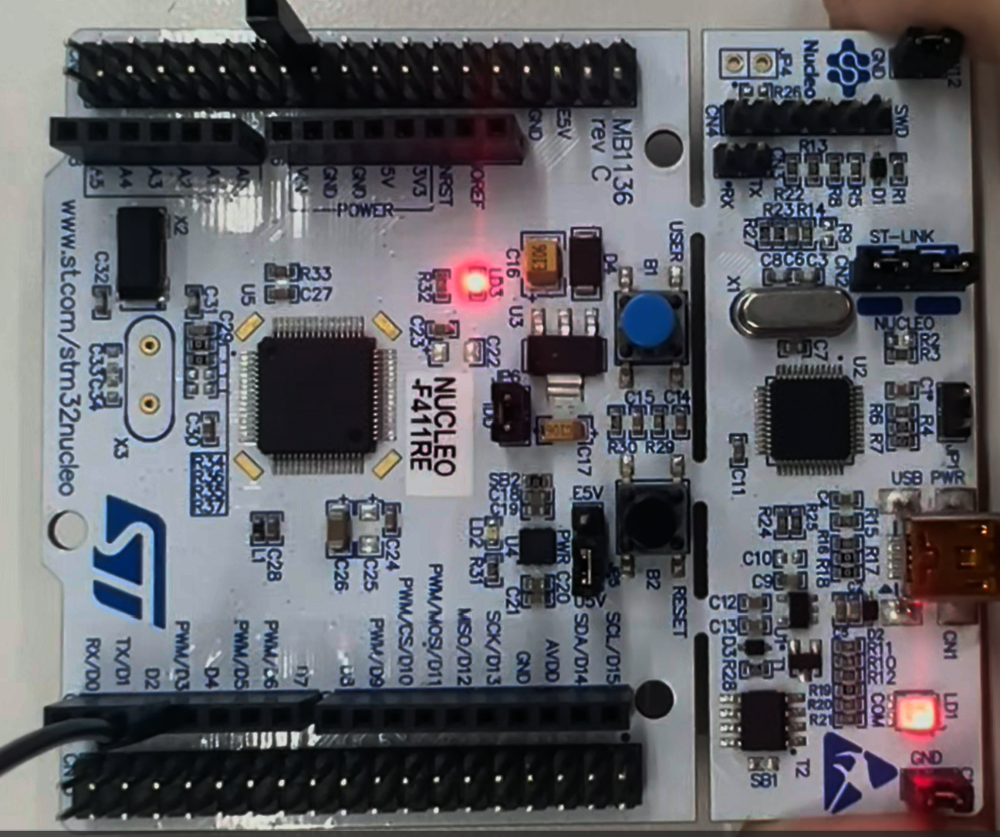<br>
	        <span style="font-size: 10px;">
			      (a) Prob0_GPIO_DIO_Arduino_LED_OFF
			</span>
    </td>
    <td align="center">
      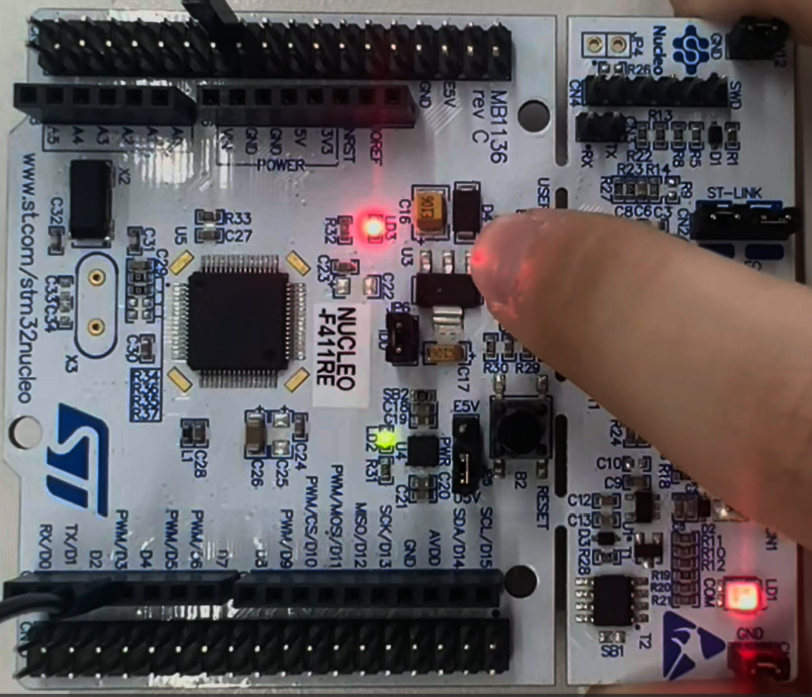<br>
			<span style="font-size: 10px;">
			 	  (b) Prob0_GPIO_DIO_Arduino_LED_ON
			</span>
    </td>
  </tr>
</table>

<p style="margin-left: 150px; font-size: 10px;">
Figure 3. Prob0_GPIO_DIO_Arduino_LED
</p>

### Discussion(Analysis)
When the button was pressed at a slight angle, the LED sometimes turned off even while the button was being pressed. This seemed to be caused by unstable contact in the button. A debouncing method can help reduce short and unwanted changes in the input signal.

---

## Problem 1: Create EC HAL_Library
In this problem, we implemented the GPIO functions in the EC_HAL library using the provided ecRCC2 and ecGPIO2 files.

### Procedure
1. Download library files(ecRCC2, ecGPIO2) from GitBook
2. Define functions in ecGPIO2_22400462.c
3. Add new environment to platformio.ini

### Main Functions
```c
// Enable and set the mode of a pin (mode: INPUT, OUTPUT, AF, ANALOG)
void GPIO_init(PinName_t pinName, uint32_t mode){     
	GPIO_TypeDef * Port;
	unsigned int pin;
	ecPinmap(pinName, &Port, &pin);
	
	// mode  : Input(0), Output(1), AlterFunc(2), Analog(3)   
	if (Port == GPIOA)
		RCC_GPIOA_enable();
	if (Port == GPIOB)
		RCC_GPIOB_enable();
	
	// Make it for GPIOC, GPIOD..GPIOH
	if (Port == GPIOC)
		RCC_GPIOC_enable();
		
	if (Port == GPIOD)
		RCC_GPIOD_enable();
	
	if (Port == GPIOE)
		RCC_GPIOE_enable();

	if (Port == GPIOH)
		RCC_GPIOH_enable();

	GPIO_mode(pinName, mode);
}

// Set the mode of a pin (mode: INPUT, OUTPUT, AF, ANALOG)
void GPIO_mode(PinName_t pinName, uint32_t mode){
   GPIO_TypeDef * Port;
   unsigned int pin;
   ecPinmap(pinName,&Port,&pin);

   Port->MODER &= ~(3UL<<(2*pin));     
   Port->MODER |= mode<<(2*pin);    
}

// Write output on the pin (output: HIGH, LOW)
void GPIO_write(PinName_t pinName, uint32_t Output){
	GPIO_TypeDef *port;
	unsigned int pin;
	ecPinmap(pinName, &port, &pin);

	if(Output == 1)	
		port->ODR |= (1UL<<pin);
	else
		port->ODR &= ~(1UL<<pin);
}

// Read and return the input value through the pin
uint32_t GPIO_read(PinName_t pinName){
	GPIO_TypeDef * Port;
	unsigned int pin;
	ecPinmap(pinName,&Port,&pin);

	uint32_t reVal = (Port->IDR >> pin) & 1UL;
	return reVal; 
}

// Set the output speed of the pin (speed: MEDIUM_SPEED, FAST_SPEED, LOW_SPEED, HIGH_SPEED)
void GPIO_ospeed(PinName_t pinName, uint32_t speed){
	GPIO_TypeDef * Port;
	unsigned int pin;
	ecPinmap(pinName,&Port,&pin);

	Port->OSPEEDR &= ~(3UL<<pin * 2);
	Port->OSPEEDR |= (speed<<pin * 2);
}

// Set the output type of the pin (type: OPEN_DRAIN, PUSH_PULL)
void GPIO_otype(PinName_t pinName, uint32_t type){
	GPIO_TypeDef * Port;
	unsigned int pin;
	ecPinmap(pinName,&Port,&pin);

	Port->OTYPER &= ~(1UL<<pin);
	Port->OTYPER |= (type<<pin);
}

// Set the output pupd of the pin (pupd: NO_PUPD, PULL_UP, PULL_DOWN, RESERVED)
void GPIO_pupd(PinName_t pinName, uint32_t pupd){
	GPIO_TypeDef * Port;
	unsigned int pin;
	ecPinmap(pinName,&Port,&pin);

	Port->PUPDR &= ~(3UL<<pin * 2);
	Port->PUPDR |= (pupd<<pin * 2);
}

// Initialize the pin mode, speed, type pupd at once
// mode: INPUT, OUTPUT, AF, ANALOG
// speed: MEDIUM_SPEED, FAST_SPEED, LOW_SPEED, HIGH_SPEED
// type: OPEN_DRAIN, PUSH_PULL
// pupd: NO_PUPD, PULL_UP, PULL_DOWN, RESERVED
void GPIO_init_all(PinName_t pinName, uint32_t mode, uint32_t speed, uint32_t type, uint32_t pupd){
	GPIO_TypeDef * Port;
	unsigned int pin;
	ecPinmap(pinName, &Port, &pin);

	GPIO_init(pinName, mode);
	GPIO_ospeed(pinName, speed);
	GPIO_otype(pinName, type);
	GPIO_pupd(pinName, pupd);
}
```

### Example Code
```c
#include "ecRCC2_22400462.h"
#include "ecGPIO2_22400462.h"

#define LED_0       PB_12
#define SW_2        PA_4

int main(void){
    uint32_t val = 0;

    GPIO_init(SW_2, INPUT);
    GPIO_ospeed(SW_2, FAST_SPEED);
    GPIO_pupd(SW_2, PULL_UP);

    GPIO_init_all(LED_0, OUTPUT, MEDIUM_SPEED, OPEN_DRAIN, PULL_UP);

    val = GPIO_read(SW_2);
    if (val == LOW)
        printf("SW_2 is pressed");
    else
        printf("SW_2 is not pressed");
}
```

### Discussion(Analysis)
- While making and testing the GPIO functions, it was inconvenient to call several functions repeatedly when the same GPIO settings had to be applied to many pins. Following the TA's advice, GPIO_init_all() was added to reduce repeated work and make the code simpler.

---

## Problem 2: Toggle a single LED with Digital Sensor(Photodetector)
In this problem, the LED was controlled according to the light detected by a photodetector.

Problem: Toggle the LED by covering the photodetector sensor.
- Dark (LED ON), Bright (LED OFF) and repeat
- Connect the Photodetector sensor to PA_0 pin on Nucleo Board.

### Procedure
1. Connect the evaluation board (JKIT-NUCLEO) to the MCU.
2. Make sure that your library ecGPIO2.h, ecGPIO2.c are in EC\include\
3. Create a new project under the directory EC\lab\
    Environment: “LAB_GPIO_DIO_LED_Photosensor”.
    Source File: “LAB_GPIO_DIO_LED_Photosensor_22400462.c”
4. Modify the platformio.ini, to add new environment.

### Configuration
|Function|Port-Pin|Configuration
|---|---|---|
|Photodetector on JKIT|PA_0|Digital IN, Pull-up
|LED0|PB_12|Digital OUT, Pull-up, Open-Drain, Medium Speed|

### Main Functions
```c
// Delay execution for # ms
void delay_ms_HSI(uint32_t ms) {
	//uint32_t EC_SYSCLK=16000000;
	volatile uint32_t cnt = ((uint32_t)EC_SYSCLK / (1000UL * 6)) * ms;
	while (cnt > 0) cnt--;
}

// Enable the peripheral clock for GPIOA
void RCC_GPIOA_enable()
{
	// RCC Peripheral Clock Enable Register 
	RCC->AHB1ENR |= RCC_AHB1ENR_GPIOAEN;
}
void RCC_GPIOB_enable();
void RCC_GPIOC_enable();
void RCC_GPIOD_enable();
void RCC_GPIOE_enable();
void RCC_GPIOH_enable();
void GPIO_init(PinName_t pinName, uint32_t mode); 
void GPIO_mode(PinName_t pinName, uint32_t mode);
void GPIO_ospeed(PinName_t pinName, uint32_t speed);
void GPIO_otype(PinName_t pinName, uint32_t type);
void GPIO_pupd(PinName_t pinName, uint32_t pupd);
void GPIO_write(PinName_t pinName, uint32_t Output);
uint32_t  GPIO_read(PinName_t pinName);
void GPIO_init_all(PinName_t pinName, uint32_t mode, uint32_t speed, uint32_t type, uint32_t pupd);
```

### Example Code
```c
#include "ecRCC2_22400462.h"
#include "ecGPIO2_22400462.h"

#define PHOTO_PIN   PA_0      // Photodetector
#define LED_PIN     PB_12     // LED0 on JKIT

void setup(void);
	
int main(void) { 
	// Initialization 
	setup();

	// Infinite Loop 
	while(1){		
		if(GPIO_read(PHOTO_PIN) == 0)	GPIO_write(LED_PIN, HIGH);
		else 							GPIO_write(LED_PIN, LOW);
		delay_ms_HSI(100);             					// delay 100 ms
	}
}

// Initialization 
void setup(void)
{
	RCC_HSI_init();	
    GPIO_init(PHOTO_PIN, INPUT);   // calls RCC_GPIOA_enable()
    GPIO_init(LED_PIN, OUTPUT);    // calls RCC_GPIOB_enable()
	GPIO_otype(LED_PIN, OPEN_DRAIN);
	GPIO_pupd(LED_PIN, PULL_UP);
	GPIO_pupd(PHOTO_PIN, PULL_UP);
	GPIO_ospeed(LED_PIN, MEDIUM_SPEED);
}
```

### Result Image
<table>
  <tr>
    <td align="center">
      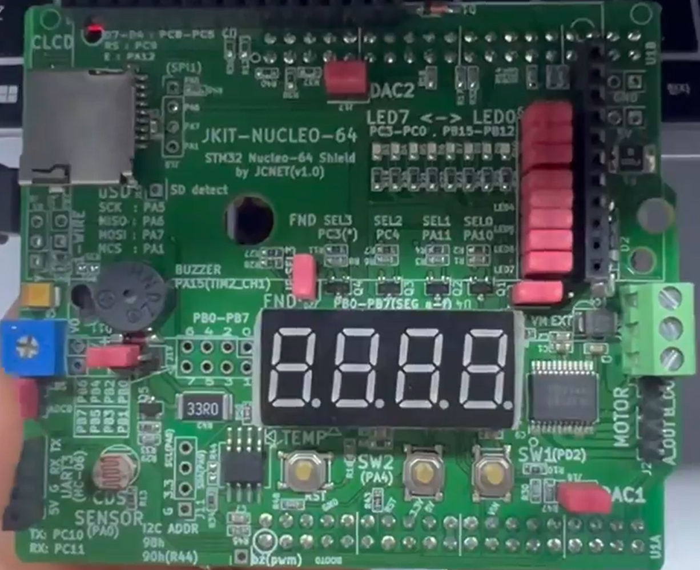<br>
	  		<span style="font-size: 10px;">
      			(a) Prob2_GPIO_DIO_Photosensor_OFF
	  		</span>
    </td>
    <td align="center">
      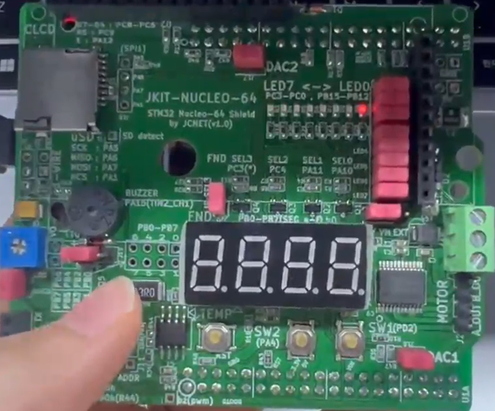<br>
	  		<span style="font-size: 10px;">
			      (b) Prob2_GPIO_DIO_Photosensor_ON
			</span>
    </td>
  </tr>
</table>

<p style="margin-left: 150px; font-size: 10px;">
Figure 4. Prob2_GPIO_DIO_Photosensor
</p>

### Discussion
The difference between PUSH_PULL and OPEN_DRAIN was observed by changing the output type using GPIO_otype(). In this experiment, the LED light was weaker when OPEN_DRAIN was used, while it was brighter when PUSH_PULL was used. This difference was caused by the way the output pin supplied current in each mode.

---

## Problem 3: Toggle multiple LEDs with a button
In this problem, four LEDs were sequentially controlled using a push button.
Each button press changes the active LED from LED0 to LED3, and the sequence
returns to LED0 after LED3.

Problem: 
- Use the four LEDs (LED0 to LED3) on the JKIT evaluation board.
- Each time SW2 is pressed, turn on one LED at a time in a sequential loop

### Procedure
1. Connect the evaluation board (JKIT-NUCLEO) to the MCU.
2. Make sure that your library ecGPIO2.h, ecGPIO2.c are in EC\include\.
3. Create a new project under the directory EC\lab\
    Environment: “LAB_GPIO_DIO_multiLED”
    Source File: “LAB_GPIO_DIO_multiLED_22400462.c”
4. Modify the platformio.ini, to add new environment.

### Main Functions
```c
// Delay execution for # ms
void delay_ms_HSI(uint32_t ms);

// Enable the peripheral clock for GPIOA
void RCC_GPIOA_enable();

// Enable the peripheral clock for GPIOB
void RCC_GPIOB_enable();

// Enable the peripheral clock for GPIOC
void RCC_GPIOC_enable();

// Enable the peripheral clock for GPIOD
void RCC_GPIOD_enable();

// Enable the peripheral clock for GPIOE
void RCC_GPIOE_enable();

// Enable the peripheral clock for GPIOH
void RCC_GPIOH_enable();

// Enable and set the mode of a pin (mode: INPUT, OUTPUT, AF, ANALOG)
void GPIO_init(PinName_t pinName, uint32_t mode); 

// Set the mode of a pin (mode: INPUT, OUTPUT, AF, ANALOG)
void GPIO_mode(PinName_t pinName, uint32_t mode);

// Set the output speed of the pin (speed: MEDIUM_SPEED, FAST_SPEED, LOW_SPEED, HIGH_SPEED)
void GPIO_ospeed(PinName_t pinName, uint32_t speed);

// Set the output type of the pin (type: OPEN_DRAIN, PUSH_PULL)
void GPIO_otype(PinName_t pinName, uint32_t type);

// Set the output pupd of the pin (pupd: NO_PUPD, PULL_UP, PULL_DOWN, RESERVED)
void GPIO_pupd(PinName_t pinName, uint32_t pupd);

// Write output on the pin (output: HIGH, LOW)
void GPIO_write(PinName_t pinName, uint32_t Output);


// Read and return the input value through the pin
uint32_t  GPIO_read(PinName_t pinName);

// Initialize the pin mode, speed, type pupd at once
void GPIO_init_all(PinName_t pinName, uint32_t mode, uint32_t speed, uint32_t type, uint32_t pupd);
```

### Configuration
|Function|Port-Pin|Configuration
|---|---|---|
|SW2 on JKIT|PA4|Digital IN, Pull-up
|LED_0~LED_3|PB_12, PB_13, PB_14, PB_15|Digital OUT, Pull-up, Open-Drain, Medium Speed|

### Example Code
```c
#include "ecRCC2_22400462.h"
#include "ecGPIO2_22400462.h"

#define LED_0       PB_12
#define LED_1       PB_13
#define LED_2       PB_14
#define LED_3       PB_15

#define SW_2        PA_4

void setup(void);
	
int main(void) { 
	// Initialization
    // Set ledNum as 3 so that the first button press turns on LED_0.
    int ledNum = 3;     // LED number for the sequence
	setup();

	// Infinite Loop
	while(1){
		if (GPIO_read(SW_2) == LOW) {
            // Turn off the LED which was turned on.
            if (ledNum == 0)
                GPIO_write(LED_0, LOW);
            else if (ledNum == 1)
                GPIO_write(LED_1, LOW); 
            else if (ledNum == 2)
                GPIO_write(LED_2, LOW);
            else {
                GPIO_write(LED_3, LOW);
            }
            
            ledNum++;           //ledNum renew

            if(ledNum>3)        //Check the last step of the sequence.
                ledNum = 0;

            // Turn on the new LED
            if (ledNum == 0)
                GPIO_write(LED_0, HIGH);
            else if (ledNum == 1)
                GPIO_write(LED_1, HIGH); 
            else if (ledNum == 2)
                GPIO_write(LED_2, HIGH);
            else {
                GPIO_write(LED_3, HIGH);
            }

            while(GPIO_read(SW_2) == LOW)
                continue;
        }
        delay_ms_HSI(100);             					// delay 100 ms
	}
}

// Initialization 
void setup(void)
{
	RCC_HSI_init();	
	GPIO_init(SW_2, INPUT);
	GPIO_pupd(SW_2, PULL_UP);
    GPIO_init_all(LED_0, OUTPUT, MEDIUM_SPEED, OPEN_DRAIN, PULL_UP);
    GPIO_init_all(LED_1, OUTPUT, MEDIUM_SPEED, OPEN_DRAIN, PULL_UP);
    GPIO_init_all(LED_2, OUTPUT, MEDIUM_SPEED, OPEN_DRAIN, PULL_UP);
    GPIO_init_all(LED_3, OUTPUT, MEDIUM_SPEED, OPEN_DRAIN, PULL_UP);
    
    GPIO_write(LED_0, LOW);
    GPIO_write(LED_1, LOW);
    GPIO_write(LED_2, LOW);
    GPIO_write(LED_3, LOW);
}
```
### Result Image
<table>
  <tr>
    <td align="center">
      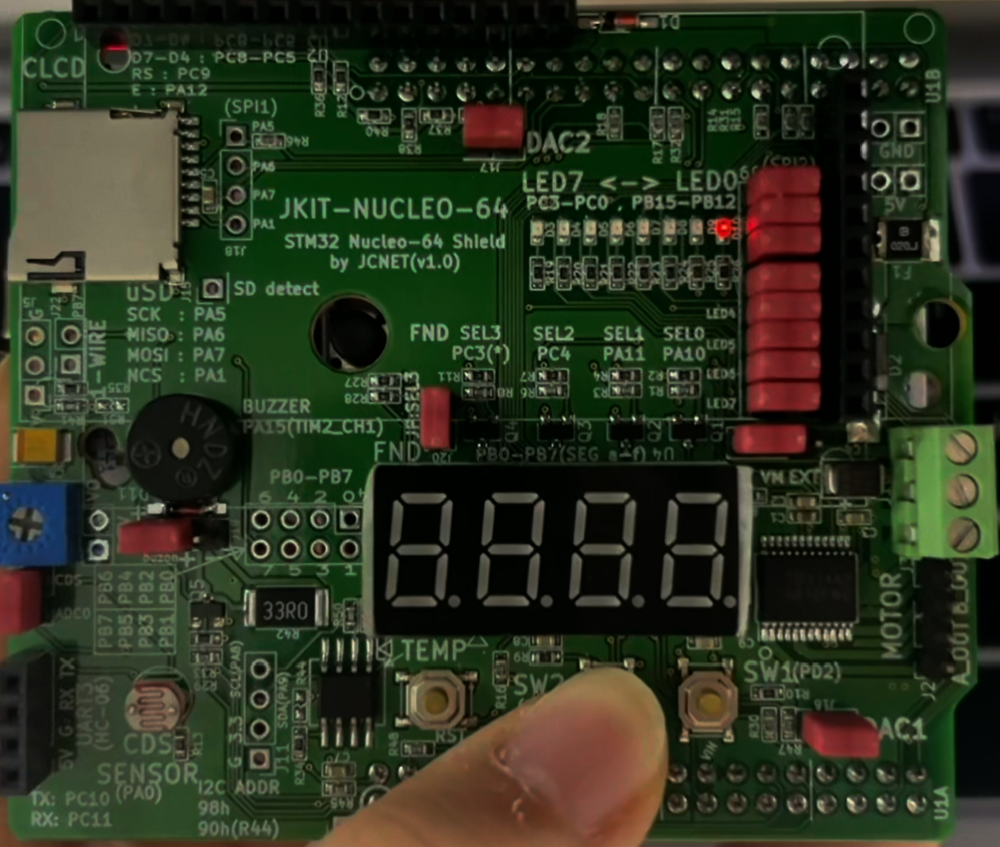<br>
	  		<span style="font-size: 10px;">
		      (a) Prob3_GPIO_DIO_multiLED_LED0
			</span>
    </td>
    <td align="center">
      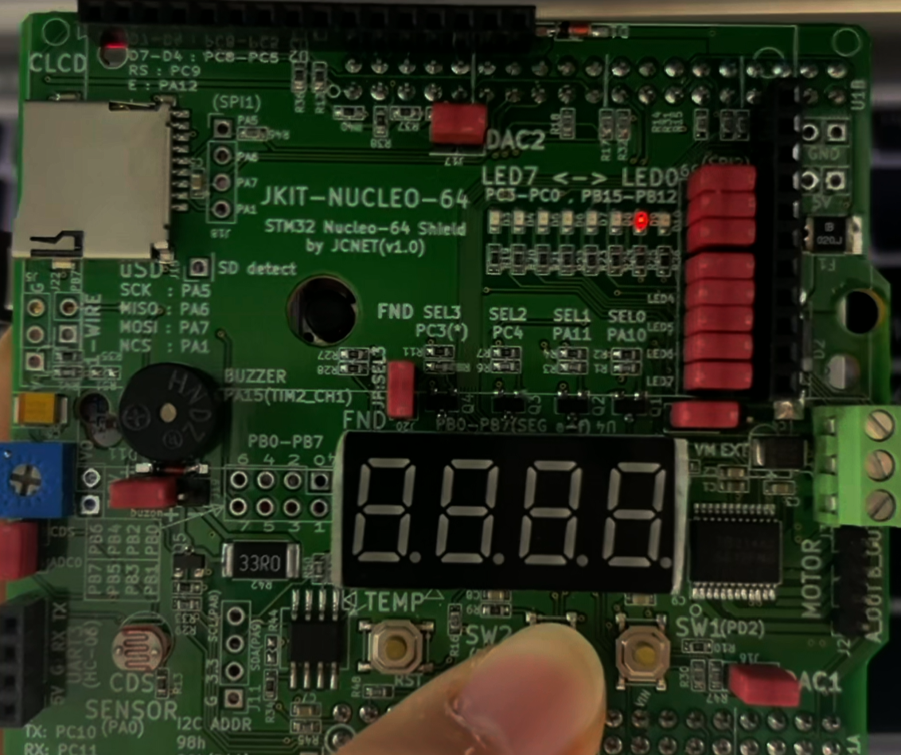<br>
	  		<span style="font-size: 10px;">
		      (b) Prob3_GPIO_DIO_multiLED_LED1
			</span>
    </td>
  </tr>
  <tr>
    <td align="center">
      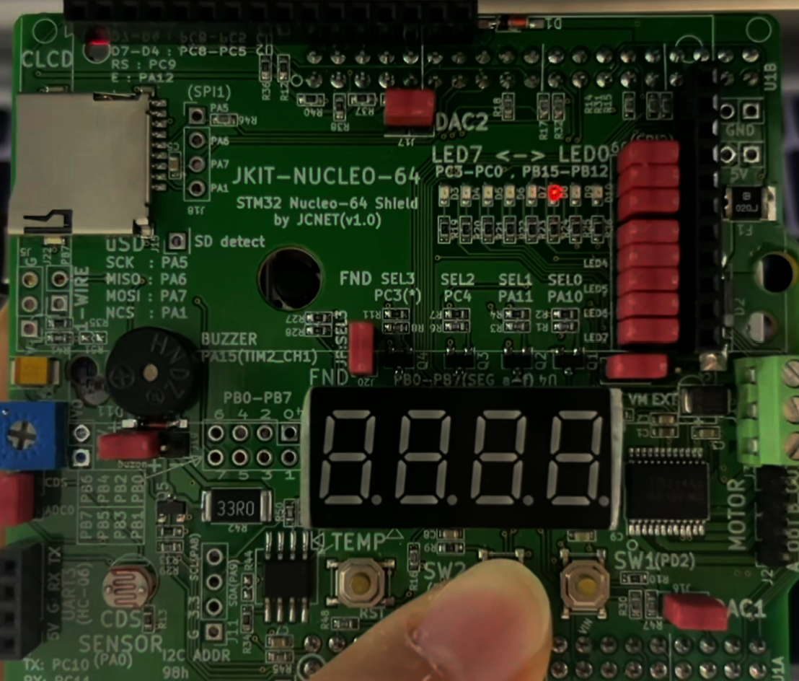<br>
	  		<span style="font-size: 10px;">
		      (c) Prob3_GPIO_DIO_multiLED_LED2
			</span>
    </td>
    <td align="center">
      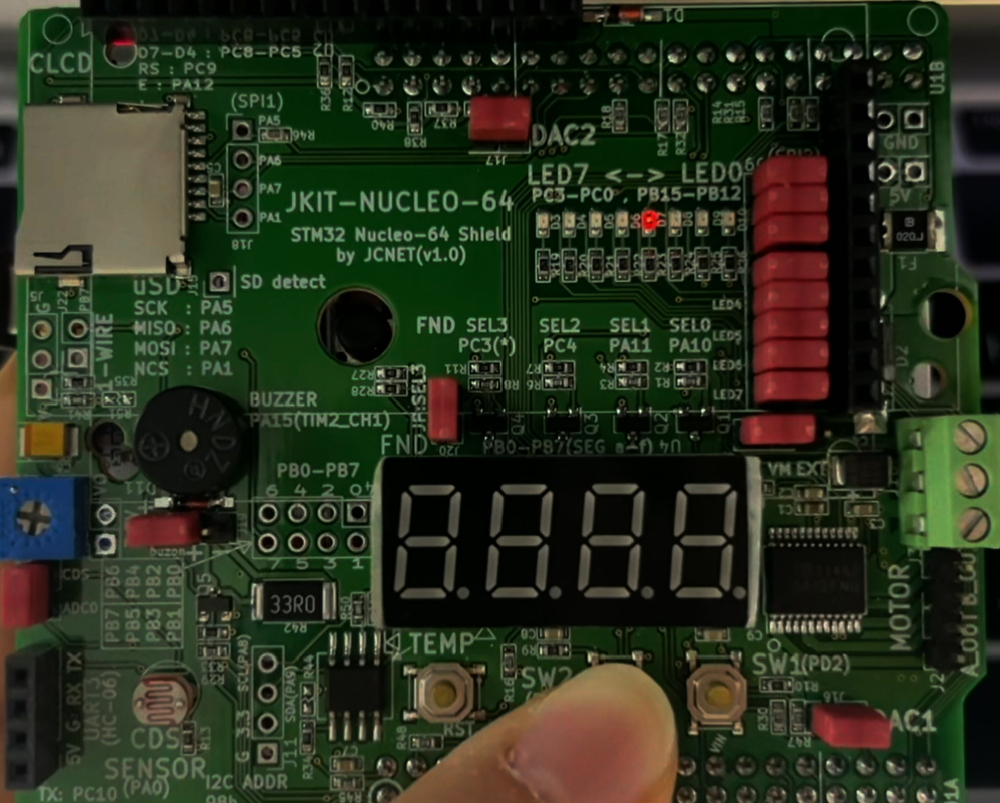<br>
	  		<span style="font-size: 10px;">
		      (d) Prob3_GPIO_DIO_multiLED_LED3
			</span>
    </td>
  </tr>
</table>

<p style="margin-left: 150px; font-size: 10px;">
Figure 5. Prob3_GPIO_DIO_multiLED
</p>

### Discussion
1. Find out a typical solution for software debouncing and hardware debouncing.
- Hardware Debouncing
    - RC filter
    - Schmitt trigger
    - SR latch
- Software Debouncing
    - Check whether the input signal stays stable for a certain time.
    - Ignore additional input for a short time after detecting an edge to prevent repeated input.
2. What method of debouncing did this NUCLEO board use for the push-button(B1)?
- According to the board circuit, resistors and a capacitor are connected around the button. Therefore, the B1 button uses hardware filtering with a capacitor to reduce the effect of button bouncing.
