# LAB: EXTI & SysTick(eval board)

**Date:** 2026-10-02

**Author/Partner:** Won Bitna

**Demo Video:** https://youtu.be/m-AsQYC6X7I

### Introduction

In this lab, external interrupts and SysTick interrupts were implemented using the NUCLEO-F411RE and JKIT evaluation board. EXTI was used to control the counter with push buttons, and SysTick was used to generate the 1-second counting interval.

#### Requirement

**Hardware**

* MCU(NUCLEO-F411RE)
* Eval Board (JKIT)
* Actuator/Sensor/Others

**Software**

* PlatformIO, CMSIS, EC\_HAL library

***

## Problem 0: STM-Arduino

We are going to create a simple program that turns LED(LD2) on triggered by **External Interrupt** of user button(BT1) (on NUCLEO-64, not on JKIT)

[**attachInterrupt()**](https://www.arduino.cc/reference/en/language/functions/external-interrupts/attachinterrupt/)

```c
attachInterrupt(digitalPinToInterrupt(pin), ISR, mode)
```

* `digitalPinToInterrupt(pin)`: translate the digital pin to the specific interrupt number.
* `ISR`: a function called whenever the interrupt occurs.
* `mode`: defines when the interrupt should be triggered. (LOW, CHANGE, RISING, FALLING)

#### Procedure

1. Create a new project under the directory `\repos\EC\lab\`
2. Open *Arduino IDE* and Create a new program named as ‘**TU\_arduino\_EXTI.ino**’.
3. Write the following code.
   * Compare this code with the polling method in [Lab: GPIO-STM-Arduino](https://ykkim.gitbook.io/ec/ec-course/lab/lab-gpio-digital-inout-eval#example-code)

```c
const int btnPin = 3;
const int ledPin =  13; 

int btnState = HIGH;

void setup() {
    pinMode(ledPin, OUTPUT);
    pinMode(btnPin, INPUT_PULLUP);
    attachInterrupt(digitalPinToInterrupt(btnPin), blink, CHANGE);
}

void loop() {
    // blank
}


void blink(){
    btnState = digitalRead(btnPin);

    if (btnState == HIGH)
        digitalWrite(ledPin, LOW);
    else 
        digitalWrite(ledPin, HIGH);
}
```

> The user button pin is `PC13`, but this pin cannot be used in arduino. So, you should connect `PC13` to `pinName` `D3` by using a wire.

<figure><figcaption></figcaption></figure>

4. Click on **upload** button.
5. Whenever the user button(BT1) is pressed (at fall), LED should be ON. When the button is released, the LED should be OFF.


#### Results

<table align="center">
  <tr>
    <td align="center">
      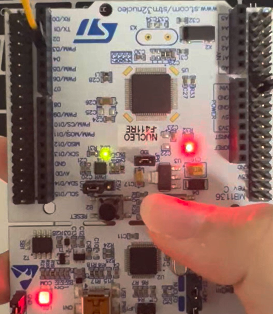
    </td>
    <td align="center">
      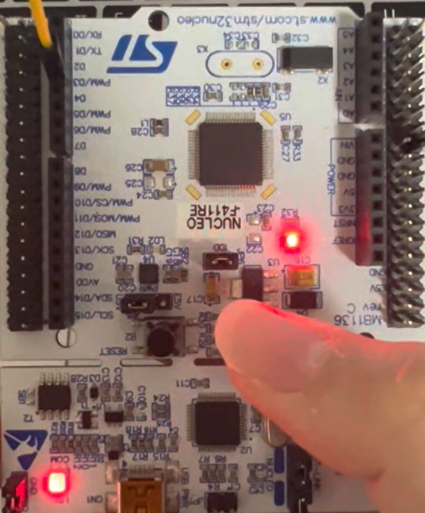
    </td>
  </tr>
  <tr>
    <td align="center">(a) Prob0_LED_OFF</td>
    <td align="center">(b) Prob0_LED_ON</td>
  </tr>
  <tr>
    <td colspan="2" align="center"><b>Prob0: STM-Arduino</b></td>
  </tr>
</table>


#### Discussion

- Unlike the previous Arduino code, where the input was checked repeatedly inside loop(), attachInterrupt() was used to handle the external signal by interrupt instead of polling. Because of this, the program does not need to continuously check the input state in the main loop.

## Prelab: EXTI Register Setting

This functions are defined in ecEXTI.* library.

```c
// Initialize EXTI with trigger type and interrupt priority
// pinName: GPIO pin for external interrupt
// trig_type: trigger type (FALL(0), RISE(1), BOTH(2))
// priority: interrupt priority
void EXTI_init(PinName_t pinName, uint32_t trig_type, uint32_t priority);

// Enable EXTI interrupt
// pinName: GPIO pin to enable
void EXTI_enable(PinName_t pinName);

// Disable EXTI interrupt
// pinName: GPIO pin to disable
void EXTI_disable(PinName_t pinName);

// Check whether EXTI interrupt is pending
// pinName: GPIO pin to check
uint32_t is_pending_EXTI(PinName_t pinName);

// Clear EXTI interrupt pending flag
// pinName: GPIO pin to clear
void clear_pending_EXTI(PinName_t pinName);
```

## Problem 1: Counter on 7-Segment display using EXTI
Problem: Create a code to display the counter-up from 0 to 9 and repeating.  The necessary conditions are the same as below.

* Count up at the rate of 1 sec.
* Pause the counting when SW2 is pressed
* Resets to zero when the push button is pressed: SW1
  * Use External Interrupts for SW1, SW2

#### Procedure

1. Connect the evaluation board [(JKIT-NUCLEO) ](https://ykkim.gitbook.io/ec/ec-course/hardware/stm32f-evaluation-board#reference-manual)to the MCU.
2. Make sure that your library are in `EC\include\`.
   * **ecRCC2.h, ecRCC2.c**
   * **ecGPIO2.h, ecGPIO2.c**
   * **ecSysTick2.h, ecSysTick2.c**
   * **ecEXTI2.h, ecEXTI2.c**
   * **ecSTM32F4v2.h**
3. Create a new project under the directory `EC\lab\`

* Environment: “**LAB\_EXTI”.**
* Source File: “**LAB\_EXTI_22400462.c”**

4. Modify the `platformio.ini` **,** to add new environment.

#### Configuration

Configure the MCU GPIO

| Function                           | Port - Pin                                                   | Configuration                                 |
| ---------------------------------- | ------------------------------------------------------------ | --------------------------------------------- |
| **Button (SW1) on JKIT**           | PD\_2                                                        | DIN, Pull-Up                                  |
| **Button (SW2) on JKIT**           | PA\_4                                                        | DIN, Pull-Up                                  |
| **7-Segment DOUT**                 | <p>PB\_0, PB\_1, PB\_2, PB\_3, PB\_4, PB\_5, PB\_6, PB\_7</p><p>('a'\~'g''dot', respectively)</p> | Push-Pull, No Pull-up-Pull-down, Medium Speed |
| **Selection of 7-Segment Display** | PA\_10 (FND\_0)                                              | DOUT, Push-Pull,                              |


#### Main Functions

```c
// Initialize MCU clock, SysTick, GPIO, FND, and EXTI
void MCU_init(void);

// Set SysTick interrupt every 1 ms
void SysTick_init(void);

// Increment msTicks every 1 ms
void SysTick_counter(void);

// Initialize DOUT pins for 7 segment leds
void FND_init(PinName_t *pinFND);

// Initialize select pins (FND0~FND3) as DOUT
// selectFND: FND select pin array to select
void FND_select_init(PinName_t *selectFND);

// Select display: FND0 to FND3
// digit: the digit to select
void FND_select(uint8_t digit);

// Display a number 0 - 9 only
// num: number to display
void FND_display(uint8_t num);

// Initialize EXTI with trigger type and interrupt priority
// trig_type: trigger type (FALL(0), RISE(1), BOTH(2))
// priority: Priorities for handling
void EXTI_init(PinName_t pinName, uint32_t trig_type, uint32_t priority);

// Check whether EXTI interrupt is pending
uint32_t is_pending_EXTI(PinName_t pinName);

// Clear EXTI interrupt pending flag after handling interrupt
void clear_pending_EXTI(PinName_t pinName);

// Handle SW2 interrupt for pause and resume
void EXTI4_IRQHandler(void);

// Handle SW1 interrupt for counter reset
void EXTI2_IRQHandler(void);

// SysTick interrupt : called every 1 ms
void SysTick_Handler(void);
```


#### Example Code

The main function only initializes the MCU and has an empty while loop. The actual operation is done by SysTick and EXTI interrupts.

```c
int main(void) {
    MCU_init();         // Initialize MCU, GPIO, EXTI and SysTick

    while (1){
        // Main loop is empty because main operation is done by interrupts
    }
}
```

**Source Code**



```c
/*----------------------------------------------------------------\
@ Embedded Controller by Young-Keun Kim - Handong Global University
Author           : Won Bitna
Created          : 05-03-2021
Modified         : 10-01-2026
Language/ver     : C++ in VS Code

Description      : LAB - EXTI & SysTick(eval)
/----------------------------------------------------------------*/

#include "ecSTM32F4v2.h"

uint8_t count = 0;      // Counter number for 7-segment
uint8_t pause = 0;      // Check the counter is pause or not


// MAIN  ----------------------------------------
int main(void) {
    MCU_init();         // Initialize MCU, GPIO, EXTI and SysTick

    while (1){
        // Main loop is empty because main operation is done by interrupts
    }
}


// SW2 interrupt : pause
void EXTI4_IRQHandler(void) {
    if (is_pending_EXTI(SW2_PIN)) {   // Check SW2 interrupt

        pause = !pause;               // Change pause each time SW2 is pressed

        clear_pending_EXTI(SW2_PIN);  // Clear pending flag after interrupt
    }
}


// SW1 interrupt : reset counter
void EXTI2_IRQHandler(void) {
    if (is_pending_EXTI(SW1_PIN)) {   // Check SW1 interrupt

        count = 0;                    // Reset displayed number to 0
        msTicks = 0;                  // Reset tick count to restart 1 sec tick

        clear_pending_EXTI(SW1_PIN);  // Clear pending flag after interrupt
    }
}


// SysTick interrupt : called every 1 ms
void SysTick_Handler(void){

    SysTick_counter();                // Increase msTicks every 1 ms

    if(msTicks == 1000){
        msTicks = 0;                  // Reset tick count for next 1 second

        if(pause == 0){               // Increase count only when it is not paused
            count++;

            if(count > 9)
                count = 0;            // 0 after number 9
        }
    }

    FND_select(0);                    // Select LED0
    FND_display(count);               // Display current count number
}
```



#### Results

<table align="center">
  <tr>
    <td align="center">
      
    </td>
    <td align="center">
      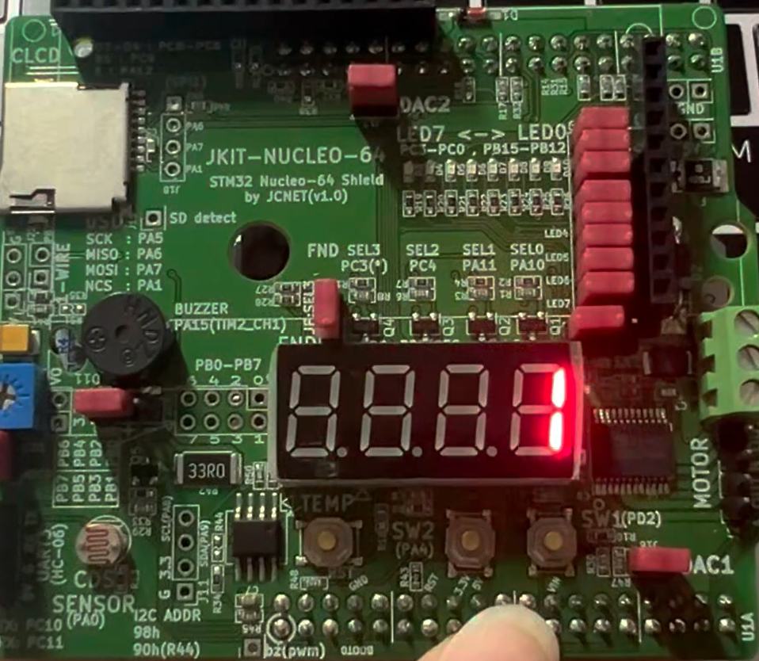
    </td>
  </tr>
  <tr>
    <td align="center">(a) Prob1_7seg_0</td>
    <td align="center">(b) Prob1_7seg_1</td>
  </tr>
  <tr>
    <td align="center">
      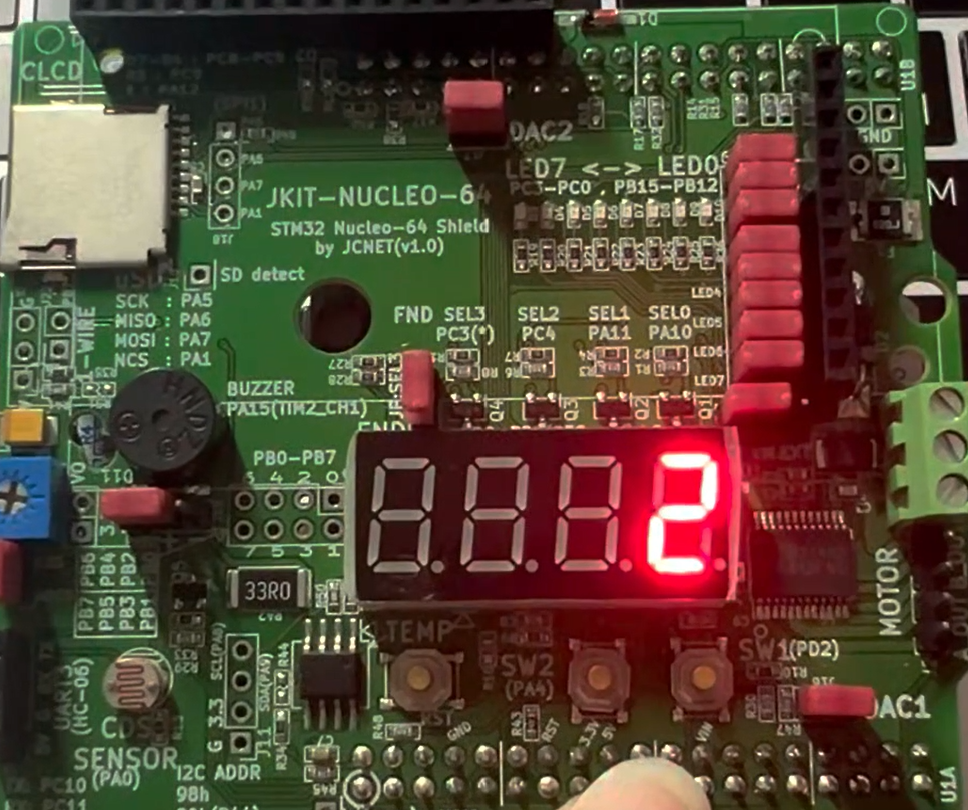
    </td>
    <td align="center">
      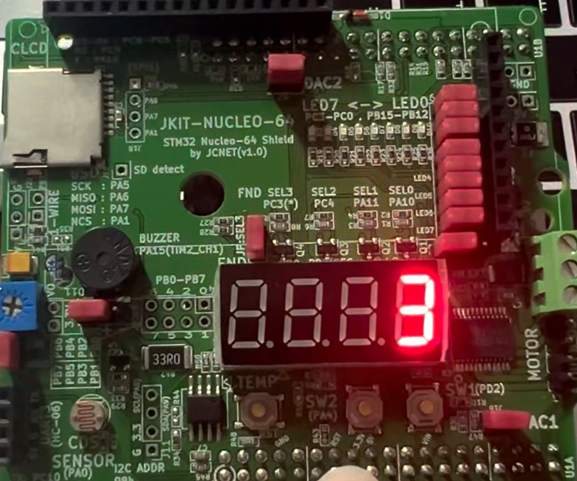
    </td>
  </tr>
  <tr>
    <td align="center">(c) Prob1_7seg_2</td>
    <td align="center">(d) Prob1_7seg_3</td>
  </tr>
  <tr>
    <td align="center">
      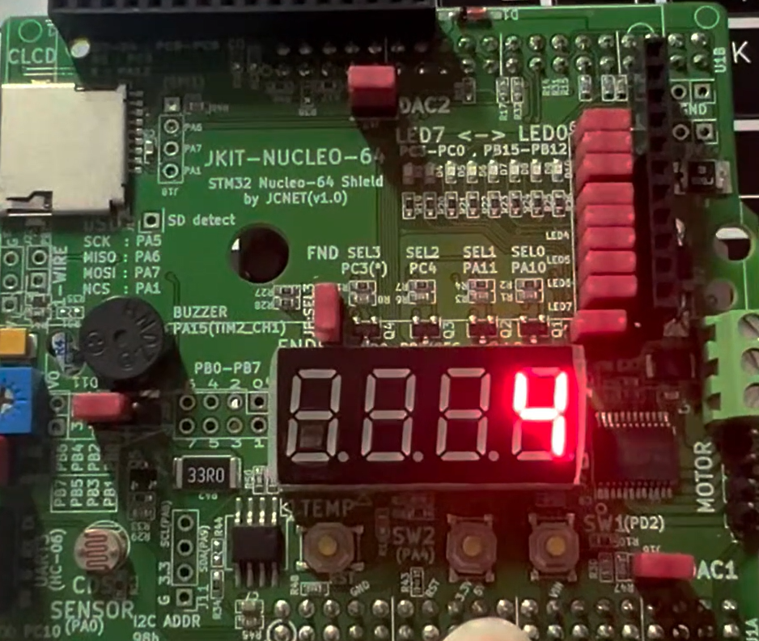
    </td>
    <td align="center">
      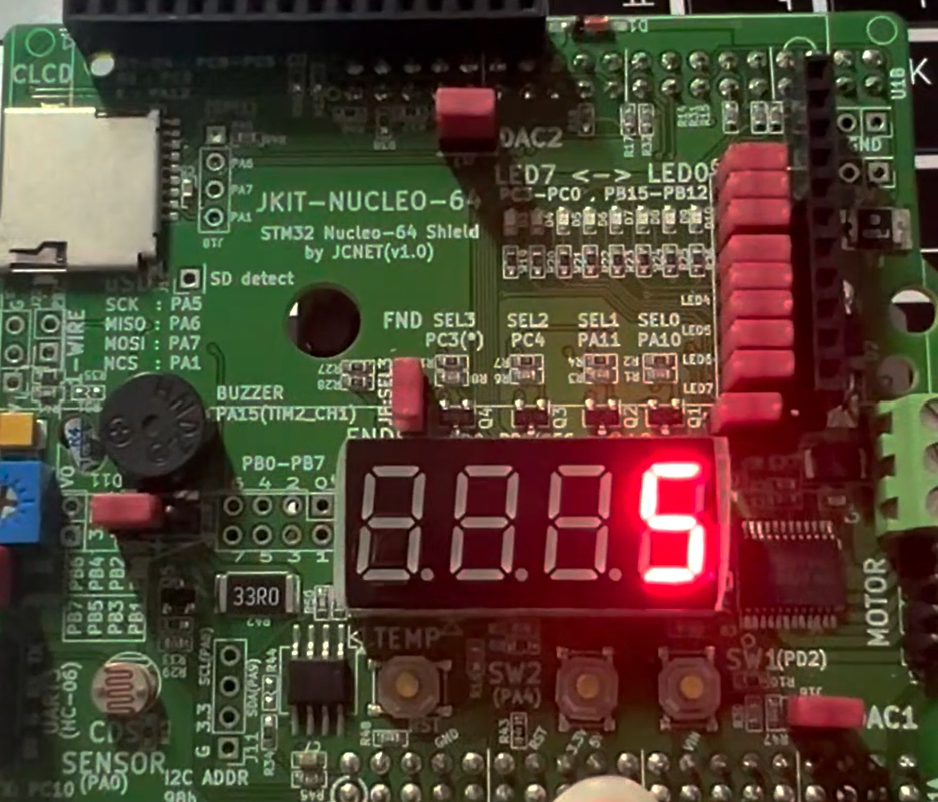
    </td>
  </tr>
  <tr>
    <td align="center">(e) Prob1_7seg_4</td>
    <td align="center">(f) Prob1_7seg_5</td>
  </tr>
  <tr>
    <td align="center">
      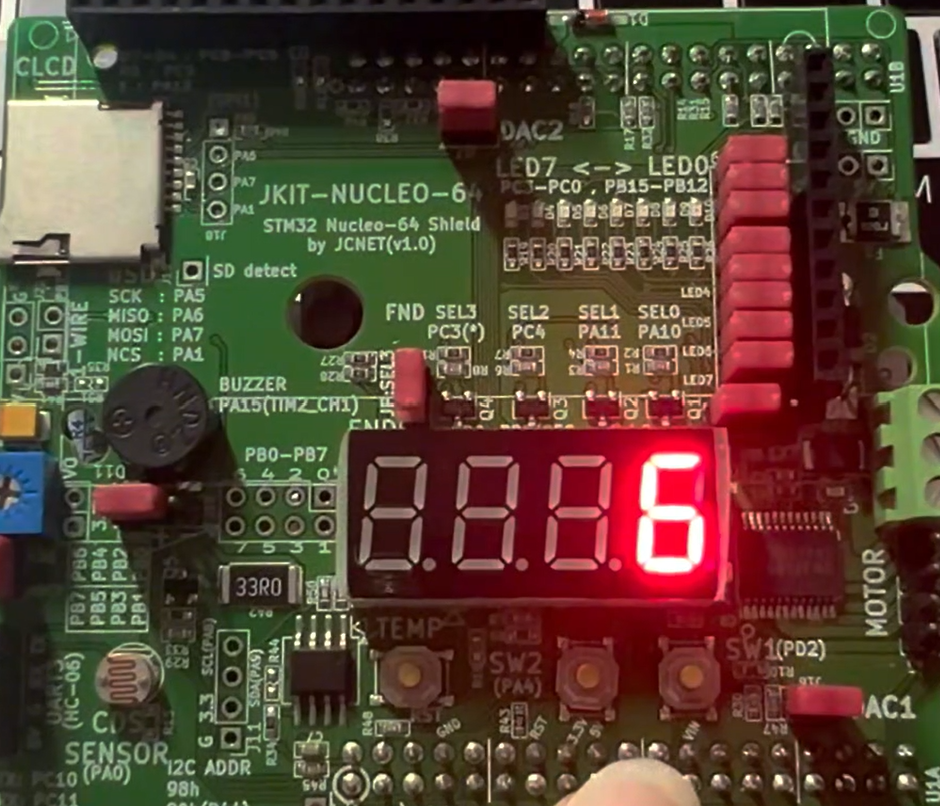
    </td>
    <td align="center">
      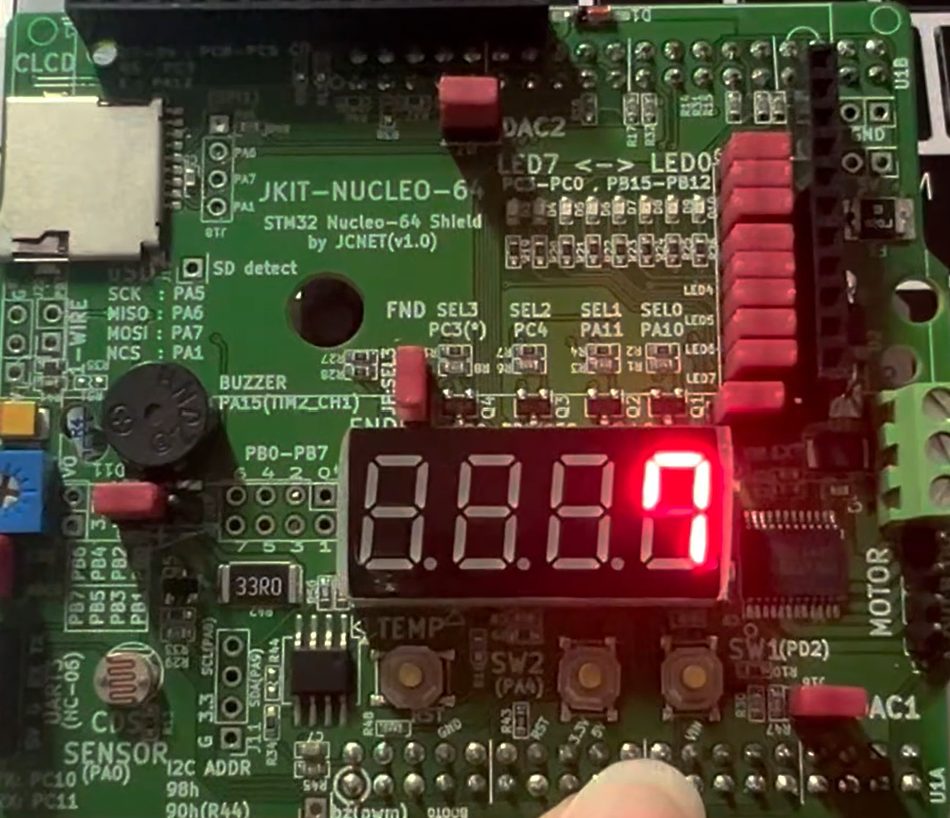
    </td>
  </tr>
  <tr>
    <td align="center">(g) Prob1_7seg_6</td>
    <td align="center">(h) Prob1_7seg_7</td>
  </tr>
  <tr>
    <td align="center">
      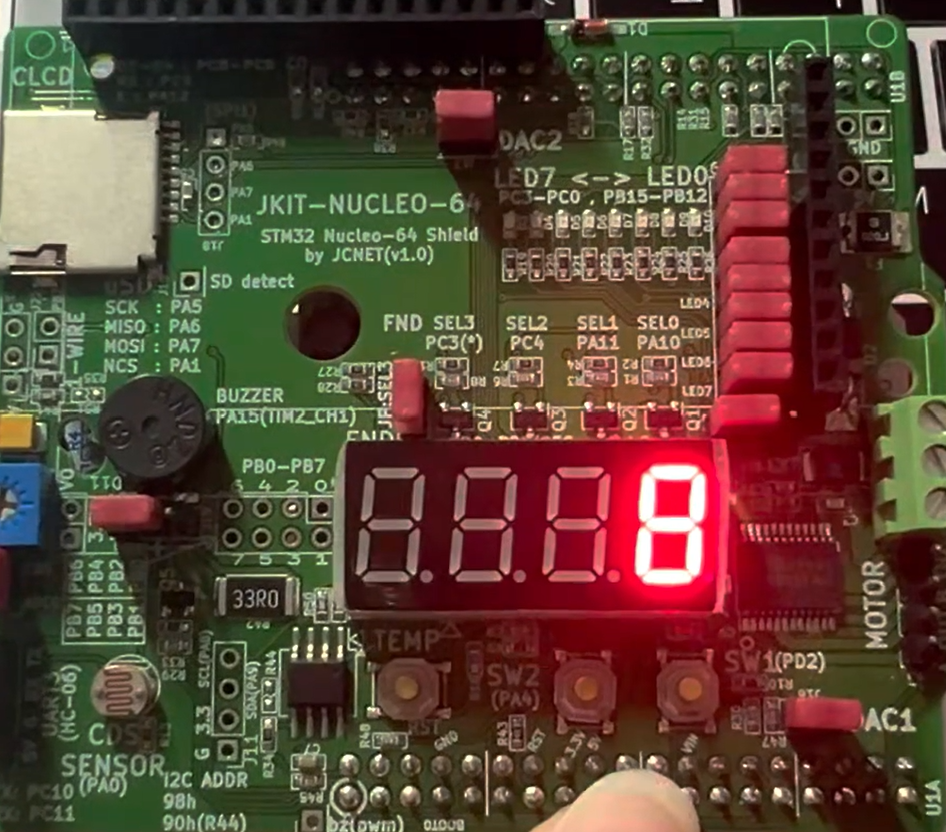
    </td>
    <td align="center">
      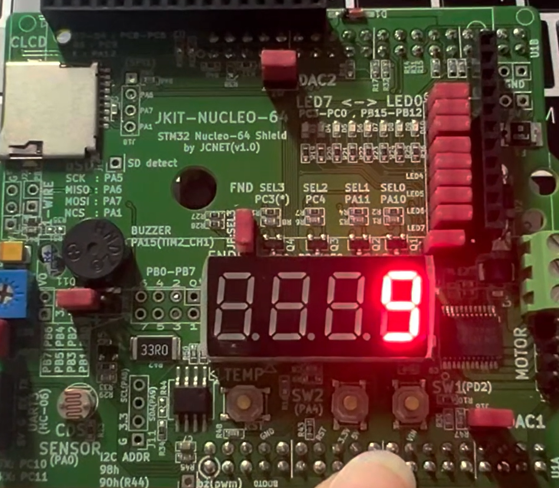
    </td>
  </tr>
  <tr>
    <td align="center">(i) Prob1_7seg_8</td>
    <td align="center">(j) Prob1_7seg_9</td>
  </tr>
  <tr>
    <td colspan="2" align="center"><b>Prob1: Counter on 7-segment display using EXTI</b></td>
  </tr>
</table>

- Demo Video: [demo video link](https://youtu.be/m-AsQYC6X7I)

#### Discussion

1. Analyze the result and explain any other necessary discussion.
- The 7-segment display increases from 0 to 9 every 1 second. SW1 is used to reset the count to 0, and SW2 is used to pause and resume the counting.
- To use interrupt instead of polling, SysTick_Handler() and EXTIx_IRQHandler() were used. The main() function only has the initialization and an empty while(1) loop. The while(1) loop keeps the program running, and the actual operations are done by the interrupt handlers when an interrupt occurs.
- msTicks is used to measure the time. Since the SysTick interrupt occurs every 1 ms, the count increases when msTicks reaches 1000.
- In EXTI2_IRQHandler(), when SW1 is pressed, both count and msTicks are reset to 0. Resetting msTicks makes the program start counting a new 1000 ms again.
- In EXTI4_IRQHandler(), a pause flag is used. Every time SW2 is pressed, the value of pause changes, so the counter can repeat pause and resume.
- SW1 is connected to PD2, so it uses EXTI2. SW2 is connected to PA4, so it uses EXTI4. I gave SW1 a higher priority than SW2 because I considered that reset is more important than pause/resume. Therefore, priority 5 was used for SW1 and priority 10 was used for SW2.


2. We can use two different methods to detect an external signal: polling and interrupt. What are the advantages and disadvantages of each approach?
- Polling checks the input state continuously inside the main loop. It is simple to understand and make, but the CPU keeps checking the input even when there is no event. If there are many inputs to check, it can be inefficient.
- Interrupt works only when an event occurs. Because the CPU does not need to check the input continuously, it is more efficient. It can also react quickly to an external event. However, interrupt is more complicated because interrupt priority, pending flag, and interrupt handlers should be managed correctly.


3. What would happen if the EXTI interrupt handler does not clear the interrupt pending flag? Check with your code
- The EXTI pending flag shows that an external interrupt event has occurred. If the pending flag is not cleared inside the interrupt handler, the interrupt can stay in the pending state even after the handler is finished.
- Then, the CPU can enter the same interrupt handler repeatedly. Therefore, clear_pending_EXTI() was used at the end of each EXTI interrupt handler to clear the pending flag.


### Troubleshooting

- At first, I removed the while(1) loop in the main() function because there was no code inside the loop. However, the program did not keep running correctly because the main() function finished after MCU_init(). After adding the infinite while(1) loop again, the program kept running and could receive interrupts continuously. From this, I understood that the empty while(1) loop is needed to keep the program running even if the main operation is done by interrupts.
- At first, I put SysTick_counter(), which increases msTicks, at the end of SysTick_Handler(). So, the count increased immediately when the program started. This happened because msTicks = 0 could satisfy the timing condition. To fix this, I moved SysTick_counter() to the beginning of SysTick_Handler(). Then, msTicks increases first, and the program checks whether 1000 ms has passed after that.
- Another problem was that the 7-segment display did not turn on even though the program compiled successfully. I checked the code and found that the FND pins were not initialized correctly in MCU_init(). The GPIO pins were set as output, but FND_init() and FND_select_init() were not called. These functions save the FND pin information used by FND_display() and FND_select(). After adding these functions, the 7-segment display worked correctly.
- Also, while writing the interrupt code, I understood that the operation inside SysTick_Handler() and EXTIx_IRQHandler() can be changed depending on the purpose of the program. Therefore, functions commonly used for program settings, such as MCU_init(), were defined in the library, and the actual interrupt operations were written in the LAB source file.


---

### Appendix (Challenge: Count upto 59)

In this code, the variable "digit" is added to display two digits.

Therefore, the 0th digit and the 1st digit are displayed alternately every 1 ms.

```c
/*----------------------------------------------------------------\
@ Embedded Controller by Young-Keun Kim - Handong Global University
Author           : Won Bitna
Created          : 05-03-2021
Modified         : 10-01-2026
Language/ver     : C++ in VS Code

Description      : LAB - EXTI & SysTick(eval)
/----------------------------------------------------------------*/

#include "ecSTM32F4v2.h"

uint8_t count = 0;      // Counter number for 7-segment
uint8_t pause = 0;      // Check the counter is pause or not
uint8_t digit = 0;      // A flag for alternately displaying two-digit numbers


// MAIN  ----------------------------------------
int main(void) {
    MCU_init();         // Initialize MCU, GPIO, EXTI and SysTick

    while (1){
        // Main loop is empty because main operation is done by interrupts
    }
}


// SW2 interrupt : pause
void EXTI4_IRQHandler(void) {
    if (is_pending_EXTI(SW2_PIN)) {   // Check SW2 interrupt

        pause = !pause;               // Change pause each time SW2 is pressed

        clear_pending_EXTI(SW2_PIN);  // Clear pending flag after interrupt
    }
}


// SW1 interrupt : reset counter
void EXTI2_IRQHandler(void) {
    if (is_pending_EXTI(SW1_PIN)) {   // Check SW1 interrupt

        count = 0;                    // Reset displayed number to 0
        msTicks = 0;                  // Reset tick count to restart 1 sec tick

        clear_pending_EXTI(SW1_PIN);  // Clear pending flag after interrupt
    }
}


// SysTick interrupt : called every 1 ms
void SysTick_Handler(void){

    SysTick_counter();                // Increase msTicks every 1 ms

    if(msTicks == 1000){
        msTicks = 0;                  // Reset tick count for next 1 second

        if(pause == 0){               // Increase count only when it is not paused
            count++;

            if(count > 59)
                count = 0;            // 0 after number 59
        }
    }

    if(digit == 0){
        FND_select(0);                    // Select LED0
        FND_display(count%10);               // Display current count number
        digit = 1;
    } else {
        FND_select(1);
        FND_display(count/10);
        digit = 0;
    }
}
```

