# LAB: GPIO 7-segment(eval board)

### LAB: GPIO 7-segment

**Date:** 2026-09-21

**Author/Partner:** Won Bitna

**Demo Video:** [Youtube Link](https://youtu.be/q7Zn8oR_eJY)

## Introduction

In this lab, you are required to create a simple program to control a 7-segment display to show a decimal number (0\~9) that increases by pressing a push-button.

**Requirement**

**Hardware**

* MCU
  * NUCLEO-F411RE
* Actuator/Sensor/Others:
  * eval board

**Software**

* PlatformIO, CMSIS, EC\_HAL library

### Exercise

Fill in the table

| **Port/Pin**    | **Description**              | **Register setting**            |
| --------------- | ---------------------------- | ------------------------------- |
| Port B Pin 5    | Clear Pin5 mode              | GPIOB->MODER &=\~(3<<(5\*2))    |
| Port B Pin 5    | Set Pin5 mode = Output       | GPIOB->MODER \|=(1<<(5*2))      |
| Port B Pin 6    | Clear Pin6 mode              | GPIOB->MODER &=~(3<<(6*2))      |
| Port B Pin 6    | Set Pin6 mode = Output       | GPIOB->MODER \|=(1<<(6*2))      |
| Port B Pin Y    | Clear PinY mode              | GPIOB->MODER &=~(3<<(Y*2))      |
| Port B Pin Y    | Set PinY mode = Output       | GPIOB->MODER \|=(1<<(Y*2))      |
| Port B Pin 5\~9 | Clear Pin5\~9 mode           | GPIOB->MODER &=\~(0x3FF<<(5*2)) |
|                 | Set Pin5\~9 mode = Output    | GPIOB->MODER \|=(0x155<<(5*2))  |
| Port X Pin Y    | Clear Pin Y mode             | GPIOX->MODER &=\~(3<<(Y*2))     |
|                 | Set Pin Y mode = Output      | GPIOX->MODER \|=(1<<(Y*2))      |
| Port B Pin5     | Set Pin5 otype=push-pull     | GPIOB->OTYPER &=~(1<<(5))       |
| Port B PinY     | Set PinY otype=push-pull     | GPIOB->OTYPER &=~(1<<Y)         |
| Port B Pin5     | Set Pin5 ospeed=Fast         | GPIOB->OSPEEDR \|=(2<<(5*2))    |
| Port B PinY     | Set PinY ospeed=Fast         | GPIOB->OSPEEDR \|=(2<<(Y*2))    |
| Port B Pin 5    | Set Pin5 PUPD=no pullup/down | GPIOB->PUPDR &=~(3<<(5*2))      |
| Port B Pin Y    | Set PinY PUPD=no pullup/down | GPIOB->PUPDR &=~(3<<(Y*2))      |

***


## Problem 1. Library for 7-segment display on JKIT Board

#### Problem

There are four 7-Segment Displays on JKIT board.

* You need to select which one to use.
* There is no BCD decoder
* JKIT - Nucleo 64: [link](https://www.devicemart.co.kr/goods/view?no=14123215\&srsltid=AfmBOooT3zgaxGXZ_q0fvy4uZxHesTbwpqNprE6P3YXMk9V0EGoGrhLM)


<p align="center"><b>Figure 1. Connected Boards</b></p>


Complete the required functions that displays numbers on 7-segment FND.(JKIT - Nucleo 64)

These functions are defined and declared in `ecGPIO2.h,ecGPIO2.c`

```c
// Display a number 0 - 9 only
void FND_display_init(PinName_t *pinFND);
void FND_display(uint8_t  num)

// Select display: FND0 to FND3
void FND_select_init(PinName_t *selectFND);
void FND_select(uint8_t select);
```

Display a decimal number: 0\~9 on each and all FNDs

#### Procedure <a href="#procedure-2" id="procedure-2"></a>

1. Connect the evaluation board [(JKIT-NUCLEO) ](https://ykkim.gitbook.io/ec/ec-course/hardware/stm32f-evaluation-board#reference-manual)to the MCU.
2. Make sure that your library **ecGPIO2.h, ecGPIO2.c** are in `EC\include\`.
3. Create a new project under the directory `EC\lab\`

* Environment: “**LAB\_GPIO\_7segment”**
* Source File: ““**LAB\_GPIO\_7segment.c”**

4. You must modify the **`platformio.ini` ,** to add new environment.

> You MUST write your name in the top of the source file, inside the comment section.

**Configuration**

<div align="center"> </div>

| Function                           | Port - Pin                                                   | Configuration                 |
| ---------------------------------- | ------------------------------------------------------------ | ----------------------------- |
| **Selection of 7-Segment Display** | <p>PA\_10, PA\_11, PC\_4, PC\_3<br>(FND\_0\~FND\_3)</p>      | DOUT, Push-Pull,              |
| **7-Segment LEDs**                 | <p>PB\_0, PB\_1, PB\_2, PB\_3, PB\_4, PB\_5, PB\_6, PB\_7</p><p>('a'\~'g''dot', respectively)<br></p> | DOUT, Push-Pull, Medium Speed |

**Example Code**

**LAB_7segment_display_22400462**

```c
#include "stm32f4xx.h"
#include "ecGPIO2_22400462.h"
#include "ecRCC2_22400462.h"

// FND segment pins (a~g, dot)
PinName_t pinFND[8] = {
    PB_0, PB_1, PB_2, PB_3,
    PB_4, PB_5, PB_6, PB_7
};

// FND selection pins (FND0~FND3)
PinName_t selectFND[4] = {
    PA_10, PA_11, PC_4, PC_3
};

void setup(void){
    int i, j;

    // Initialize system clock
    RCC_HSI_init();

    // Initialize FND segment pins and selection pins
    FND_init(pinFND);
    FND_select_init(selectFND);

    // Configure FND segment pins
    for(i=0; i<8; i++){
        GPIO_otype(pinFND[i], PUSH_PULL);
        GPIO_ospeed(pinFND[i], MEDIUM_SPEED);
    }

    // Configure FND selection pins
    for(j=0; j<4; j++){
        GPIO_otype(selectFND[j], PUSH_PULL);
    }
}

int main(void){

    setup();

    // Numbers to display
    uint8_t numDisplay1 = 0;
    uint8_t numDisplay2 = 5;

    // Select FND0 and FND1
    uint8_t selectFND1 = 0;
    uint8_t selectFND2 = 1;

    while(1){

        // Display 0 on FND0
        FND_select(selectFND1);
        FND_display(numDisplay1);
        delay_ms_HSI(1);

        // Display 5 on FND1
        FND_select(selectFND2);
        FND_display(numDisplay2);
        delay_ms_HSI(1);
    }
}
```

**ecGPIO2_22400462.h**

```c
////////////////////////////////////////////////////////////////////
/* Include the following in GPIO.h */
////////////////////////////////////////////////////////////////////

// FND for JKIT board 
extern int numberFND[12][8];
void FND_init(PinName_t *pinFND);
void FND_select_init(PinName_t *selectFND);
void FND_display(uint8_t num);
void FND_select(uint8_t digit);

```

**ecGPIO2_22400462.c**

```c
// FND - JKIT board
static PinName_t _fndPins[8];
static PinName_t _fndSel[4];

//Each led that has to light up gets a 1, every other led gets a 0
//its in order  { (a,b,c,d,e,f,g,dp) }
int numberFND[12][8]={
                    {1,1,1,1,1,1,0,0},          //zero
                    {0,1,1,0,0,0,0,0},          //one
                    {1,1,0,1,1,0,1,0},          //two
                    
					{1,1,1,1,0,0,1,0},			//three
					{0,1,1,0,0,1,1,0},			//four
					{1,0,1,1,0,1,1,0},			//five
					{1,0,1,1,1,1,1,0},			//six
					{1,1,1,0,0,1,0,0},			//seven
					{1,1,1,1,1,1,1,0},			//eight
					{1,1,1,1,0,1,1,0},			//nine

                    {0,0,0,0,0,0,0,1},          //dot
                   	{0,0,0,0,0,0,0,0}		      //blank
                  };
                  

// Initialize DOUT pins for 7 segment leds
void FND_init(PinName_t *pinFND){
	for (int i=0; i<8; i++){
		_fndPins[i] = pinFND[i];
		GPIO_init(_fndPins[i], OUTPUT);
	}
}

// Initialize select pins (FND0~FND3) as DOUT
void FND_select_init(PinName_t *selectFND){	
	for (int i=0; i<4; i++){
		_fndSel[i] = selectFND[i];
		GPIO_init(_fndSel[i], OUTPUT);
	}
}

// Display a number 0 - 9 only
void FND_display(uint8_t num){
    for(int i=0; i<8; i++){
		GPIO_write(_fndPins[i], numberFND[num][i]);
	}
}

// Select display: FND0 to FND3
void FND_select(uint8_t digit){
	for(int i=0; i<4; i++){
		if(i == digit)
			GPIO_write(_fndSel[i], HIGH);
		else
			GPIO_write(_fndSel[i], LOW);
	}

}

```


#### Results

Experiment images and results

> 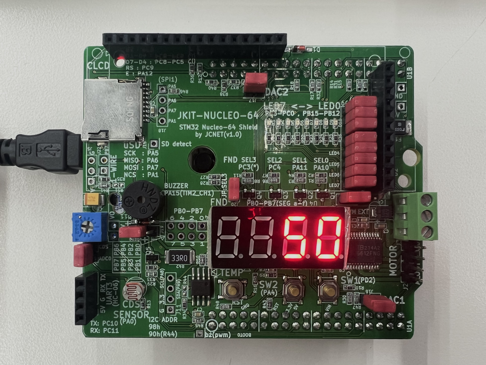

<p align="center"><b>Figure 2. Display 50</b></p>


## Problem 2: Counter with Button Press <a href="#problem-1-display-a-number-with-button-press" id="problem-1-display-a-number-with-button-press"></a>

#### Procedure <a href="#procedure-1" id="procedure-1"></a>

- Create a code that increases the displayed number from 0 to 9 with each button press.

* After the number '9', it should start from '0' again.
* Modify from Problem 1 source code

#### Configuration

Configure the MCU GPIO

| Function                           | Port - Pin                                                   | Configuration                                 |
| ---------------------------------- | ------------------------------------------------------------ | --------------------------------------------- |
| **Button (SW2) on JKIT**           | PA\_4                                                        | DIN, Pull-Up                                  |
| **7-Segment DOUT**                 | <p>PB\_0, PB\_1, PB\_2, PB\_3, PB\_4, PB\_5, PB\_6, PB\_7</p><p>('a'\~'g''dot', respectively)</p> | Push-Pull, No Pull-up-Pull-down, Medium Speed |
| **Selection of 7-Segment Display** | PA\_10 (FND\_0)                                              | DOUT, Push-Pull,                              |

**\* Challenge : Extend the display number from 0 to 19**


**Flow Chart**


<p align="center"><b>Figure 3. Flow Chart of Problem 2</b></p>


**Code**


```c
#include "stm32f4xx.h"
#include "ecGPIO2_22400462.h"
#include "ecRCC2_22400462.h"

// FND segment pins (a~g, dot)
PinName_t pinFND[8]    = {PB_0, PB_1, PB_2, PB_3, PB_4, PB_5, PB_6, PB_7};
// FND selection pins (FND0~FND3)
PinName_t selectFND[4] = {PA_10, PA_11, PC_4, PC_3};
// Push button SW2
PinName_t SW_2 = PA_4;

void setup(void){
    int i, j;
    // Intialize System Clock
    RCC_HSI_init();    

    // Intialize FND pins and Others
    FND_init(pinFND);
    FND_select_init(selectFND);    

    // Set SW2 as input and pull-up resistor
	GPIO_init(SW_2, INPUT);
	GPIO_pupd(SW_2, PULL_UP);

	// Configure FND segment pins as output
    for(i=0; i<8; i++){
		GPIO_init_all(pinFND[i], OUTPUT, MEDIUM_SPEED, PUSH_PULL, NO_PUPD);
    }
	// Configure FND selection pins as push-pull
    for(j=0; j<4; j++){
        GPIO_otype(selectFND[j], PUSH_PULL);
    }
};

int main(void) {
    setup();
    uint8_t numDisplay  = 0;		// Number to display
    uint8_t selectFND  = 0;			// Select FND0
	FND_select(selectFND);


	while(1){
		// Check if SW2 is pressed
		if(GPIO_read(SW_2) == LOW){
			FND_display(numDisplay);	// Display the current display number
			numDisplay++;				// Increase the display number

			// Wait until the button is released
			while(GPIO_read(SW_2) == LOW)
				continue;
		}
		// Return to 0 after 9
		if(numDisplay > 9)
			numDisplay = 0;
	}
}
```


#### Results

Experiment images and results

> [demo video link](https://youtu.be/q7Zn8oR_eJY)

| 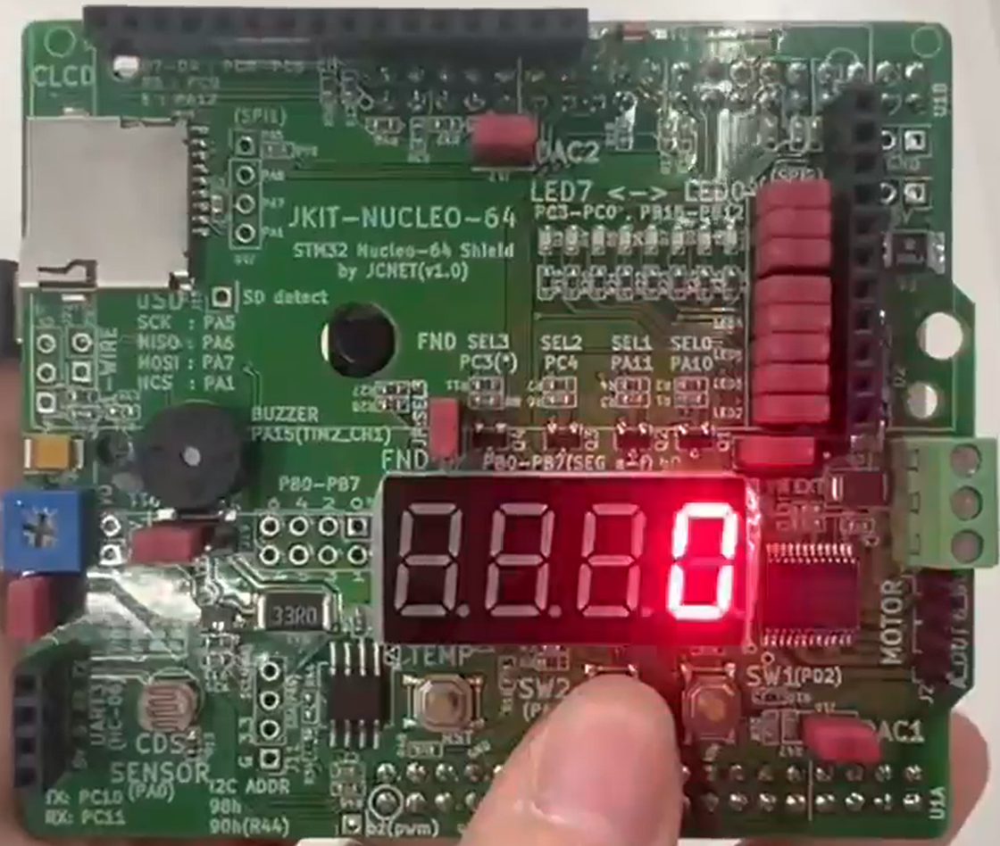   | 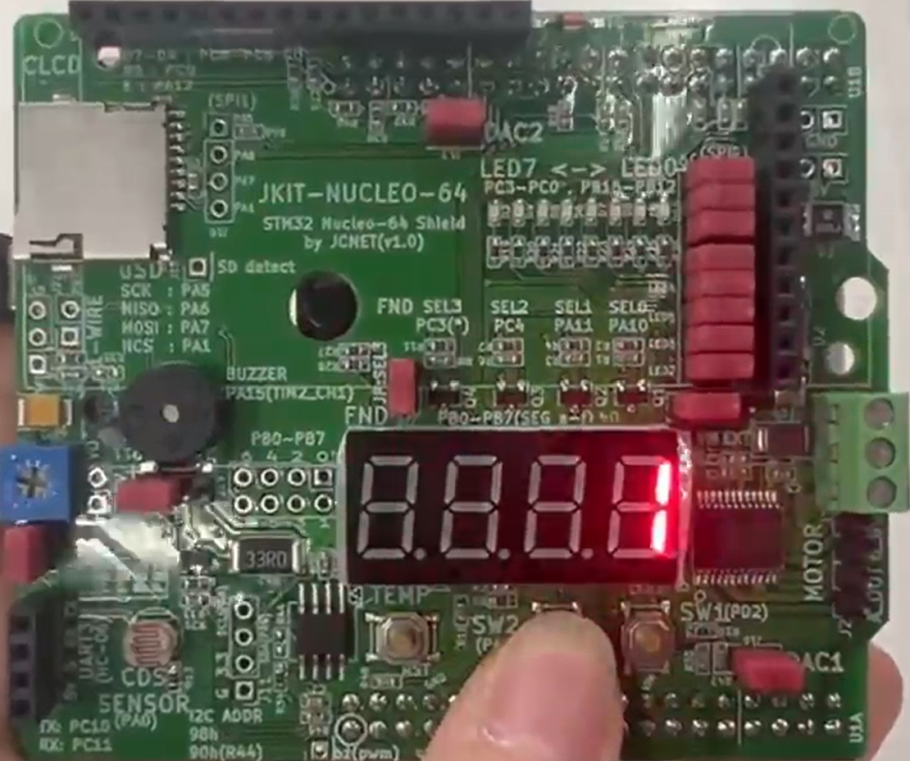 |
| :-------------------------------------------: | :-----------------------------: |
| (a) display 0 | (b) display 1 |
| 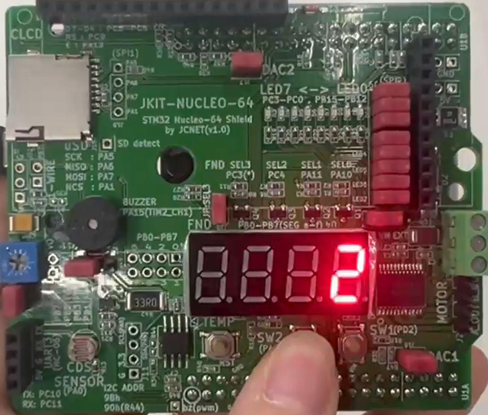               | 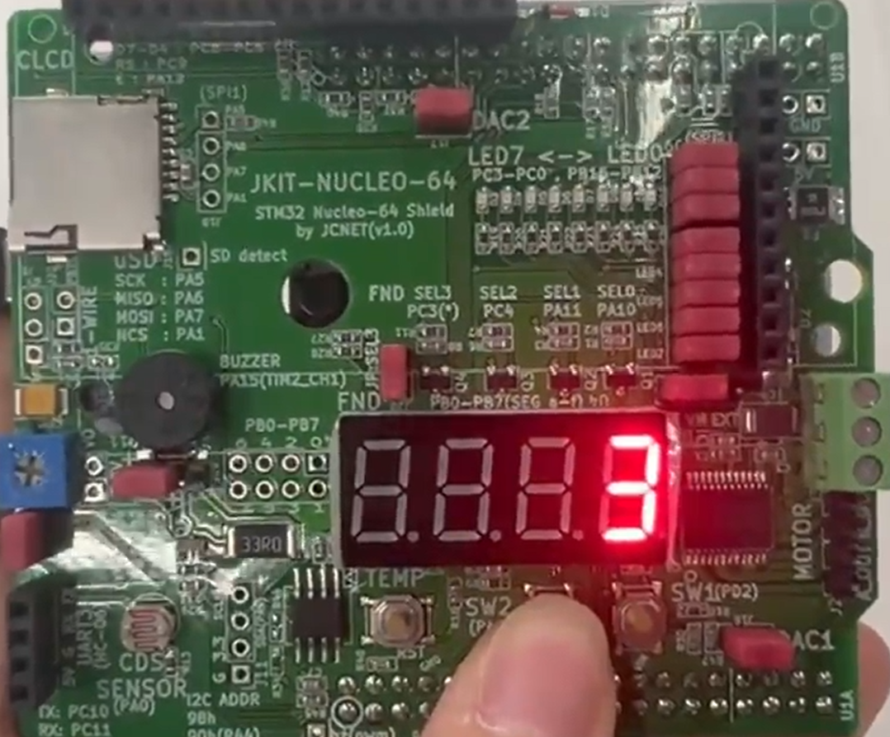 |
| (c) display 2 | (d) display 3 |
| 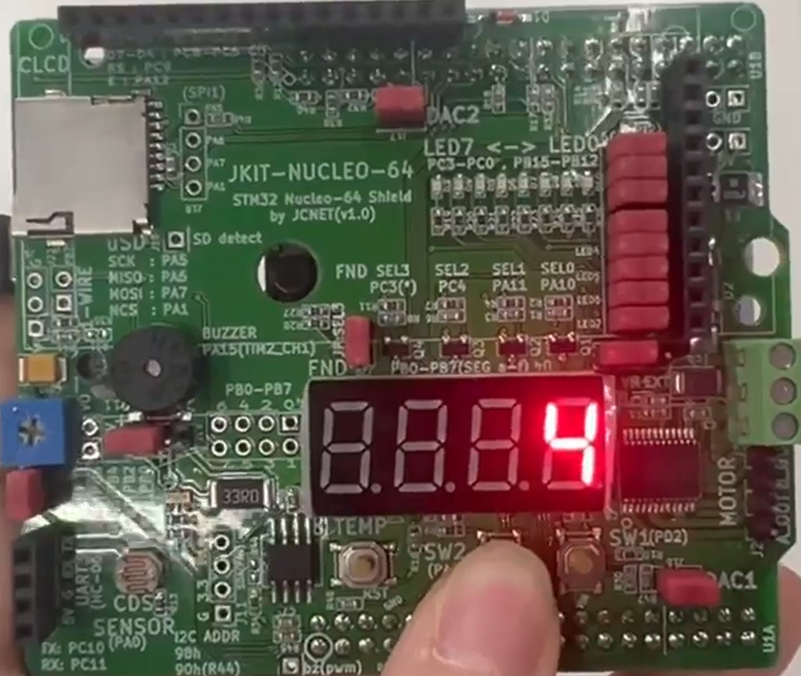               | 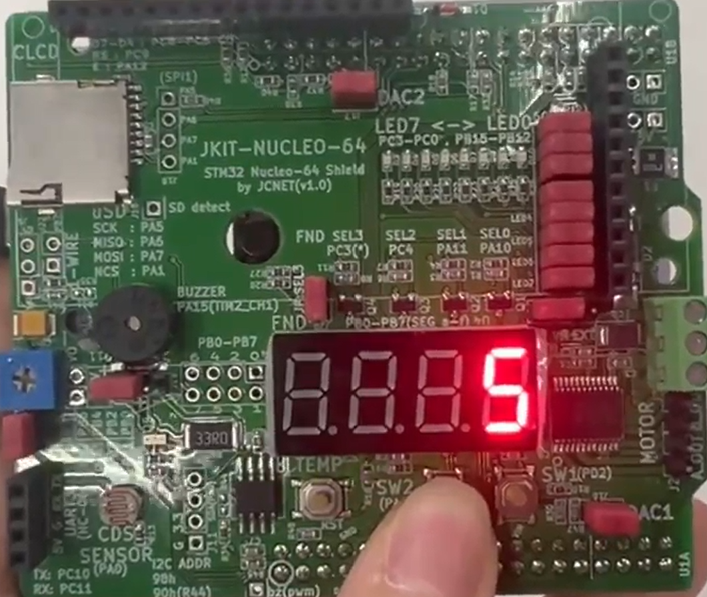 |
| (e) display 4 | (f) display 5 |
| 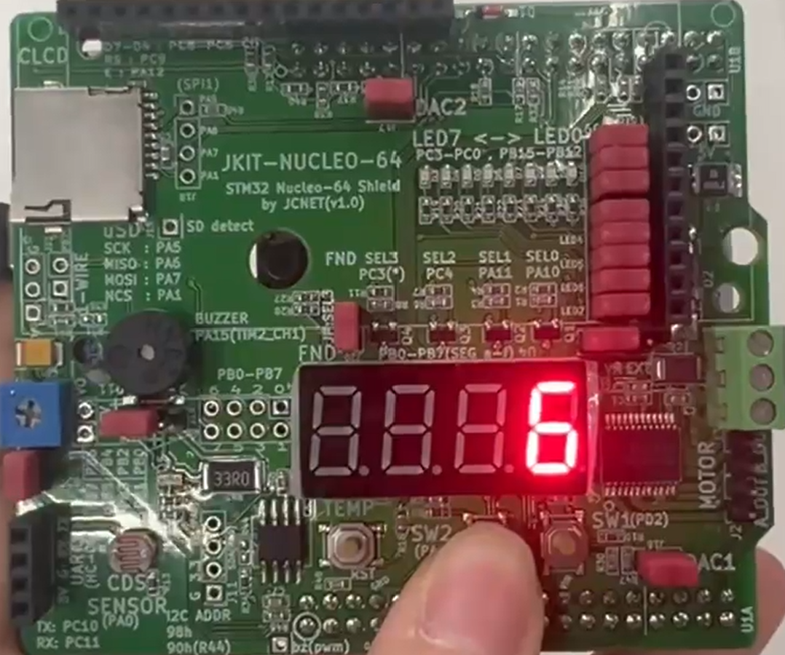               | 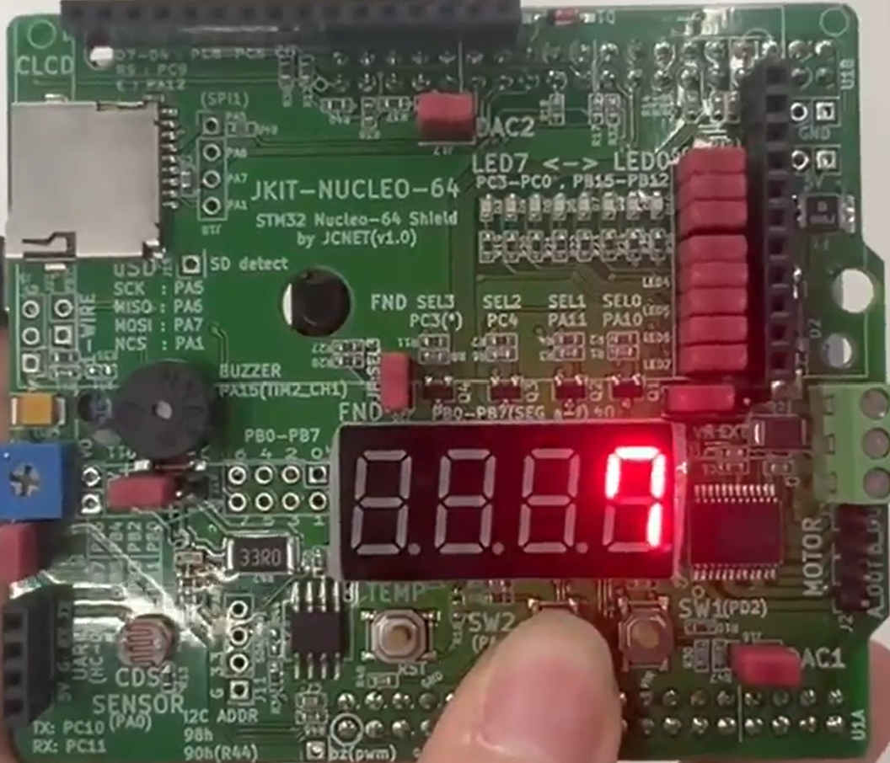 |
| (g) display 6 | (h) display 7 |
| 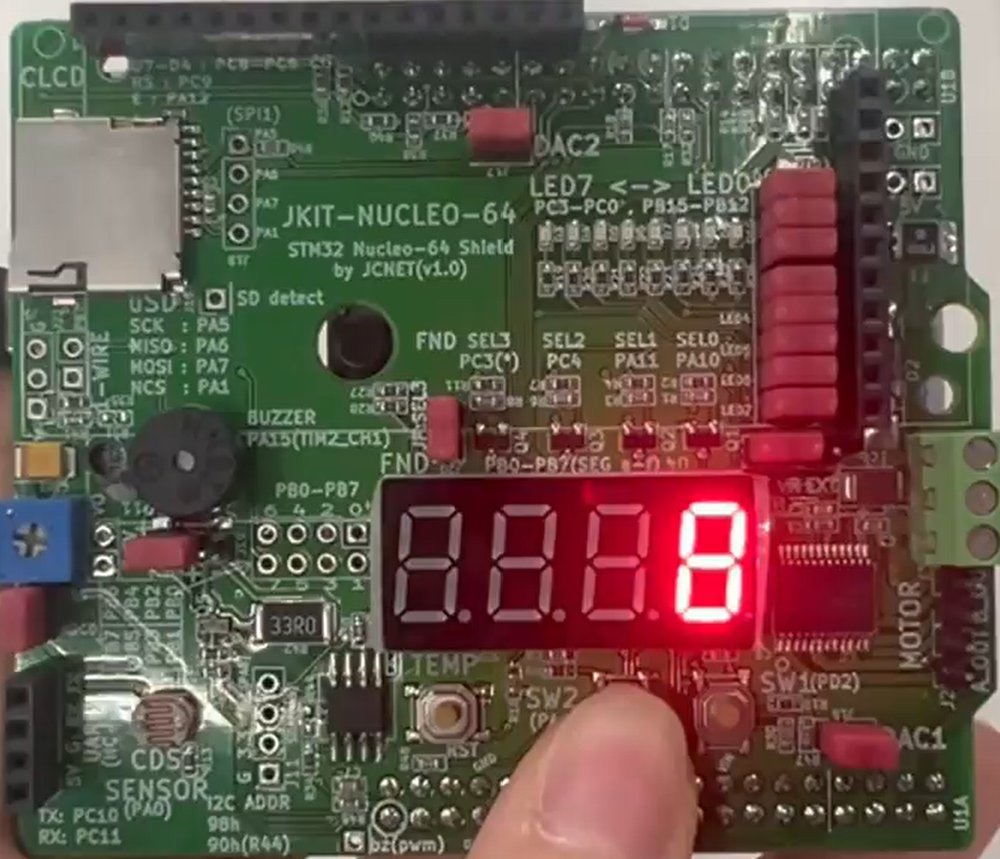               | 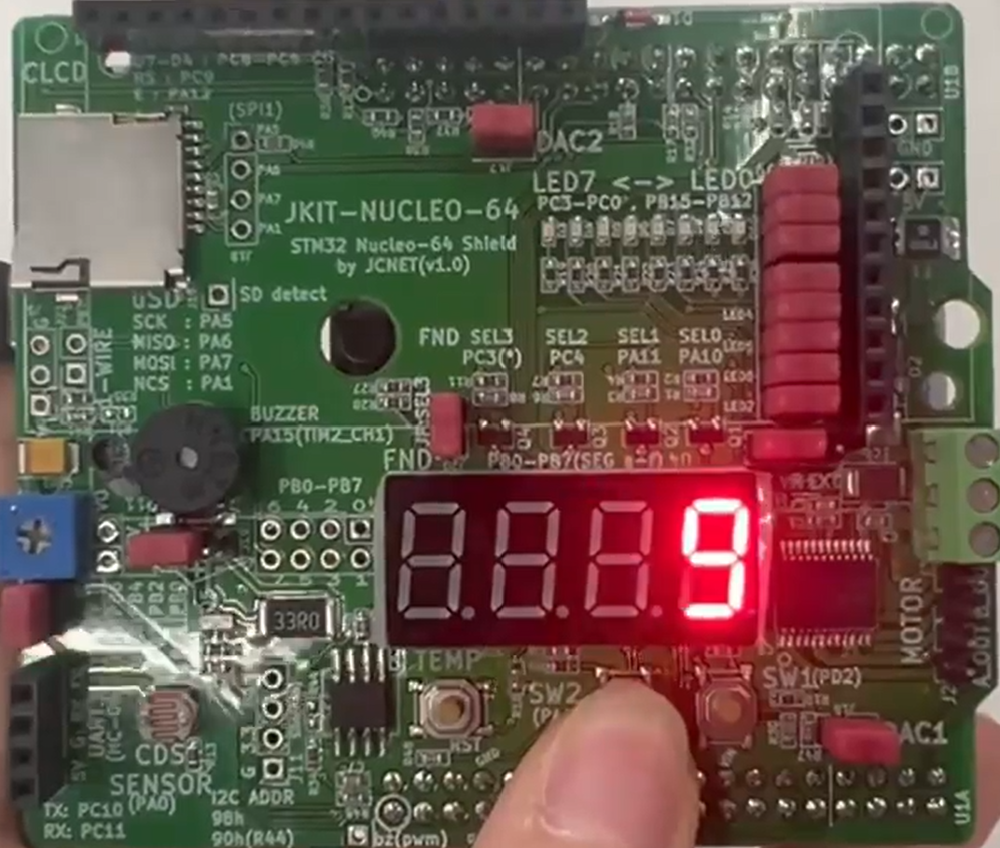 |
| (i) display 8 | (j) display 9 |
| 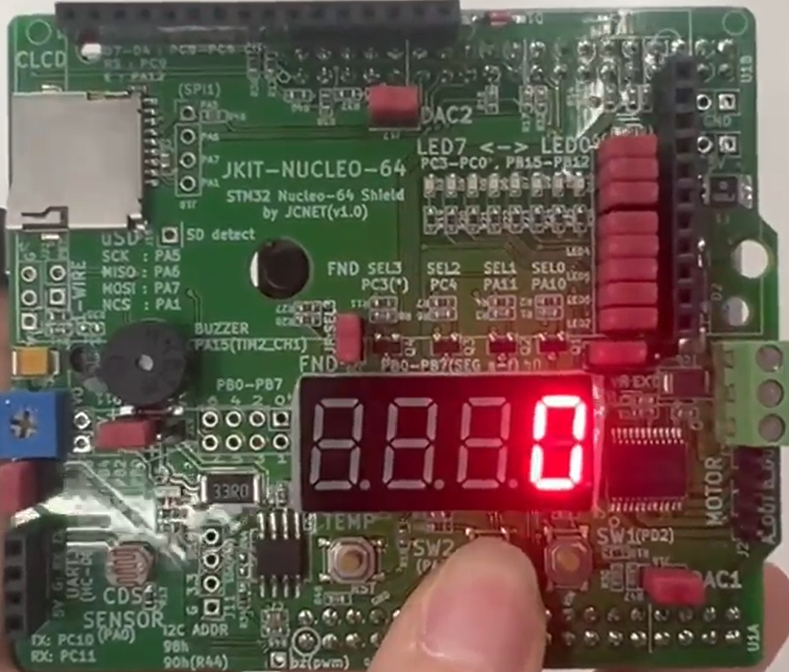 |                               |
| (k) display 0 after 9 |                               |

<p align="center"><b>Figure 4. Display the Sequential Numbers</b></p>

#### Discussion

1. Analyze the result and explain any other necessary discussion.

> The result showed that the number on the 7-segment display increased from 0 to 9 whenever the button was pressed. After 9, the display returned to 0. Through this experiment, we could control the FND output using the button input.

>Also, while(GPIO_read(SW_2) == LOW) continue; was used to wait until the button was released. Without this code, the loop can run several times while the button is still pressed, so the number may increase more than once. By using this code, the number was changed only once for each button press.

2. What are the common cathode and common anode of 7-segment display?

> A 7-segment display consists of several LEDs that share a common terminal.
> In a common cathode display, all cathodes of the LEDs are connected together to GND. Therefore, a segment turns ON when a HIGH signal is applied to its anode.
> In a common anode display, all anodes of the LEDs are connected together to VCC. Therefore, a segment turns ON when a LOW signal is applied to its cathode.

3. Does the LED of a 7-segment display (common anode) pin turn ON when 'HIGH' is given to the LED pin from the MCU?

> No. In a common anode 7-segment display, the common anode is connected to VCC. A segment turns ON when the MCU gives a LOW signal to the corresponding LED pin, allowing current to flow through the LED. When a HIGH signal is given, there is little or no voltage difference across the LED, so the segment turns OFF.

4. How can we display 4 digit-numbers on the 4 FNDS at the same time? How to remove ghosting of displaying a number?

> We can use multiplexing to display four digits. Only one FND is actually turned ON at a time. The MCU selects one digit and displays its number, then quickly moves to the next digit. By repeating this process very fast, all four digits appear to be ON at the same time to the human eye. 
>
> To prevent ghosting, all FND digits should first be turned OFF before changing the segment data. After the new segment data is set, the next FND should be turned ON. This short blank period prevents the previous digit's segment pattern from appearing on the next digit.

***

### Reference

Figure 1 and Configuration Image: 

```
https://raw.githubusercontent.com/LeeJunjae1/EC_22000573
```

***

### Troubleshooting

>  At first, the number increased several times with one button press. To solve this problem, `while(GPIO_read(SW_2) == LOW) continue;` was added so that the program waits until the button is released.