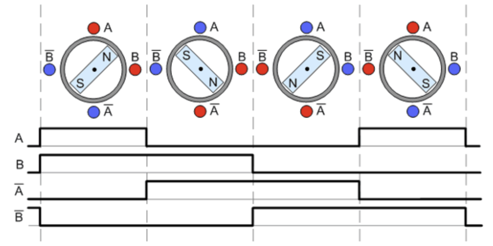
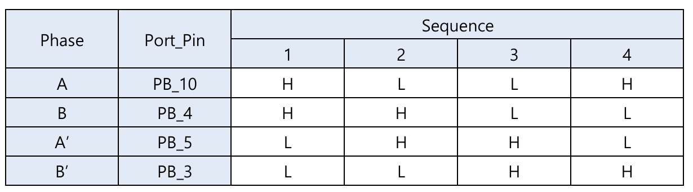
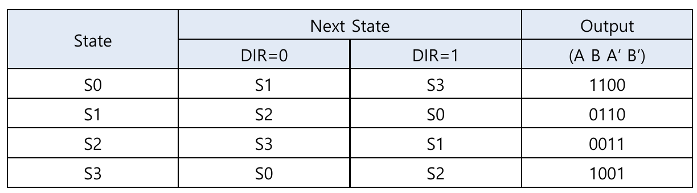
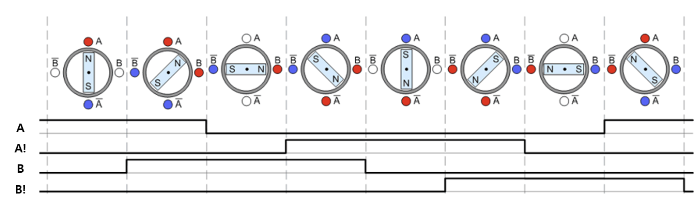
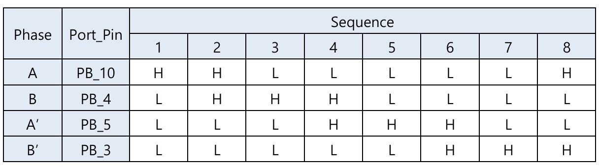
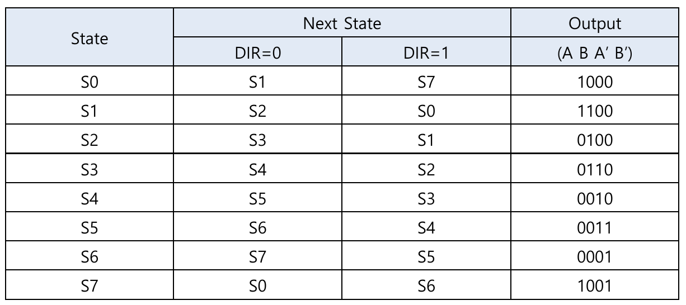
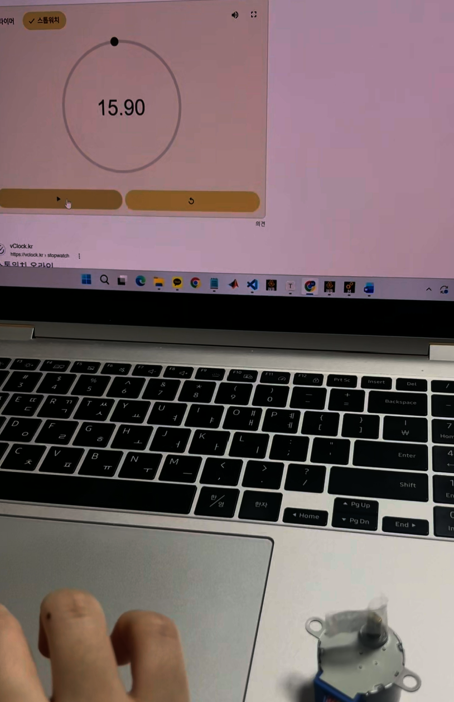
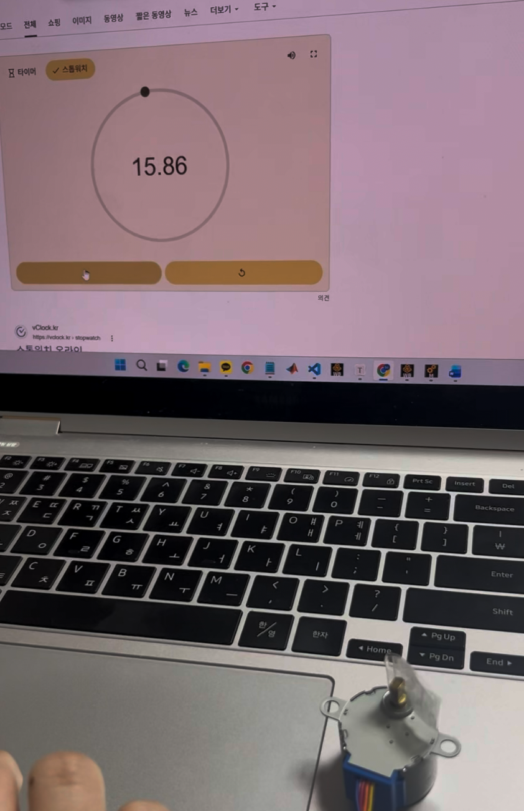
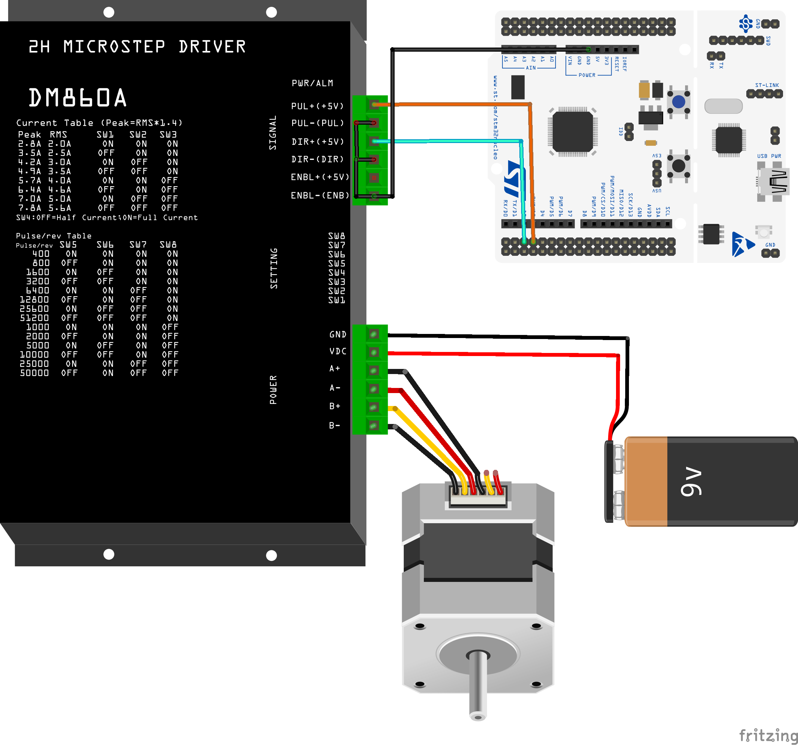

# LAB: Stepper Motor

**Date:** 2026-10-12

**Author/Partner:** Won Bitna

**Demo Video:** https://youtu.be/VoS2hd69Urw

## Introduction

In this lab, we learned how to drive a stepper motor using the digital GPIO outputs of an MCU. We used a Finite State Machine (FSM) to design the algorithm for stepper motor control. The rotation speed was tested in FULL and HALF stepping modes using millisecond and microsecond delays. The measured rotation periods were compared with the theoretical values to check the accuracy of the motor control.

#### Requirement

**Hardware**

* MCU
  * NUCLEO-F411RE
* Actuator/Sensor/Others:
  * **Tutorial:**
    * Stepper Motor SM-42BYG011 (12V)
    * Motor Driver A4988
  * **Lab:**
    * Stepper Motor 28BYJ-48 (5V)
    * Motor Driver ULN2003
  * breadboard

**Software**

* PlatformIO, VS Code, CMSIS, EC\_HAL library


## Problem : Stepper Motor Control with FSM

For the lab, I used stepper motor driver that requires a sequence of 4-input pulses as the input.

* **Driver:** **ULN2003 motor driver **[ULN2003 spec sheet](https://www.electronicoscaldas.com/datasheet/ULN2003A-PCB.pdf)
* **Motor:** 28BYJ-48.

  

1. 
   Find out the number of steps required to rotate 1 revolution of the stepper motor with Full-steppping.
2. Then, rotate the stepper motor 1 revolution with 1 rpm.
3. Repeat the above process in the opposite direction.
4. Increase and decrease the speed of the motor as fast as it can rotate to find the maximum and minimum speed of the motor.
5. Apply the half-stepping and repeat the above.


### FSM design for Stepper Motor Sequence

We are going to apply the finite state machine method to drive a stepper motor.

Reference: 

[Tutorial: FSM programming ](/ec/ec-course/tutorial/tutorial-finite-state-machine-programming.md)

#### State Table for Full-Stepping

**Full-stepping sequence**





**State Table**: Moore FSM



#### State Table for Half-Stepping

**Half-stepping sequence**





* **State Table**: Moore FSM



### Programming FSM

**Main Functions** 

```c
// Enable and set the mode of a pin (mode: INPUT, OUTPUT, AF, ANALOG)
void GPIO_init(PinName_t pinName, uint32_t mode);

// Updates  EC_SYSCLK either 84 MHz or 16 MHz
void SysTick_init(void);

// Initialize EXTI with trigger type and interrupt priority
// trig_type: trigger type (FALL(0), RISE(1), BOTH(2))
// priority: Priorities for handling
void EXTI_init(PinName_t pinName, uint32_t trig_type,uint32_t priority);

// Blocking delay in milliseconds (msec: delay time in millisec)
void delay_ms(uint32_t msec);

// Blocking delay in microseconds (usec: delay time in microsec)
void delay_us(uint32_t usec);

// Initialization of Stepper Motor (mode: HALF(0), FULL(1) / pinStepper: [A, B, AN, BN])
void stepper_init(uint32_t mode, PinName_t *pinStepper);

// Converts Motor [rpm] to step delay in [msec] or [usec]
// speed_mode: MS(millisec, 0), US(microsec, 1)
void stepper_speed (uint32_t speedRPM, uint32_t speed_mode);

// Run Stepper Motor for given steps, direction and speed mode
// (dir: DIR_CW(0), DIR_CCW(1))
// speed_mode: MS(millisec, 0), US(microsec,1))
void stepper_step(uint32_t steps, uint32_t direction, uint32_t speed_mode);

// Stepper Motor Output for given state
void stepper_out(uint32_t state);

// Stop Stepper Motor
void stepper_stop(void);
```


**Function Definitions**

- ecStepper2.h 

```c
#include "stm32f411xe.h"
#include "ecPinNames.h"
#include "ecRCC2.h"
#include "ecGPIO2.h"
#include "ecSysTick2.h"
			
#ifndef __EC_STEPPER2_H
#define __EC_STEPPER2_H

#ifdef __cplusplus
 extern "C" {
#endif /* __cplusplus */

// Stepper Mode
#define HALF 0
#define FULL 1	 
#define DIR_CW 0
#define DIR_CCW 1	  
#define MS 0        // millisec
#define US 1        // microsec

// 28BYJ-48 nominal steps per output revolution
// Gear reduction ratio: 64:1
#define FULL_STEP_PER_REV (32UL * 64UL)  // 2048
#define HALF_STEP_PER_REV (64UL * 64UL)  // 4096

// Select the steps per revolution based on the mode
// You should select the stepper motor mode (mode: HALF(0), FULL(1))
#define STEP_PER_REV ((STEPPER_MODE == FULL) ? FULL_STEP_PER_REV : HALF_STEP_PER_REV)

#define STEPPER_MODE	FULL

//State number 
typedef enum {
	S0, S1, S2, S3, S4, S5, S6, S7
} StateNum;

// FULL stepping sequence  - FSM
typedef struct {
    uint32_t next[2];  // Next state for CW(0) and CCW(1)
    uint8_t out[4];    // Output signals for A, B, A', B'
} StateStepper_t;

// Initialization of Stepper Motor (mode: HALF(0), FULL(1) / pinStepper: [A, B, AN, BN])
void stepper_init(uint32_t mode, PinName_t *pinStepper);

// Converts Motor [rpm] to step delay in [msec] or [usec]
// speed_mode: MS(millisec, 0), US(microsec, 1)
void stepper_speed (uint32_t speedRPM, uint32_t speed_mode);

// Run Stepper Motor for given steps, direction and speed mode
// (dir: DIR_CW(0), DIR_CCW(1))
// speed_mode: MS(millisec, 0), US(microsec,1))
void stepper_step(uint32_t steps, uint32_t direction, uint32_t speed_mode);

// Stepper Motor Output for given state
void stepper_out(uint32_t state);

// Stop Stepper Motor
void stepper_stop(void);


#ifdef __cplusplus
}
#endif /* __cplusplus */

#endif // __EC_STEPPER2_H
```

- ecStepper2.c

```c
#include "stm32f4xx.h"
#include "ecStepper2.h"


// Stepper Motor variable
static PinName_t stepperPins[4];
static volatile uint32_t _steps;
static volatile uint32_t _step_delay_ms = 100;		// millisec	
static volatile uint32_t _step_delay_us = 100000;		// microsec
static const StateStepper_t *fsm;				// points at fsm_full or fsm_half (chosen in stepper_init)
static volatile uint32_t state = 0;				// current FSM state


// FSM States for Full Stepping (S0~S3)
static const StateStepper_t fsm_Full[4] = {	
 	{{S1,S3},{HIGH,HIGH,LOW,LOW}},		// S0 
	{{S2,S0},{LOW,HIGH,HIGH,LOW}},		// S1
	{{S3,S1},{LOW,LOW,HIGH,HIGH}},		// S2
	{{S0,S2},{HIGH,LOW,LOW,HIGH}}		// S3
};

// FSM States for Half Stepping (S0~S7)
static const StateStepper_t fsm_Half[8] = {  
	{{S1,S7},{1,0,0,0}},		// S0
	{{S2,S0},{1,1,0,0}},		// S1
	{{S3,S1},{0,1,0,0}},		// S2
	{{S4,S2},{0,1,1,0}},		// S3
	{{S5,S3},{0,0,1,0}},		// S4
	{{S6,S4},{0,0,1,1}},		// S5
	{{S7,S5},{0,0,0,1}},		// S6
	{{S0,S6},{1,0,0,1}},		// S7
};


// Initialization of Stepper Motor (mode: HALF(0), FULL(1) / pinStepper: [A, B, AN, BN])
void stepper_init(uint32_t mode, PinName_t *pinStepper){
	if (mode == HALF) 
		fsm = fsm_Half;
	else
		fsm = fsm_Full;

	//  GPIO Digital Out Initiation
	// For A, B, AN, BN
	for (int i=0; i<4; i++){
		stepperPins[i] = pinStepper[i];
		GPIO_init(stepperPins[i], OUTPUT);
	}
}

// Converts Motor [rpm] to step delay in [msec] or [usec]
void stepper_speed (uint32_t speedRPM, uint32_t speed_mode){      // rpm
	// [usec] can be used for a higher accuracy, but needs delay_us() 

	// Divide it by STEP_PER_REV to get one step delay
	if(speed_mode == MS)
		_step_delay_ms = 60*1000UL/(STEP_PER_REV*speedRPM); 		//in [msec]	
	else if(speed_mode == US)
		_step_delay_us = 60*1000000UL/(STEP_PER_REV*speedRPM); 		//in [microsec]	

}

// Run Stepper Motor for given steps, direction and speed mode
// (dir: DIR_CW(0), DIR_CCW(1))
// speed_mode: MS(millisec, 0), US(microsec,1))
void stepper_step(uint32_t steps, uint32_t direction, uint32_t speed_mode){
	// Exit if stepper_init() not called 
	if (fsm == 0) return;

	// Save the number of steps
	_steps = steps;

	// run for step size: 
	for (uint32_t i = 0; i < _steps; i++){
		// Update Present State
		state = fsm[state].next[direction];
		
		// Output of Present State
		stepper_out(state);
	
		// Delay for steppermotor speed
		if(speed_mode == MS)
			delay_ms(_step_delay_ms);
		else if(speed_mode == US)
			delay_us(_step_delay_us);
	}
}

// Stepper Motor Output for given state
void stepper_out(uint32_t state){
	
	// stepperPins[0]=A, stepperPins[1]=B, ...
	// out[0]=A, out[1]=B, ...

	for(int i=0; i<4; i++){
		GPIO_write(stepperPins[i], fsm[state].out[i]);
	}
}


// Stop Stepper Motor
void stepper_stop(void) {
    _steps = 0;    
    
	// All pins DigitalOut '0'
	for(int i=0; i<4; i++){
		GPIO_write(stepperPins[i], LOW);
	}
}
```

> Note that these are **blocking** stepper controllers.
>
> While the stepper is running, the MCU cannot process other polling commands. It would be better to be the non-blocking controller.

#### Source Code: Stepper Motor

[Github Code LINK](https://github.com/bitna-cmd/EC-STM32F4-22400462/blob/main/README.md)

```c
// #include "stm32f411xe.h"
// #include "ecGPIO2.h"
// #include "ecRCC2.h"
// #include "ecEXTI2.h"
// #include "ecSysTick2.h"
// #include "ecStepper2.h"
#include "ecSTM32F4v2.h"

#define BUTTON_PIN      PC_13
#define DELAY_UNIT		US
#define MOTOR_RPM		19

// ( A, B,  AN,  BN)
PinName_t pinStepper[4]    = {PB_10,PB_4,PB_5,PB_3};

// Initialiization 
void setup(void){	
	RCC_PLL_init();                                 // System Clock = 84MHz
	SysTick_init();                                 // Systick init
	
	GPIO_init(BUTTON_PIN, INPUT);           		// GPIOC pin13 initialization
    EXTI_init(BUTTON_PIN, FALL,0);           		// External Interrupt Setting

	stepper_init(STEPPER_MODE, pinStepper); 				// Stepper GPIO pin initialization
	stepper_speed(MOTOR_RPM, DELAY_UNIT);                          	//  set stepper motor speed (rpm)
}


int main(void) { 
	// Initialiization --------------------------------------------------------
	setup();							// Initialize System Clock, SysTick, GPIO, EXTI, Stepper
	uint32_t rev=5;						// The number of revolutions
	uint32_t steps=STEP_PER_REV*rev;	// The number of the total steps of every revolutions
	
	// Inifinite Loop ----------------------------------------------------------
	while(1){
		stepper_step(steps, DIR_CW, DELAY_UNIT);    // (Step : 2048, Direction : 0 or 1, Mode : FULL or HALF)
		delay_ms(2000);				    // Delay 2 sec
		stepper_step(steps, DIR_CCW, DELAY_UNIT);   // (Step : 2048, Direction : 0 or 1, Mode : FULL or HALF)
		delay_ms(2000);				    // Delay 2 sec
	}
}

// stop the stepper motor when BUTTON is pressed
void EXTI15_10_IRQHandler(void) {  
	if (is_pending_EXTI(BUTTON_PIN)) {
		stepper_stop();
		clear_pending_EXTI(BUTTON_PIN); // cleared by writing '1'
	}
}
```

#### Configuration

| Function     | Pins                           | Configuration |
| ------------ | ------------------------------ | ------------- |
| A, B, A', B' | <p>PB10, PB4, PB5, PB3<br></p> | DOUT, FAST    |

#### Connection Diagram

We should consider the specification sheet of the motor and the motor driver for wiring and min/max input voltage/current.

<figure><figcaption></figcaption></figure>

#### Discussion

1. Find out the trapezoid-shape velocity profile for a stepper motor. When is this profile necessary?

   > A trapezoidal velocity profile is a method of controlling motor speed in three stages: acceleration, constant speed, and deceleration. First, the motor slowly increases its speed until it reaches the target RPM. Then, it rotates at a constant speed. Finally, it gradually slows down before stopping.
   >
   > In a stepper motor, this method can be used by changing the delay time between steps. During acceleration, the step delay becomes shorter. During deceleration, the step delay becomes longer.
   >
   > This method is especially useful when the motor needs to rotate at a high speed or move a heavy load. If the motor starts or stops too suddenly, it may lose steps or vibrate. Therefore, a trapezoidal velocity profile helps the motor rotate more smoothly and safely.
2. How would you change the code more efficiently for micro-stepping control? You don’t have to code this but need to explain your strategy.

   > In this experiment, the stepper motor was controlled by using an FSM to send HIGH or LOW signals to each coil. However, microstepping requires more detailed control of the current flowing through each coil.
   >
   > To achieve this, PWM and a suitable current control circuit can be used. A lookup table can store the required current values for each microstep. Also, a hardware timer can update the signals at regular times, reducing the need for blocking delays.
   >
   > Another simple method is to use a motor driver that supports microstepping, such as the A4988 or DRV8834, with a compatible motor. These drivers control the coil currents internally, so the MCU does not need to control each coil directly. This makes the code simpler and more efficient.
3. There are other types of Stepper Motor Drivers that are simple to use, such as you only give one pulse signal and direction, instead of giving 4 pulse signals. Such examples are A4988, DRV 8834, and TB6600 drivers. Compare these motor drivers with ULN2003 in terms of operating method.

> The ULN2003 used in this experiment is a transistor-array driver that controls the motor coils based on signals from the MCU. Therefore, the MCU needs four GPIO pins and an FSM to control the output sequence of the coils. The rotation direction is also controlled by changing the order of the FSM states.
>
> In contrast, drivers such as the A4988, DRV8834, and TB6600 usually use STEP and DIR signals. When the MCU sends a STEP pulse, the driver controls the coils internally. The DIR signal determines the rotation direction. These drivers also support microstepping by controlling the current inside the motor coils.
>
> Therefore, the ULN2003 requires the MCU to control the coil sequence directly, while the other drivers handle this process internally. This makes the MCU code simpler. However, the motor type and electrical specifications must be checked before using each driver.

4. additional discussion

> At first, the measured rotation period at 1 RPM had an error of about 20% compared to the theoretical value. The cause was found in the delay functions. The problem was the accuracy of the delay time. The original `delay_ms()` function uses milliseconds, and the calculated step delay is stored as an integer. Therefore, the decimal part is removed, which can cause an error in the rotation speed. 
>
> To improve the accuracy, a new `delay_us()` function was implemented using the SysTick VAL register. This function measures time in microseconds, so it can control the step delay more precisely.
>
> In the experiment using milliseconds, the maximum speed was 14 RPM for both FULL and HALF modes. The period errors were about 4.85% and 5.59%, respectively. However, when microseconds were used, the motor could operate at a higher tested speed of 19 RPM. The period errors were only about 0.70% for FULL mode and 0.45% for HALF mode.
>
> These results show that microsecond delays provide better time resolution and allow more precise speed control, especially at higher rpm. However, the two methods (using msec/usec) were tested at different RPM values, so their accuracy cannot be directly compared.
>


## Results

To improve the accuracy of the measurement, the total time for 5 revolutions was measured and divided by five to calculate the average time for one revolution. This method helped reduce the effect of stopwatch reaction time errors.

The theoretical rotation period was calculated using the following equation.

$$
T_{\text{theory}} = \frac{60}{RPM}
$$

The measured rotation period was calculated as follows.

$$
T_{\text{measured}} = \frac{T_{\text{5 revolutions}}}{5}
$$

The percentage error was calculated using the following equation.

$$
Error(\%) = \frac{|T_{\text{measured}} - T_{\text{theory}}|}{T_{\text{theory}}} \times 100
$$

**Rotation Speed Measurement**

| Delay Unit | Stepping Mode | Maximum RPM | Theoretical Period (s) | Measured Period (s) | Error (%) |
| :--------: | :-----------: | ----------: | ---------------------: | ------------------: | --------: |
|     MS     |     FULL      |          14 |                  4.286 |               4.078 |      4.85 |
|     MS     |     HALF      |          14 |                  4.286 |               4.046 |      5.59 |
|     US     |     FULL      |          19 |                  3.158 |               3.180 |      0.70 |
|     US     |     HALF      |          19 |                  3.158 |               3.172 |      0.45 |

The lowest tested speed was 1 RPM in all conditions.

The maximum tested speed was 14 RPM using millisecond delays and 19 RPM using microsecond delays. The microsecond method showed smaller period errors in these tests. However, the measurements were taken at different RPM values.


### Experiment Images and Results


|  |  |
| :----------------------------------------------------------: | :----------------------------------------------------------: |
|               (a) Full-Stepping 5 Rev Duration               |               (b) Half-Stepping 5 Rev Duration               |

**Figure 1.** 5 Revolution Duration at Maximum Speed


### Demo Video

[demo video link](https://youtu.be/VoS2hd69Urw)


### Reference

https://ykkim.gitbook.io/ec/ec-course/lab/lab-stepper-motor

https://www.ti.com/product/ULN2003A


### Appendix
**Connection Diagram (Motor Driver Shield based on A4988)**

MCU: &#x20;

* DIR: D2(PA10),  STEP: D3(PB3),  ENABLE: D6(PB10)&#x20;

Power Supply:  8\~12V

Depends on the motor shield

* SW4 to SW6 : ON  (Lowest Current RMS)
* SW1 to SW3:  x1 micro-stepping


