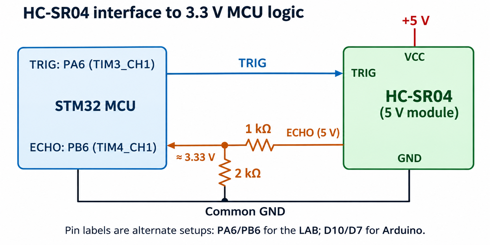
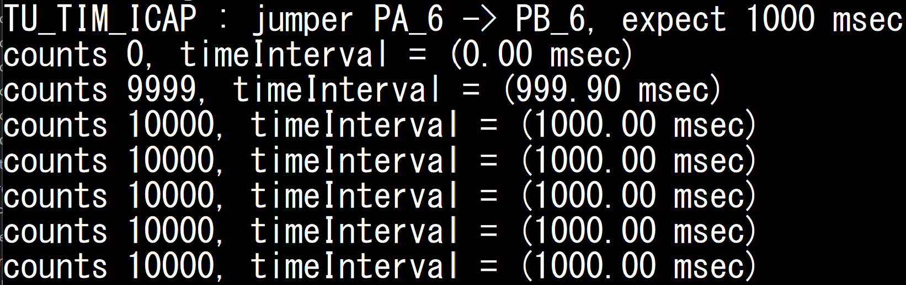
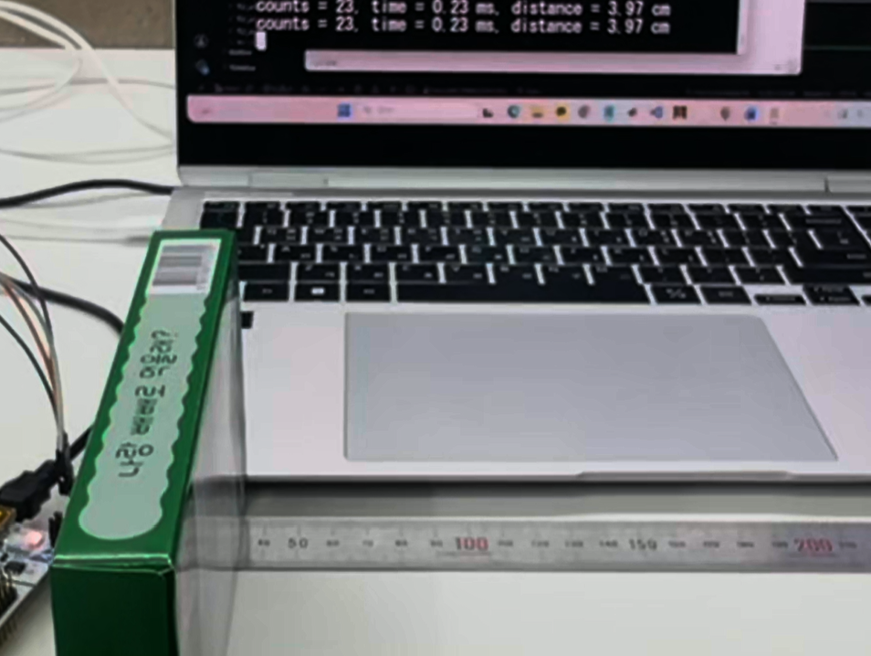
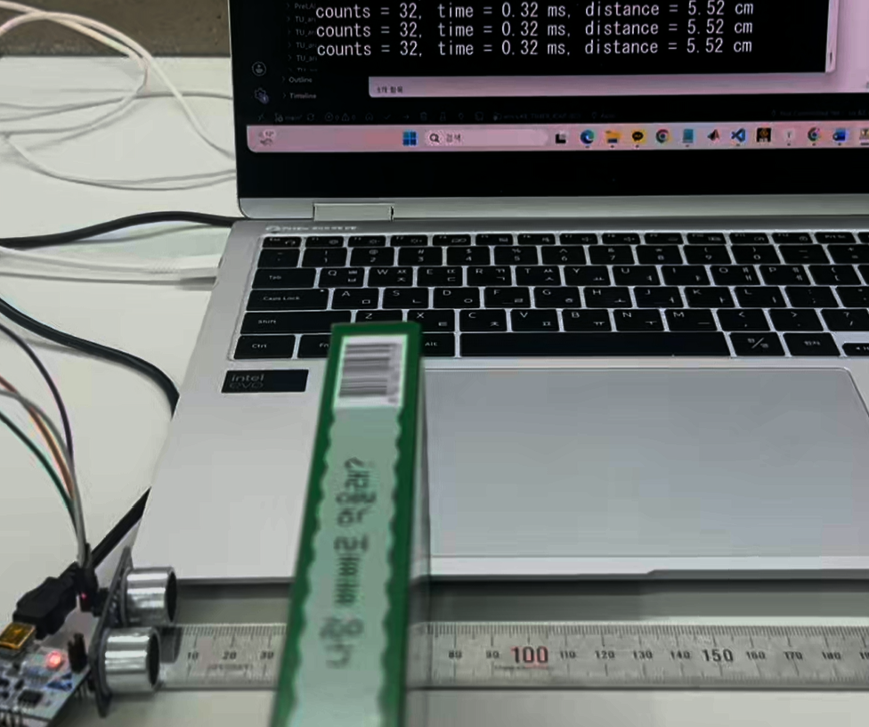
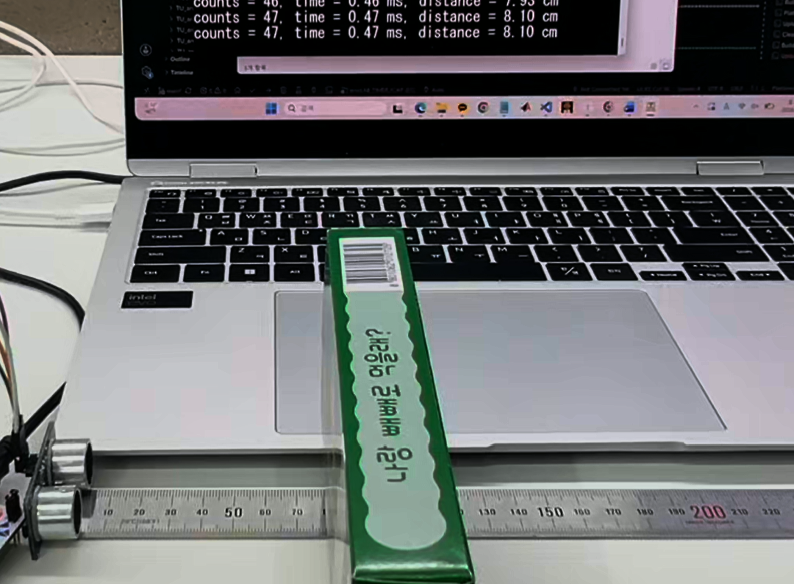
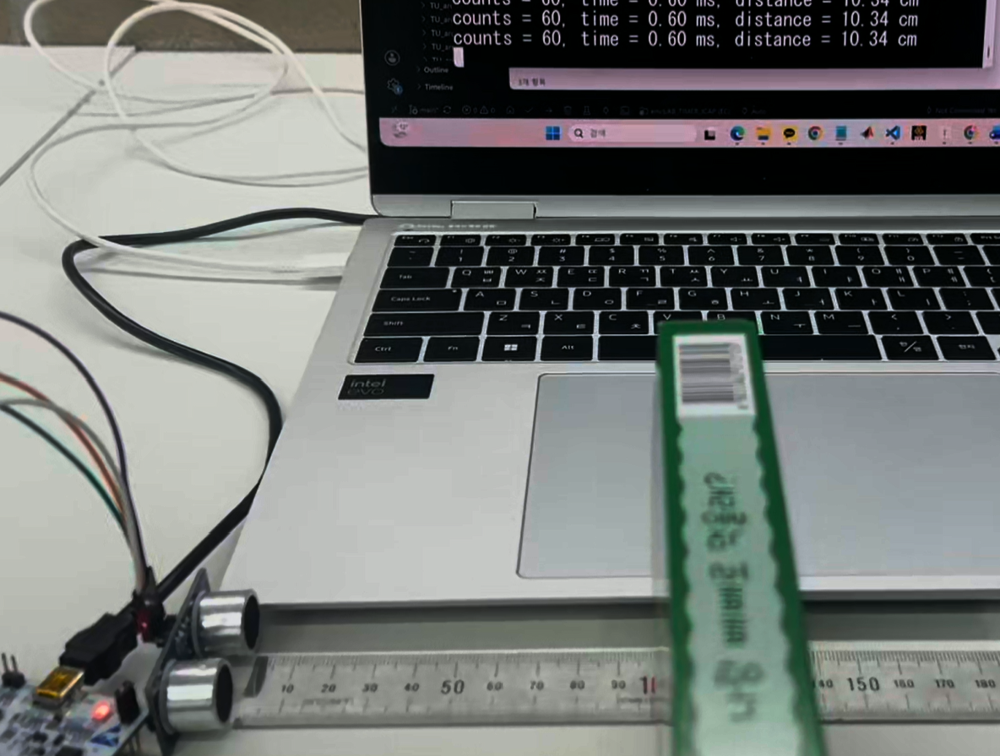
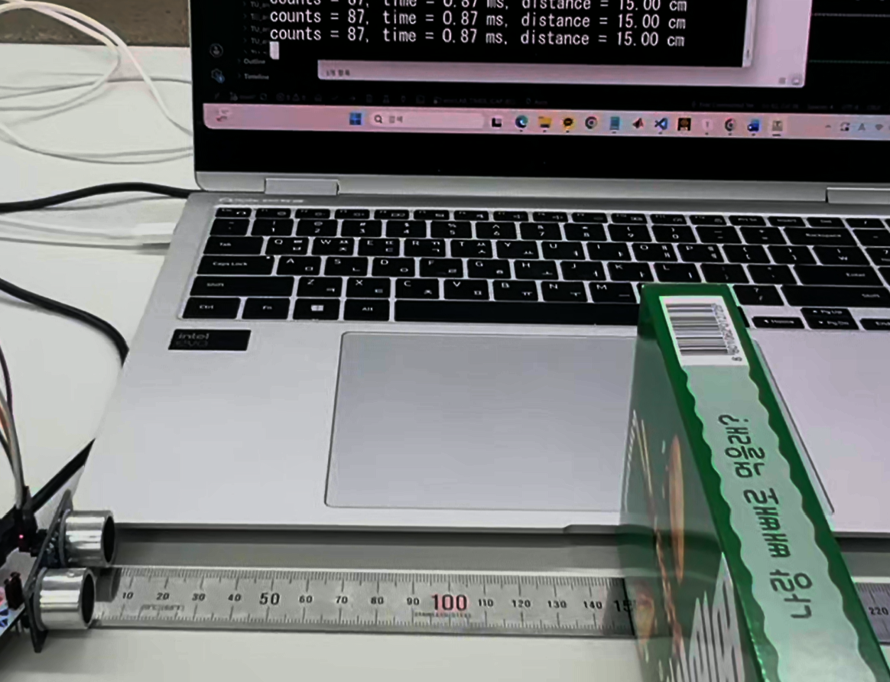
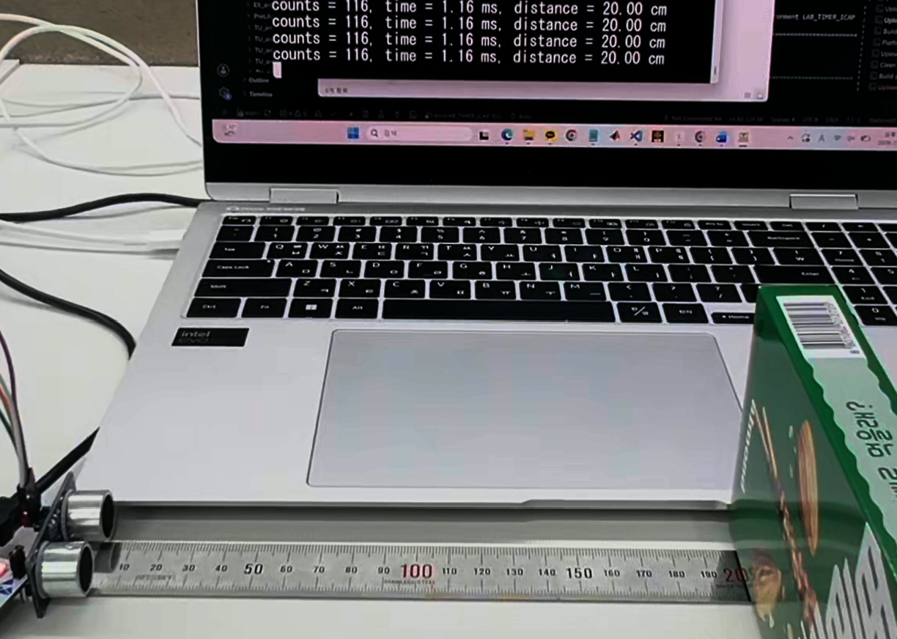
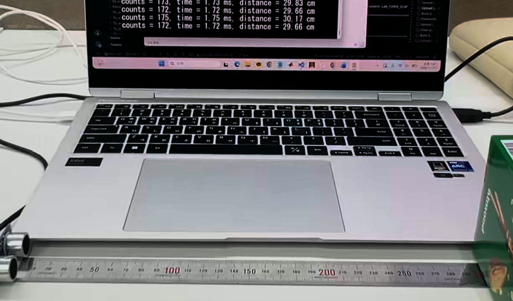
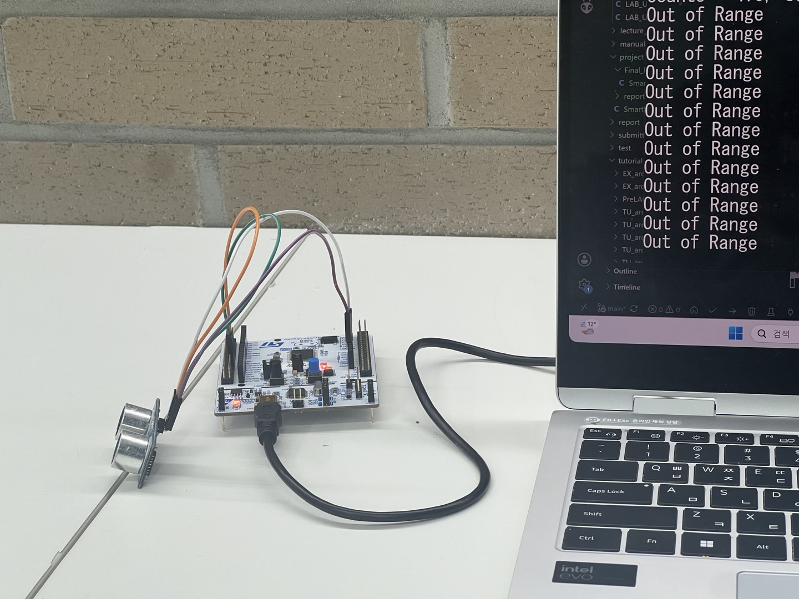

# 4. LAB: Input Capture - Ultrasonic Sensor

**Date:** 2026-10-10

**Author:** Won Bitna

**Github:** https://github.com/bitna-cmd/EC-STM32F4-22400462/blob/main/README.md

**Demo Video:** https://youtu.be/308Qev2ock0

## Introduction

In this lab, I created a simple program that uses input capture mode to measure the distance using an ultrasonic distance sensor. The sensor also needs trigger pulses that can be generated by using the timer output.

### Requirement

#### Hardware

- MCU
  - NUCLEO-F411RE
- Actuator/Sensor/Others:
  - HC-SR04
  - breadboard

#### Software

- VS Code, PlatformIO, CMSIS, EC-STM32 library

------

## Problem: Ultrasonic Distance Sensor (HC-SR04)

The HC-SR04 ultrasonic distance sensor. This economical sensor provides 2cm to 400cm of non-contact measurement functionality with a ranging accuracy that can reach up to 3mm. Each HC-SR04 module includes an ultrasonic transmitter, a receiver and a control circuit.



**The HC-SR04 Ultrasonic Range Sensor Features:**

- Input Voltage: 5V
- Working current: approximately 15mA for the referenced module; needed to check the actual variant
- Digital Output: 5V
- Digital Output: 0V (Low)
- Nominal measuring angle: 15°; usable response depends on the target and module
- Ultrasonic Frequency: 40kHz
- Range: 2cm - 400cm

### Procedure

1. Create a new project under the lab directory

- The environment t name is “**LAB_TIMER_ICAP”.**
- Create a new source file named as “**LAB_TIMER_ICAP.c”**

2. Include updated library in `\include\` to the project.

3. Connect the HC-SR04 ultrasonic distance sensor to MCU pins

- PA6 - trigger (PWM pin)
- PB6 - echo (ICAP pin)
- VCC and GND

Need to use a 1 kΩ resistor from ECHO to the capture-input node and a 2 kΩ resistor from that node to ground. A nominal 5 V ECHO level becomes approximately 3.33 V. Need to connect the MCU and sensor grounds together. The Arduino example uses D10/D7; the register/library LAB uses PA6/PB6.

### Distance Measurement

The program needs to

- Generate a trigger pulse as PWM to the sensor.

- Receive echo pulses from the ultrasonic sensor

- Measure the distance by calculating pulse-width of the echo pulse.

- Display measured distance in [cm] on serial monitor of Tera-Term for

  (a) 10mm (b) 50mm (c) 100mm

The 10 mm point is below the specified 20 mm minimum range. Report it as an out-of-range observation, not a required accurate reading. Keep the 50 mm and 100 mm measurements for comparison within the nominal range.

### Configuration

| System Clock | PWM                                       | Input Capture                                                |
| :----------- | :---------------------------------------- | :----------------------------------------------------------- |
| PLL (84MHz)  | PA6 (TIM3_CH1)                            | PB6 (TIM4_CH1)                                               |
|              | AF, Push-Pull, No Pull-up Pull-down, Fast | AF, No Pull-up Pull-down                                     |
|              | PWM period: 100msec pulse width: 10usec   | Counter Clock : 0.1MHz (10us) CH1 -> TI1 -> IC1 (rising edge) CH1 ->TI1 -> IC2 (falling edge) |

The 100 ms trigger period allows more than the 60 ms measurement interval recommended for the referenced HC-SR04 module. Used a 10 us HIGH trigger pulse; the 10 us capture tick is a separate setting. Confirmed the requirements of the actual module variant.

### Circuit Diagram


### Discussion

1. Overcapture occurs when another capture arrives while the previous CCxIF flag is still set. When can this occur, how does it differ from counter overflow, and when can a time span be recovered from the available timestamps? Explain when lost captures make the original interval ambiguous.

> Overcapture occurs when a new capture event happens before the previous CCxIF flag is cleared. This can happen when input signals arrive too quickly or the interrupt handler is delayed.
>
> Overcapture is different from counter overflow. Counter overflow occurs when the timer reaches its maximum count and returns to zero. It does not necessarily cause data loss, and the time interval can be calculated if the number of overflows is known.
>
> A time interval can still be recovered if the required timestamps are available and timer overflows are handled correctly. However, if capture events are lost, the original interval may become unclear because the missing timestamps cannot be recovered. In this case, it may be impossible to know how many events occurred between the remaining timestamps.

2. In the tutorial, what is the accuracy when measuring the period of 1Hz square wave? Show your result.

> A 1 Hz square wave has a theoretical period of 1000 ms. In this experiment, the PWM output from PA6 was connected to PB6 using a jumper wire. The Input Capture timer was set to 100 us per count. The measured period was mostly 1000.00 ms, with one measurement of 999.90 ms. The percentage error was calculated using the following formula.
> $$
> Error (\%) = \frac{|T_{measured} - T_{theoretical}|}{T_{theoretical}} \times 100
> $$
> For the measurement of 999.90 ms,
> $$
> Error(\%) = \frac{|999.90 - 1000|}{1000} \times 100 = 0.01 (\%)
> $$
> Therefore, the percentage error ranged from 0% to 0.01%, and the calculated accuracy ranged from 99.99% to 100%. This shows that the Input Capture measured the period very accurately.
>
> 
>
> Figure 1. Period measurement of a 1 Hz square wave using Input Capture.

### Code

[github link](https://github.com/bitna-cmd/EC-STM32F4-22400462/blob/main/README.md)

**Main Functions**

```c
// Enable and set the mode of a pin (mode: INPUT, OUTPUT, AF, ANALOG)
void GPIO_init(PinName_t pinName, uint32_t mode);

// Initialize the selected USART configuration of TX, RX, and baud rate
// (baud: BAUD_xxxx)
void USART_init(USART_TypeDef* USARTx, PinName_t pin_GPIO_TX, PinName_t pin_GPIO_RX, uint32_t baud);

//  Low Frequency PWM initialization in msec. (below 1kHz)
// 	Default: 		50% duty ratio. PWM_mode1, Period in msec.
//  TIM2/TIM5 		(32-bit ARR) : msec 1 ~ 4,294,967
//  TIM1/TIM3/TIM4 	(16-bit ARR) : msec 1 ~ 6,553   
void PWM_init(PinName_t pinName, uint32_t msec);

// Set Pulse width in usec
// pulse_width_us: HIGH duration in microsec
void PWM_pulsewidth_us(PinName_t pinName, uint32_t pulse_width_us);

// Default: 1 usec Tick Timer,  Assume TIn=ICn
void ICAP_init(PinName_t pinName, uint32_t edge_type);

// User Deinfed ICn with 1 usec Tick Timer
//     Initialize in this order
//
//     ICAP_init(ECHO, IC_RISE);				// IC1
//     ICAP_ICn_init(ECHO, IC_FALL, IC_2);		// IC2
//     ICAP_tick(ECHO, 10);					    // one tick = 10 usec  <- last
//
void ICAP_ICn_init(PinName_t pinName, uint32_t edge_type, uint32_t ICn);

//  Timer Counter Tick in usec.  
//  This modifies PSC. Then, ARR is kept at maximum
//  CK_CNT = EC_SYSCLK / (PSC+1)   ->   PSC = usec * EC_SYSCLK/1e6 - 1
//  NOTE:  TIM_init_us() / TIM_period_us() cannot be used here: they FIX the PSC
void ICAP_tick(PinName_t pinName, uint32_t usec);

// Check whether the update interrupt flag (UIF) is set.
// return: non-zero if set, 0 otherwise.
uint32_t is_UIF(TIM_TypeDef *TIMx);

// Clear the update interrupt flag (UIF)
void clear_UIF(TIM_TypeDef *TIMx);

// Check if a capture event has occurred on the selected channel
uint32_t is_CCIF(TIM_TypeDef *TIMx, uint32_t ICn);

// Read the captured timer counter value from the selected channel
uint32_t ICAP_read(PinName_t pinName, uint32_t ICn);

// Clear the capture interrupt flag of the selected channel
void clear_CCIF(TIM_TypeDef *TIMx, uint32_t  ICn);
```

**Source code**

```c
#include "ecSTM32F4v2.h"

#define PWM_PIN     PA_6  // TIM3_CH1, TRIG
#define ICAP_PIN    PB_6  // TIM4_CH1, ECHO
#define LED_PIN     PA_5

uint32_t pwm_period_ms = 100;
uint32_t uTick = 10;
uint32_t timer_arr  = 65536;    // ticks per counter wrap (ARR+1)

// volatile uint32_t ovf_cnt = 0;      //counts overflows
volatile uint32_t cap_prev   = 0;   // CCR of the previous rising edge
volatile uint32_t cap_curr    = 0;  // CCR of the current falling edge
volatile uint32_t counts = 0;       // [ticks]
volatile float timeInterval = 0;    // [usec]
volatile uint8_t  _started   = 0;   
volatile float distance = 0;        // [cm]

void setup(void){
    RCC_PLL_init();
    SysTick_init();

    // Initialize LED pin
    GPIO_init(LED_PIN,OUTPUT);

    // Initialize Input Capture pin
    GPIO_init(ICAP_PIN, AF);
    GPIO_pupd(ICAP_PIN, NO_PUPD);

    // Initialize USART2 (baudrate: 9600)
    USART_init(USART2, PA_2, PA_3, 9600);

    // Initialize PWM (pwm period: 100ms, pulsewidth: 10us)
    PWM_init(PWM_PIN, pwm_period_ms);
    GPIO_otype(PWM_PIN, PUSH_PULL);
    GPIO_pupd(PWM_PIN, NO_PUPD);
    GPIO_ospeed(PWM_PIN, FAST_SPEED);
    PWM_pulsewidth_us(PWM_PIN, 10);

    // Input capture  rising edge TIn=ICn, tick = uTick usec    
    ICAP_init(ICAP_PIN, IC_RISE);
    ICAP_ICn_init(ICAP_PIN, IC_FALL, IC_2);     //TI1 -> IC2, falling
    ICAP_tick(ICAP_PIN, uTick);         

    timer_arr=TIM4->ARR + 1;
}

int main(void){
    setup();
    printf("HC-SR04 Distance Measurement\r\n");

    while(1){
        // Calculate distance
        distance = timeInterval / 58.0;     // (cm)

        // Print message
        if(2.0<=distance && distance<=400.0){
            printf("counts %lu, timeInterval = %.2f ms, distance: %.2f cm\r\n", 
                counts, timeInterval/1000, distance);  
        } else {
            printf("Out of range\r\n");
        }
   
        led_toggle(LED_PIN);
        delay_ms(2000);
    }
}

void TIM4_IRQHandler(void){

    // Counter Overflow
    if(is_UIF(TIM4)){
        clear_UIF(TIM4);
    }

    // Rising Edge
    if(is_CCIF(TIM4, IC_1)){
        cap_prev = ICAP_read(ICAP_PIN, IC_1);
        _started = 1;
        clear_CCIF(TIM4, IC_1);
    }

    // Falling Edge
    if(is_CCIF(TIM4, IC_2)){
        cap_curr = ICAP_read(ICAP_PIN, IC_2);

        // Calculate counts
        if(_started){
            if(cap_curr >= cap_prev){
                counts = cap_curr - cap_prev;
            }
            else{
                counts = timer_arr - cap_prev + cap_curr;
            }

            // Calulate timeInterval
            timeInterval = counts * uTick;
            _started = 0;
        }

        clear_CCIF(TIM4, IC_2);
    }
}
```

### Results

<table align="center">
  <tr>
    <td align="center"></td>
    <td align="center"></td>
  </tr>
  <tr>
    <td align="center">(a) Measurement at 1 cm</td>
    <td align="center">(b) Measurement at 5 cm</td>
  </tr>
  <tr>
    <td align="center"></td>
    <td align="center"></td>
  </tr>
  <tr>
    <td align="center">(c) Measurement at 8 cm</td>
    <td align="center">(d) Measurement at 10 cm</td>
  </tr>
  <tr>
    <td align="center"></td>
    <td align="center"></td>
  </tr>
  <tr>
    <td align="center">(e) Measurement at 15 cm</td>
    <td align="center">(f) Measurement at 20 cm</td>
  </tr>
  <tr>
    <td align="center"></td>
    <td align="center"></td>
  </tr>
  <tr>
    <td align="center">(g) Measurement at 30 cm</td>
    <td align="center">(h) Out of range measurement</td>
  </tr>
</table>

<p align="center">
  <b>Figure 2.</b> Distance measurements using the HC-SR04
</p>

The HC-SR04 ultrasonic sensor was tested at different distances. The measured values were generally close to the actual distances, especially at 5 cm and 10 cm. Around 0~3.5cm, the readings became unstable and sometimes showed incorrect values. This was noticeable at 1 cm, which is below the sensor's minimum measurement range of 2 cm. When object was not detected in close, the system displayed "Out of Range". Overall, the sensor worked well within its measurement range, but it did not work well outside the range.

https://youtu.be/308Qev2ock0

## Reference

```
https://ykkimhgu.github.io/EC-STM32F4-Book/chapters/ch13-input-capture/04-lab.html#problem-ultrasonic-distance-sensor-hc-sr04
```

