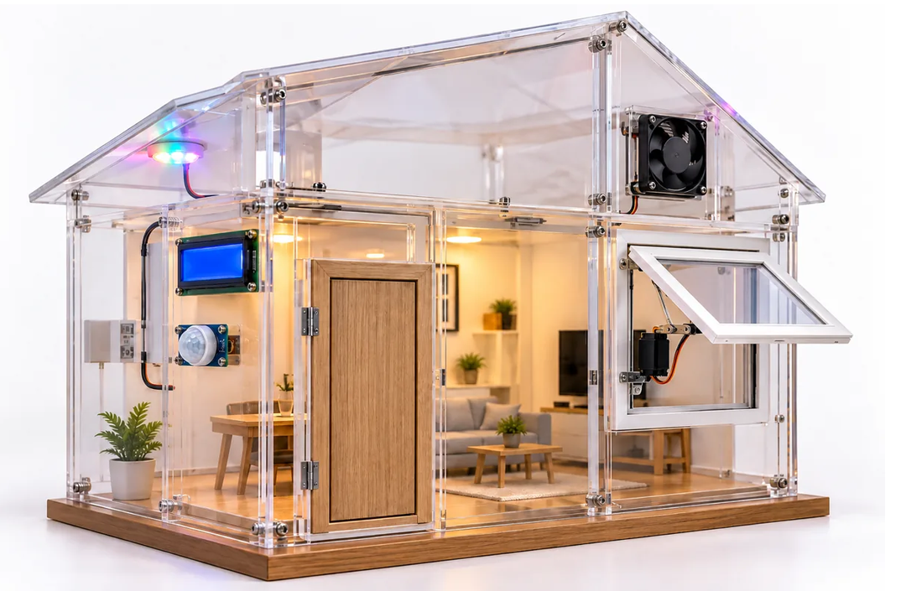
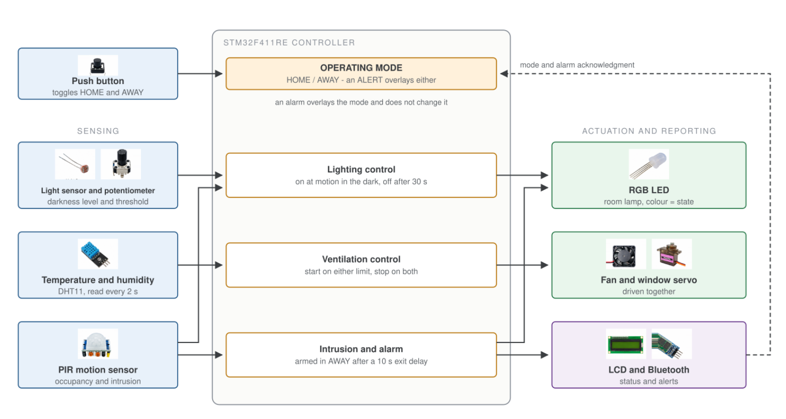
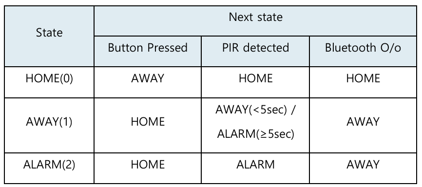
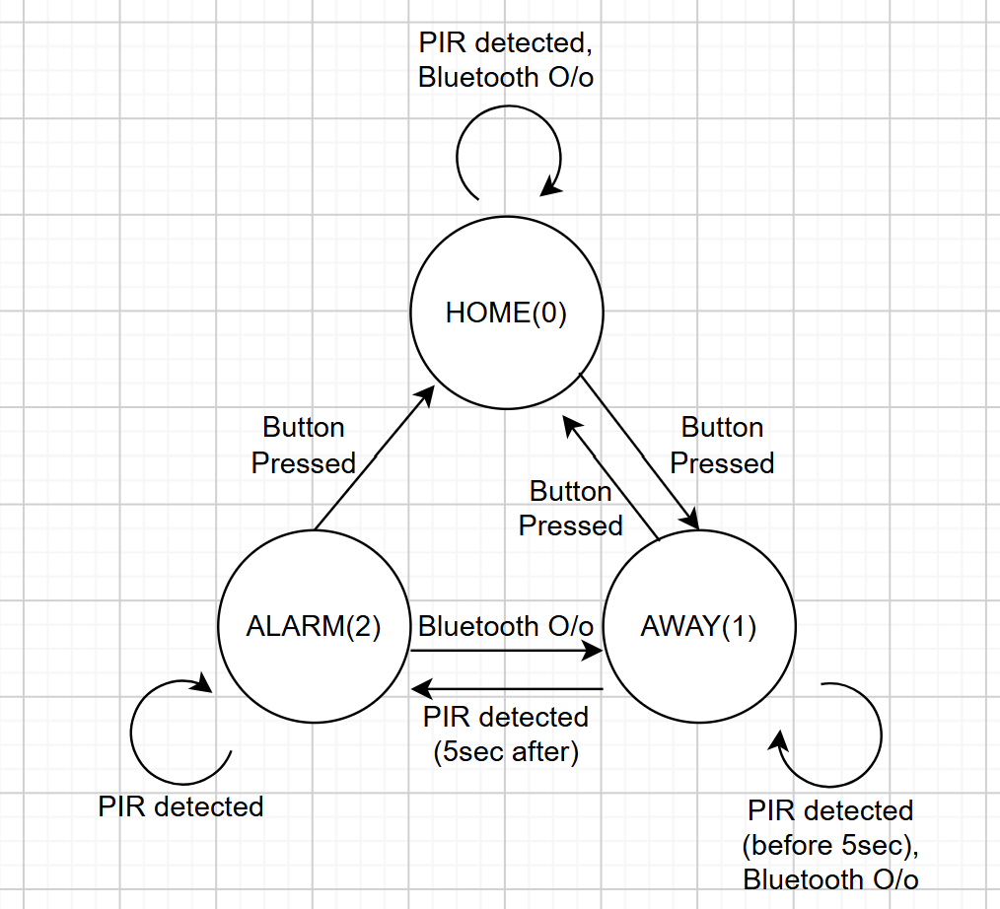
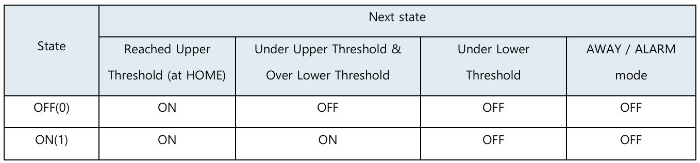
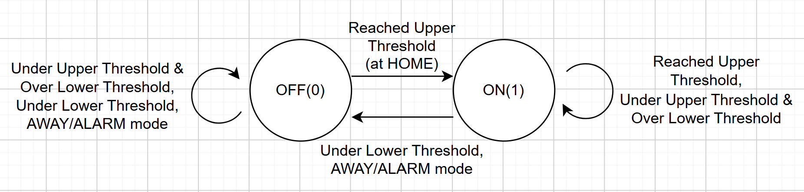
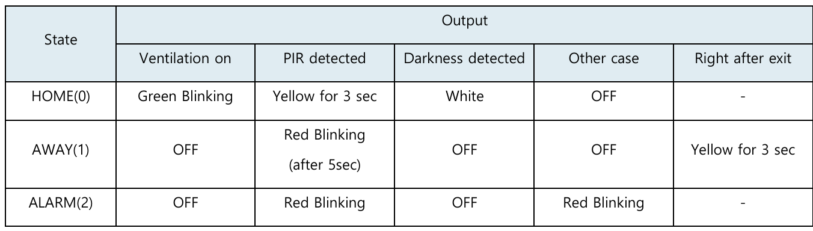

## Smart-Home Management System

Date: 2026-11-10


### **I. Introduction**

-----

##### Overview

Design an STM32-based smart home system that provides motion-based lighting, temperature and humidity ventilation, and away-mode intrusion detection

*Figure 1. Smart home concept illustration.*



*Figure 2. System overview with the given sensors, displays and actuators.*

##### Requirements

**Hardware**

| Category           | Component                           | Qty         | Notes                                                                |
| ------------------ | ----------------------------------- | ----------- | -------------------------------------------------------------------- |
| **MCU**            | STM32 Nucleo-F411RE board           | 1           | Makes all control decisions                                          |
| **Digital Sensor** | DHT11 temperature / humidity sensor | 1           | Needs an external pull-up on the data line                           |
|                    | PIR motion sensor                   | 1           | Detects intruder                                                     |
|                    | Push button                         | 1           | Toggles HOME / AWAY                                                  |
| **Analog Sensor**  | Light sensor                        | 1           | light detection                                                      |
|                    | Air-quality sensor                  | 1           | Supplied, not required; see the optional extension                   |
|                    | Potentiometer                       | 1           | Sets the darkness threshold                                          |
| **Display**        | I2C LCD                             | 1           | use provided I2C library                                             |
| **Actuator**       | RGB LED                             | 1           | Three digital outputs, one per colour. Check common anode or cathode |
|                    | Ventilation fan                     | 1           | needs DC motor driver                                                |
|                    | Window servo motor                  | 1           | Operates the ventilation window; separate supply                     |
| **Communication**  | Bluetooth module                    | 1           | Serial link to USART6                                                |
| **Others**         | Door lock                           | 1           | Supplied, not required                                               |
|                    | Ceiling fan                         | 1           | Supplied, not required                                               |
|                    | Acrylic home model, motor drivers   | As supplied |                                                                      |


**Software**

- IDE: VS Code

- Complier: PlatformIO `framework=cmsis`

- Library: EC-STM32F4

- Extra Library: EC-STM32F4 `ecDHT11`, `ecI2C2`

  - Refer to `TU_DHT11.c` and `TU_I2C_LCD.c` 


### II. Problem

-----

##### Overview

Build a smart home system that controls the lighting, ventilation and alarms under the following conditions.

| State     | Condition                  | Required behavior                                                                                                          |
| --------- | -------------------------- | -------------------------------------------------------------------------------------------------------------------------- |
| **HOME**  | `mode == HOME`             | Provide motion-based lighting and run ventilation as needed. Motion is not an intrusion.                                   |
| **AWAY**  | `mode == AWAY`             | Suspend the motion-based lighting and monitor motion as intrusion. Ventilation keeps working.                              |
| **ALARM** | `alarm == INTRUSION_ALARM` | Show the warning and perform the matching response. Clearing the alarm returns to previous mode, HOME or AWAY as selected. |

The push-button selects HOME/AWAY. AWAY starts a **5 s exit delay** before intrusion monitoring, so the user can leave. Show the countdown on the LCD.


##### Basic Functions

| Function        | Required behavior                                                                                                                                                                                                        |
| --------------- | ------------------------------------------------------------------------------------------------------------------------------------------------------------------------------------------------------------------------ |
| **Lighting**    | In HOME, when PIR detects motion at the entrance, light the RGB LED **yellow** for 3 seconds. When the light sensor in the living room reports darkness, turn on **White** LED. Under mode='Intrusion' blink **Red** LED |
| **Ventilation** | In HOME only, run the ventilation fan and open the servo window when temperature **or** humidity exceeds its upper threshold. Stop and close only after **both** readings fall below their lower thresholds              |
| **Intrusion**   | Under mode == AWAY only, PIR motion detection raises `INTRUSION_ALARM`.                                                                                                                                                  |
| **Button**      | Pressing the button toggles HOME/AWAY. Acknowledge alarms through Bluetooth, display on LCD                                                                                                                              |
| **LCD**         | Shows the current mode and specific information as instructed                                                                                                                                                            |

> Threshold Settings
>
> - Potentio: around 2760
>
> - Temperature(upper): 40 [deg/C]
>
> - Temperature(lower): 35 [deg/C]
>
> - Humidity(upper): 63 (%)
>
> - Humidity(lower): 60 (%)


##### Light and Display Response

The RBG LED is driven as **three digital outputs**, one per color.

- Away Intrusion: **Red,** blinking every 0.5s

- AWAY countdown: **Yellow**, R=H, G=H for 3 sec

- HOME light on: **White**, R=H, G=H, B=H

- HOME entrance: **Yellow**, R=H, G=H for 3 sec

- HOME veltilation: **Green**, blinking 1 sec

For LCD display, you need to show

- Mode name: HOME, AWAY, ALARM

- Mode = HOME

  - Temp, humidity reading (00°, 00%)

- Mode = HOME+Ventilation

  - Temp, humidity reading, VENT (00°, 00%, VENT)

- Mode = AWAY

  - Away-Countdown

- Mode = ALARM

  - INTRUDER (blink 1 sec)

> Lighting Condition Priority Settings
>
> 1. Ventilation(Green): 습하거나 더운 조건은 움직임 감지보다 덜 지속적으로 발생
> 2. Motion detect(Yellow): 움직임은 밝기보다 더 일시적인 상태라 판단
> 3. Brightness(White): 밝기는 계속 어두울 수도 있고, 밝을 수도 있으므로 후순위 우선순위라 판단

##### Communication Message to server

Using the bluetooth, send a message and display on your laptop's monitor whenever a condition is changed. You may choose the message content.

- Remote Control : You can turn-off the intrusion alarm using bluetooth. e.g. mode=ALARM to mode=AWAY

  - You can choose the command key.

##### Interrupt, Timing and Fault Handling

- Use at least 1 EXTI IRQ
- Use at least 1 timer update event interrupt IRQ (control loop etc), 250msec tick could be appropriate for this project.
- Report invalid sensor readings and watch out for a long blocking delays.
- Use JADC intead of ADC. Choose appropriate JADC TRIG Timing.

### III. Hardware Configuration

----

##### MCU Configuration

| Function        | Peripheral                                      | Pin (Arduino)                                                       | Configuration            |
| --------------- | ----------------------------------------------- | ------------------------------------------------------------------- | ------------------------ |
| Ventilation fan | TIM2 CH1 (PWM)                                  | PA_15 (D32)                                                         | 1 ms (1 kHz)             |
| Window servo    | TIM3 CH2 (PWM)                                  | PC_7 (D9)                                                           | 20 ms (50 Hz)            |
| RGB LED, red    | GPIO output                                     | PB_13 (D23)                                                         | DOUT                     |
| RGB LED, green  | GPIO output                                     | PB_14 (D35)                                                         | DOUT                     |
| RGB LED, blue   | GPIO output                                     | PB_15 (D36)                                                         | DOUT                     |
| Control loop    | TIM1 (update interrupt)                         | none                                                                | 250 ms                   |
| Light sensor    | ADC1 injected, result in JDR1                   | PA_0 (A0)                                                           | TIM5 TRGO of 125 ms      |
| Potentiometer   | ADC1 injected, result in JDR2                   | PC_1 (A4)                                                           | TIM5 TRGO of 125 ms      |
| DHT11           | GPIO, bit-banged (SysTick µs timing, `ecDHT11`) | PA_6 (D12)                                                          | one read per 2 s         |
| Push button     | GPIO + EXTI10                                   | PA_10 (D2)                                                          | interrupt on press       |
| PIR motion      | GPIO + EXTI3                                    | PB_3 (D3)                                                           | interrupt on rising edge |
| I2C LCD         | I2C1                                            | PB_8 (D21, SCL), PB_9 (D20, SDA)                                    | —                        |
| Bluetooth       | USART6                                          | PA_11 (D18, TX), PA_12 (D19, RX)                                    | 9600 baud                |
| Debug serial    | USART2                                          | PA_2 (TX), PA_3 (RX)                                                | —                        |
| Spare           | TIM4 CH1, CH2                                   | PB_6, PB_7 free (PB_7 only until the optional ceiling fan is added) | —                        |


##### Circuit Diagram

Draw a computer-generated circuit diagram showing necessary parts (sensor, actuator etc).

Add a circuit diagram or results image in the project report.


### IV. Algorithm

----

##### Logic Design

In the report, you need to explain concisely how you designed the system with state tables/diagram or flow-chart.

Listing all necessary states (states, input, output etc) to implement this design problem.

Listing all necessary conditional FLAGS for programming. (매크로, 플래그)

Showing the logic flow from the initialization

and more


===================================

**Mode Logic**

The system has three modes: HOME, AWAY, and ALARM. Mode transitions are controlled by button inputs, PIR detection, and Bluetooth command inputs. (In AWAY mode, PIR detection is ignored during the first 5 seconds)

<p align="center">
  
</p>
<p align="center">Table 1. Mode state transition table.</p>

<p align="center">
  
</p>
<p align="center">Figure 3. Mode state transition diagram.</p>

**Ventilation Logic**


Ventilation is controlled by using two states, ON and OFF. Used upper and lower thresholds to prevent frequent switching. (Ventilation is disabled in AWAY and ALARM modes)

<p align="center">
  
</p>
<p align="center">Table 2. Ventilation state transition table.</p>

<p align="center">
  
</p>
<p align="center">Figure 4. Ventilation state transition diagram.</p>

**Lighting Logic**

The RGB LED output is determined by the current mode and priorities. Unlike mode and ventilation control, lighting control does not involve state transitions. Instead, the LED output changes depending on the conditions.

In HOME mode, the priority is ventilation (green), PIR detection (yellow), and darkness (white). In AWAY and ALARM modes, the LED indicates the exit delay or intrusion warning.

<p align="center">
  
</p>
<p align="center">Table 3. Lighting priority and output table.</p>


##### Code

Bitna Won: https://github.com/bitna-cmd/EC-STM32F4-22400462/blob/main/README.md

Yerin Choi: https://github.com/choie2022/EC-STM32F4-22400741/blob/main/README.md


**void setup(void)**

시스템에 필요한 센서와 출력 장치를 초기화하는 함수이다. Fan과 서보 모터는 PWM으로 제어하고, photo sensor와 potentiometer는 JADC 함수들을 이용해 값을 측정한다. 또한 버튼과 PIR 센서에는 EXTI를 적용하였다. Tera term의 STM창에는 USART2를 통해 메세지가 뜨게 하여 상태를 확인하였고, Bluetooth 통신을 위해 USART6를 초기화하였다. 또한 TIM1을 250ms 주기로 설정하여 제어 루프의 기준 타이머로 사용하였다.

```c
void setup(void){
    RCC_PLL_init();     // set system clock as 84MHz
    SysTick_init();     //Initialize SysTick timer

    // Initialize Fan PWM: TIM4 CH2, 1 ms period
    PWM_init(FAN, 1);
    PWM_duty(FAN, 0.0f);

    // Initialize Window PWM: TIM3 CH2, 20ms period
    PWM_init(WINDOW, 20);
    PWM_pulsewidth_us(WINDOW, SERVO_MID_US);

    // Initialize LED
    GPIO_init(LED_R, OUTPUT);   // Red
    GPIO_init(LED_G, OUTPUT);   // Green
    GPIO_init(LED_B, OUTPUT);   // Blue

    // Initialize lighting trigger timer 
    JADC_init(LIGHT);
    JADC_init(POT);
    PinName_t seqCHn[2] = {LIGHT, POT};
    JADC_sequence(seqCHn, 2);   
    JADC_trigger_init(TIM5, 125, ADC_RISE);

    // Initialize DHT sensor (temperature, humidity)
    DHT11_init(DHT11);  

    // Initialize button pin (GPIO+EXTI10)
    GPIO_init(BUTTON, INPUT);
    EXTI_init(BUTTON, FALL, 1);

    // Initialize PIR (motion) pin (GPIO+EXTI3)
    GPIO_init(PIR, INPUT);
    EXTI_init(PIR, RISE, 2);

    // Initialize I2C LCD
    I2C1_init();        // Initialize I2C1
    LCD_init();         // Initialize LCD display

    // Initialize Debug Serial USART2
    USART_init(USART2, PA_2, PA_3, 9600);
    // Initialize Bluetooth USART6
    USART_init(USART6, PA_11, PA_12, 9600);

    TIM_UI_init(TIM1, 250);    // Control Loop Timer for update interrupt as 250msec
}
```

**TIM1_UP_TIM10_IRQHandler()**

TIM1의 Update Interrupt를 이용해 250ms마다 current_count를 증가시키도록 하였다. 이 카운터를 활용하여 각 기능의 동작 시간을 계산하였으며, 10카운트마다 dht_flag를 update하여 DHT11을 2.5초 간격으로 측정하도록 하였다. Ventilation 함수와 LED 제어 함수도 이 인터럽트에서 주기적으로 실행시켰다.

```c
// Controller loop
void TIM1_UP_TIM10_IRQHandler(void){
    if(is_UIF(TIM1)){
        current_count++;

        // DHT11 flag control (to read every 2.5sec)
        if(current_count%10 == 0){
            dht_flag = 1;
        }

        // operate ventilation
        ventilation();
        // operate LED action
        lighting();
        // clear timer interrupt
        clear_UIF(TIM1);
    }   
}
```

##### **int main(void)**

main 함수에서는 모드와 환기 상태의 변화를 확인하고 serial monitor에 띄우며, LCD display update 온습도 측정을 수행한다. 이전 상태를 저장하는 변수 previous_mode와 previous_vent를 사용하여 상태가 바뀌었을 때 Bluetooth 메시지를 전송하도록 하였다.

DHT11은 dht_flag가 1일 때만 측정하며, 이 간격은 current_count가 10만큼 증가하는 간격이므로 2.5sec이다. DHT11이 정상적으로 읽은 경우 온습도값을 갱신한다. 측정에 실패하면 Reading Error 메시지를 출력하고 이전 측정값은 유지한다.

```c
int main(void){
    setup();


    // Does the LCD answer ?  A module with the wrong address stays blank.
	err = I2C1_write(LCD_ADDR, LCD_BACKLIGHT);
	if(err)	printf("LCD NOT found. Check the wiring\r\n");
	else	printf("LCD found at 0x%02X\r\n", LCD_ADDR);

    previous_mode = mode;
    previous_vent = vent_flag;

    send_status("MODE: HOME\r\n");

    // first line
	LCD_setCursor(0, 0);
	LCD_print("EC2026  I2C LCD");

    while(1){

        // Check mode change
        if(mode != previous_mode){
            uint8_t old_mode = previous_mode;
            previous_mode = mode;
            if(mode == HOME){
                send_status("MODE: HOME\r\n");
            }
            else if(mode == AWAY){
                if(old_mode == ALARM){
                    send_status("ALARM CLEARED\r\n");
                }
                send_status("MODE: AWAY\r\n");
            }
            else if(mode == ALARM){
                send_status("WARNING: INTRUSION!\r\n");
                send_status("MODE: ALARM\r\n");
            }
        }
        // Check ventilation change
        if(vent_flag != previous_vent){
            previous_vent = vent_flag;
            if(vent_flag == 1){
                send_status("VENTILATION ON\r\n");
            }
            else{
                send_status("VENTILATION OFF\r\n");
            }
        }
        // LCD update
        if(current_count != last_lcd_count){
            last_lcd_count = current_count;     // when current count is updated, lcd display update
            lcd();
        }

        // check DHT reading every 2.5sec
        if(dht_flag == 1){
            dht_flag = 0;
            err = DHT11_read();
            // check DHT reading is OK
            if(err == DHT11_OK){
                temp = DHT11_temperature();
                humi = DHT11_humidity();
                printf("Temperature=%d, Humidity=%d, potentio: %f \r\n", temp, humi, pot_value);
            } else {
                printf("DHT READING ERROR\r\n");
            } 
        }
    }
}
```

**void EXTI15_10_IRQHandler(void)**

버튼 입력의 Falling Edge를 이용해 HOME과 AWAY 모드를 전환하도록 하였다. HOME에서 AWAY로 변경할 때는 exit_count를 update하여 외출 후 5초 뒤부터 침입을 감지할 수 있도록 하였다. 반대로 AWAY 또는 ALARM에서 버튼을 누르면 HOME으로 돌아오고, 기존 침입 및 움직임 감지 Flag를 초기화한다.

```c
// Button function - change mode (HOME / AWAY), flags and count when button is pressed
void EXTI15_10_IRQHandler(void){
    if(is_pending_EXTI(BUTTON)){
        clear_pending_EXTI(BUTTON);
        // Change to current mode and update flags and count
        if(mode == HOME){
            mode = AWAY;            // change mode to AWAY
            exit_flag = 1;          // report exit
            exit_count = current_count;     // store current count in exit count
            intrusion_flag = 0;     // clear intrusoin flag
            pir_flag = 0;           // clear PIR flag
        } else if (mode == AWAY || mode == ALARM){
            mode = HOME;            // change mode to HOME
            intrusion_flag = 0;     // clear intrusion flag
            pir_flag = 0;           // clear PIR flag
        }
    }
}
```

**void EXTI3_IRQHandler(void )**

PIR 센서는 Rising Edge 인터럽트를 이용하여 움직임을 감지한다. HOME 모드에서는 움직임을 감지하면 pir_flag를 update하고 LED 제어를 위한 시작 시점의 current_count를 저장한다.

AWAY 모드에서는 외출 후 5초가 지났는지 먼저 확인하고, 해당 시간이 지난 후 움직임이 감지되면 intrusion_flag를 설정하여 ALARM 모드로 전환한다. 이를 통해 동일한 PIR 센서 입력을 받아도 모드에 따라 다른 동작을 수행하도록 구현하였다.

```c
// PIR function: check is motion detected
void EXTI3_IRQHandler(void){
    if(is_pending_EXTI(PIR)){
        // clear EXTI pending
        clear_pending_EXTI(PIR);

        if(mode == HOME){
            pir_start_count = current_count;    // for LED displaying time 
            pir_flag = 1;
            printf("MOTION DETECTED\r\n");
        } else if (mode == AWAY){
            // intrusion should be detected after 5 sec from exit
            if((current_count - exit_count)>=20){
                intrusion_flag = 1;
                intrusion_count = current_count;
                mode = ALARM;
                printf("WARNING: INTRUSION\r\n");
            }
        }
    }
}
```

**void ADC_IRQHandler(void)**

조도센서와 가변저항의 값을 측정하기 위해 JADC 관련 함수를 사용하였다. TIM5를 125ms 주기로 설정하여 analog to digial 변환을 실행하고, 변환이 완료되면 각각의 값을 읽어 저장한다.

측정한 두 값은 lighting()에서 white light를 켜기 위해 비교하며, potentiometer를 통해 조명이 켜지는 밝기 기준을 조절할 수 있도록 하였다.

```c
// Read the current brightness and standard brightness by JADC
void ADC_IRQHandler(void){
    if(is_ADC_JEOC()){
        light_value = JADC_read(1);
        pot_value = JADC_read(2);
        clear_ADC_JEOC();
    }
}
```

**void ventilation(void)**

온도 또는 습도가 Upper Threshold 이상이 되면 팬을 작동시키고 vent_flag를 1로 설정하였다. 이후 측정값이 Upper Threshold 아래로 내려가더라도 두 값이 모두 Lower Threshold 미만이 되기 전까지는 기존 환기 상태를 유지하도록 임계치를 적용하였다.

설정한 Upper Threshold는 온도 30°C, 습도 55%이고, Lower Threshold는 온도 28°C, 습도 52%이다.

```c
// TIM4 fan control
// The current temparature and humidity are above upper threshold
    if(temp>=TRSH_TEMP_UPPER || humi>=TRSH_HUMI_UPPER){
        PWM_duty(FAN, 0.5f);
        vent_flag = 1;
    // The current temparature and humidity are above lower threshold
    } else if ((temp>=TRSH_TEMP_LOWER || humi>=TRSH_HUMI_LOWER) && vent_flag == 1) {
        PWM_duty(FAN, 0.5f);
    // The current temparature and humidity are below lower threshold
    } else {
        PWM_duty(FAN, 0.0f);    // turn off fan
        vent_flag = 0;
    }
```

서보모터는 TIM3의 PWM 신호를 이용해 창문을 열고 닫도록 하였다. 250ms마다 실행되는 제어 루프에서 3카운트마다 각도를 10°씩 변경하고, 각도에 해당하는 PWM Pulse Width를 계산하였다. AWAY와 ALARM 모드에서는 팬을 정지시키고 창문을 닫도록 설정하였다.

```c
// TIM3 window control
if(current_count%3 == 0){
    // check threshold condition
    // The current temparature and humidity are above upper threshold
    if (temp>=TRSH_TEMP_UPPER || humi>=TRSH_HUMI_UPPER){
        if (angle < SERVO_MAX_ANGLE)
            angle += 10;    // increase angle upto maximum angle
    // The current temparature and humidity are above lower threshold
    } else if ((temp>=TRSH_TEMP_LOWER || humi>=TRSH_HUMI_LOWER) && vent_flag == 1) {
        if (angle < SERVO_MAX_ANGLE)
            angle += 10;    // increase angle upto 90 deg
    // The current temparature and humidity are below lower threshold
    } else {
        if(angle > 0)
            angle -= 10;    // decrease angle down to 0 deg
        vent_flag = 0;
    }
    // update pulsewidth of servo motor of window
    pulsewidth = SERVO_MID_US + angle * (SERVO_MAX_US - SERVO_MID_US) / SERVO_MAX_ANGLE;
    PWM_pulsewidth_us(WINDOW, pulsewidth);
}
```

**void lighting(void)**

RGB LED는 시스템 상태에 따라 서로 다른 색상을 출력하도록 하였다. 여러 조건이 동시에 발생할 수 있기 때문에 HOME 모드에서는 환기 상태, PIR 감지, 주변 밝기 순서로 우선순위를 설정하였다.

환기가 작동 중이면 초록색 LED가 1초 간격으로 점멸하고, PIR 센서가 움직임을 감지하면 노란색 LED가 약 3초 동안 켜지도록 하였다. 두 조건에 해당하지 않고 주변이 어두운 경우에는 흰색 LED를 켜도록 하였다.

```c
if(mode == HOME){
    if(vent_flag == 1){
        all_led_off();

        if((current_count/4)%2 == 0){
            GPIO_write(LED_G, HIGH);
        } else {
            GPIO_write(LED_G, LOW);
        }
    }
    else if(pir_flag == 1){
        GPIO_write(LED_R, HIGH);
        GPIO_write(LED_G, HIGH);
        GPIO_write(LED_B, LOW);
    }
    else if(light_value >= pot_value){
        GPIO_write(LED_R, HIGH);
        GPIO_write(LED_G, HIGH);
        GPIO_write(LED_B, HIGH);
    }
    else{
        all_led_off();
    }
}
```

AWAY 모드로 전환한 직후에는 노란색 LED를 3초 동안 켜고, 이후 침입이 발생하면 빨간색 LED가 점멸하도록 하였다. 각 동작의 시작 시점을 별도로 저장하고 현재 카운트와 비교하여 동작 시간을 관리하였다.

```c
// AWAY / ALARM mode
if(exit_flag == 1){
    GPIO_write(LED_R, HIGH);
    GPIO_write(LED_G, HIGH);
    GPIO_write(LED_B, LOW);

    if((current_count - exit_count) >= 12){
        exit_flag = 0;
        all_led_off();
    }
}
else if(intrusion_flag == 1){
    GPIO_write(LED_G, LOW);
    GPIO_write(LED_B, LOW);

    if(current_count%2 == 0){
        led_toggle(LED_R);
    }
}
```

**void lcd(void)**

LCD에는 현재 모드에 따라 서로 다른 정보를 출력하도록 하였다. HOME 모드에서는 온도와 습도를 표시하고, 환기 중에는 VENT를 추가로 표시한다.

AWAY 모드에서는 외출 후 5초 동안 카운트다운을 표시하고, ALARM 모드에서는 MODE: ALARM과 INTRUDER 메시지를 출력한다. 경고 메시지는 intrusion_count를 기준으로 1초 간격으로 점멸하도록 구현하였다.

```c
// LCD display function
void lcd(void){
    if(mode == ALARM){
        LCD_setCursor(0,0);                 // first row
        LCD_print("MODE: ALARM     ");
        LCD_setCursor(0,1);                 // second row
        // Blink message every 1sec
        if(((current_count - intrusion_count)/4)%2 == 0){
            LCD_print("INTRUDER      ");
        } else {
            LCD_print("              ");
        }
        return;
    }
    // store message in 'lcd_line'
    snprintf(lcd_line, sizeof(lcd_line), "TEMP:%lu HUMI:%lu", (unsigned long)temp, (unsigned long)humi);
    LCD_setCursor(0, 0);    // first row
    LCD_print(lcd_line);    // display message on LCD
    LCD_setCursor(0, 1);    // second row
    if(mode == HOME){
        LCD_print("MODE: HOME      ");
        LCD_setCursor(12, 1);
        // If ventilation on, display "VENT"
        if (vent_flag == 1){
            LCD_print("VENT");
        }
        return;
    } else {
        LCD_print("MODE: AWAY      ");
        LCD_setCursor(12, 1);
        
        // Display count from 5 to 1 for 5 sec
        if(current_count - exit_count < 20){
            snprintf(lcd_line, sizeof(lcd_line), "%lu",
                     (unsigned long)(5 - (current_count - exit_count) / 4));
            LCD_print(lcd_line);
        }
        return;
    }
}
```

**void USART6_IRQHandler(void)**

Bluetooth 통신에는 USART6를 사용하였다. Bluetooth를 통해 문자를 수신하면 해당 문자를 읽어 USART2와 USART6로 Echo하도록 구현하였다.

또한 ALARM 모드에서 'O' 또는 'o'를 수신하면 침입 경보를 해제하고 AWAY 모드로 돌아가도록 하였다. 이를 통해 Bluetooth를 이용한 원격 경보 해제 기능을 구현하였다.

```c
// USART6 is connected to PC through STM port
void USART6_IRQHandler(void){
    if(is_USART_RXNE(USART6)){   
        PC_data = USART_read(USART6);    // Read one character from USART6->DR

        // Echo the received character to both serial terminals
        // USART2 -> STM PC terminal & USART6 -> Bluetooth terminal
        USART_write(USART2, &PC_data,1);   // Echo received character to local PC
        USART_write(USART6, &PC_data,1);   // show recieved character to Tera Term

		// Control warning flag which are received through Bluetooth
		if((PC_data == 'O' || PC_data == 'o') && mode == ALARM){
			intrusion_flag = 0;
            mode = AWAY;
        }
    }
}
```

**void send_status(void)**

상태 변경 메시지를 Bluetooth와 PC 터미널에 동시에 출력하기 위해 'send_status()' 함수를 작성하였다. USART6을 통해 Bluetooth로 메시지를 전송하고, printf()를 이용해 USART2에 연결된 PC에서도 같은 내용을 확인할 수 있도록 하였다.

이 함수를 main()의 상태 변경 감지 부분에서 호출하여 모드 변경과 환기 시작 및 종료 등의 정보를 전달하도록 구성하였다.

```c
// Send message to display on bluetooth (tera term)
void send_status(const char *msg){
    // Bluetooth
    USART_write(USART6, (uint8_t*)msg, strlen(msg));

    // PC TeraTerm
    printf("%s", msg);
}
```

**void all_led_off(void)**

RGB LED의 모든 출력을 LOW로 설정하는 함수를 별도로 작성하였다. LED 제어 조건이 변경되거나 조명을 끄는 상황에서 이 함수를 호출하여 이전 LED 상태가 남지 않도록 하였다. 특히 여러 색상을 하나의 RGB LED로 표현하기 때문에 각 색상의 상태를 초기화하는 과정이 필요하였다.

```c
// Turn off all LED (R,G,B)
void all_led_off(void){
    GPIO_write(LED_R, LOW);
    GPIO_write(LED_G, LOW);
    GPIO_write(LED_B, LOW);
    return;
}
```

**Summary**

전체 시스템은 TIM1의 250ms 주기 인터럽트를 기준으로 동작한다. 또한 센서별 인터럽트와 상태 Flag를 이용해 각 기능을 제어하도록 설계하였다. PIR과 버튼은 외부 인터럽트로 처리하고, 조도센서는 JADC를 이용해 주기적으로 측정하였다. 온습도 측정은 메인 반복문에서 별도로 수행하여 DHT11 측정 중 발생하는 대기 시간이 타이머 인터럽트에 직접 영향을 주지 않도록 하였다.

또한 HOME, AWAY, ALARM 모드와 vent_flag, pir_flag, intrusion_flag 등의 상태 변수를 활용하여 센서 입력과 출력 장치의 동작을 연결하였다. 이를 통해 여러 기능이 동시에 필요한 상황에서도 정해진 조건과 우선순위에 따라 시스템이 동작하도록 구성하였다.


### V. Results and Analysis

-----

##### Results

**Demo Video Link: []()**

Show important result images to explain your output for key processes.

Add a circuit diagram or results image in the project report.

##### Analysis

Compare expected and observed behavior, report measured thresholds and response, and describe any limitations or failures, if there is any


### VI. Reference

-----

List all external sources used, including datasheets, libraries, diagrams, websites, and reused code, with links or sufficient identifying details.

> If you got AI assistance, need to include how you have used it, include the prompt link.


### Appendix

-----

1. Additional Library

**DHT11 API:** `ecDHT11.h`

- [Example Code for DHT](https://github.com/ykkimhgu/EC-student/blob/main/tutorial/tutorial-student/TU_DHT11.c)
- `DHT11_read()` blocks for about 25 ms, of which roughly 5 ms runs with interrupts off.
- Do not call it from inside an interrupt handler.
- Treat `DHT11_ERR_CHECKSUM` and `DHT11_ERR_NO_REPLY` as invalid reading: hold the last valid values, report the fault, and count the failures for you report.
- 

**I2C API:** `ecI2C.h`

- [Example Code for I2C LCD](https://github.com/ykkimhgu/EC-student/blob/main/tutorial/tutorial-student/TU_I2C_LCD.c)


2. Other Appendix

   Include supporting measurements, calibration data, configuration tables, or supplementary diagrams that are too detailed for the main report.

3. Troubleshooting

   Describe significant hardware or software problems, how they were diagnosed and resolved, and any unresolved issues.
