# LAB: EXTI & SysTick(eval board)

##

**Date:** 2026-10-02

**Author/Partner:** Won Bitna

**Demo Video:** https://youtu.be/e9Rxjhfbl_I

### Introduction

In this lab, you are required to create two simple programs using interrupt:

(1) Display the number counting from 0 to 9 with Button Press

(2) Counting at a rate of 1 second

#### Requirement

**Hardware**

* MCU
  * NUCLEO-F411RE
* Eval Board (JKIT)
* Actuator/Sensor/Others:

**Software**

* PlatformIO, CMSIS, EC\_HAL library

***

## Problem 0: STM-Arduino



We are going to create a simple program that turns LED(LD2) on triggered by **External Interrupt** of user button(BT1) (on NUCLEO-64, not on JKIT)

[**attachInterrupt()**](https://www.arduino.cc/reference/en/language/functions/external-interrupts/attachinterrupt/)

```c
attachInterrupt(digitalPinToInterrupt(pin), ISR, mode)
```

* `digitalPinToInterrupt(pin)`: translate the digital pin to the specific interrupt number.
* `ISR`: a function called whenever the interrupt occurs.
* `mode`: defines when the interrupt should be triggered. (LOW, CHANGE, RISING, FALLING)

#### Procedure

1. Create a new project under the directory `\repos\EC\lab\`
2. Open *Arduino IDE* and Create a new program named as ‘**TU\_arduino\_EXTI.ino**’.
3. Write the following code.
   * Compare this code with the polling method in [Lab: GPIO-STM-Arduino](https://ykkim.gitbook.io/ec/ec-course/lab/lab-gpio-digital-inout-eval#example-code)

```c
const int btnPin = 3;
const int ledPin =  13; 

int btnState = HIGH;

void setup() {
    pinMode(ledPin, OUTPUT);
    pinMode(btnPin, INPUT_PULLUP);
    attachInterrupt(digitalPinToInterrupt(btnPin), blink, CHANGE);
}

void loop() {
    // blank
}


void blink(){
    btnState = digitalRead(btnPin);

    if (btnState == HIGH)
        digitalWrite(ledPin, LOW);
    else 
        digitalWrite(ledPin, HIGH);
}
```

> The user button pin is `PC13`, but this pin cannot be used in arduino. So, you should connect `PC13` to `pinName` `D3` by using a wire.

<figure><figcaption></figcaption></figure>

4. Click on **upload** button.
5. Whenever the user button(BT1) is pressed (at fall), LED should be ON. When the button is released, the LED should be OFF.


#### Results

<table align="center">
  <tr>
    <td align="center">
      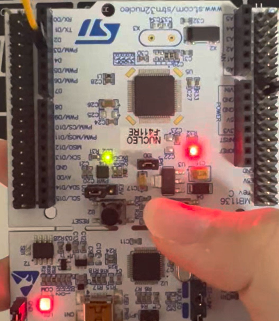
    </td>
    <td align="center">
      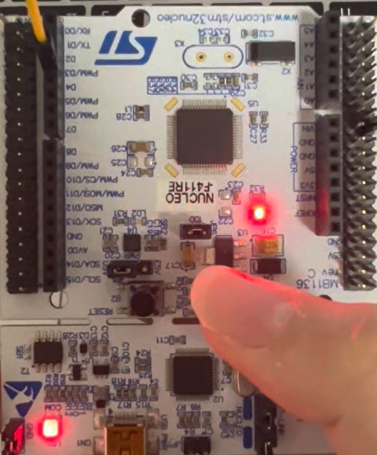
    </td>
  </tr>
  <tr>
    <td align="center">(a) Prob0_LED_OFF</td>
    <td align="center">(b) Prob0_LED_ON</td>
  </tr>
  <tr>
    <td colspan="2" align="center"><b>Prob0: STM-Arduino</b></td>
  </tr>
</table>


***

## Prelab: EXTI Register Setting

Do the PreLAB: External Interrupt

* It is about creating `ecEXTI.*` library
* Fill-in the blanks in the given header files
* Submit the Prelab report

```c
void EXTI_init(PinName_t pinName, uint32_t trig_type, uint32_t priority);
void EXTI_enable(uint32_t pin);  // mask in IMR
void EXTI_disable(uint32_t pin);  // unmask in IMR
uint32_t  is_pending_EXTI(uint32_t pin);
void clear_pending_EXTI(uint32_t pin);
```

## Problem 1: Counter on 7-Segment display using EXTI

#### Problem

Create a code to display the counter-up from 0 to 9 and repeating.

* Count up at the rate of 1 sec.
  * Use `delay_ms()` in the main loop
* Pause the counting when SW2 is pressed
* Resets to zero when the push button is pressed: SW1
  * Must use External Interrupts for SW1, SW2

**\* Challenge : Extend the count-up number : 0 to 59**

#### Procedure

1. Connect the evaluation board [(JKIT-NUCLEO) ](https://ykkim.gitbook.io/ec/ec-course/hardware/stm32f-evaluation-board#reference-manual)to the MCU.
2. Make sure that your library are in `EC\include\`.
   * **ecRCC2.h, ecRCC2.c**
   * **ecGPIO2.h, ecGPIO2.c**
   * **ecSysTick2.h, ecSysTick2.c**
   * **ecEXTI2.h, ecEXTI2.c**
   * **ecSTM32F4v2.h**
3. Create a new project under the directory `EC\lab\`

* Environment: “**LAB\_EXTI”.**
* Source File: “**LAB\_EXTI.c”**

4. You must modify the `platformio.ini` **,** to add new environment.

#### Configuration

Configure the MCU GPIO

| Function                           | Port - Pin                                                   | Configuration                                 |
| ---------------------------------- | ------------------------------------------------------------ | --------------------------------------------- |
| **Button (SW1) on JKIT**           | PD\_2                                                        | DIN, Pull-Up                                  |
| **Button (SW2) on JKIT**           | PA\_4                                                        | DIN, Pull-Up                                  |
| **7-Segment DOUT**                 | <p>PB\_0, PB\_1, PB\_2, PB\_3, PB\_4, PB\_5, PB\_6, PB\_7</p><p>('a'\~'g''dot', respectively)</p> | Push-Pull, No Pull-up-Pull-down, Medium Speed |
| **Selection of 7-Segment Display** | PA\_10 (FND\_0)                                              | DOUT, Push-Pull,                              |

#### Circuit Diagram

> You need to include the circuit diagram (if necessary)


#### Code

Explain your source code with the necessary comments.

```c
// MAIN CODE ONLY
int main(void) {
    MCU_init();
	while (1){
    }
}
```

**Source Code**



```c
/*----------------------------------------------------------------\
@ Embedded Controller by Young-Keun Kim - Handong Global University
Author           : Won Bitna
Created          : 05-03-2021
Modified         : 10-01-2026
Language/ver     : C++ in VS Code

Description      : Tutorial - EXTI & SysTick(eval)
/----------------------------------------------------------------*/

#include "ecSTM32F4v2.h"

uint8_t count = 0;      // Counter number for 7-segment
uint8_t pause = 0;      // Check the counter is pause or not


// MAIN  ----------------------------------------
int main(void) {
    MCU_init();         // Initialize MCU, GPIO, EXTI and SysTick

    while (1){
        // Main loop is empty because main operation is done by interrupts
    }
}


// SW2 interrupt : pause
void EXTI4_IRQHandler(void) {
    if (is_pending_EXTI(SW2_PIN)) {   // Check SW2 interrupt

        pause = !pause;               // Change pause each time SW2 is pressed

        clear_pending_EXTI(SW2_PIN);  // Clear pending flag after interrupt
    }
}


// SW1 interrupt : reset counter
void EXTI2_IRQHandler(void) {
    if (is_pending_EXTI(SW1_PIN)) {   // Check SW1 interrupt

        count = 0;                    // Reset displayed number to 0
        msTicks = 0;                  // Reset tick count to restart 1 sec tick

        clear_pending_EXTI(SW1_PIN);  // Clear pending flag after interrupt
    }
}


// SysTick interrupt : called every 1 ms
void SysTick_Handler(void){

    SysTick_counter();                // Increase msTicks every 1 ms

    if(msTicks == 1000){
        msTicks = 0;                  // Reset tick count for next 1 second

        if(pause == 0){               // Increase count only when it is not paused
            count++;

            if(count > 9)
                count = 0;            // 0 after number 9
        }
    }

    FND_select(0);                    // Select LED0
    FND_display(count);               // Display current count number
}
```



#### Results

<table align="center">
  <tr>
    <td align="center">
      
    </td>
    <td align="center">
      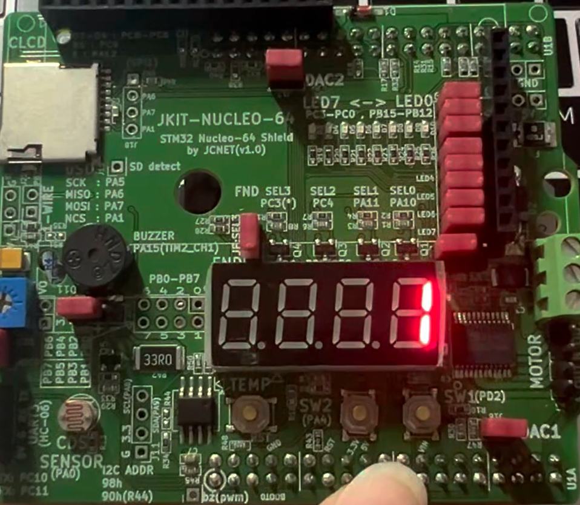
    </td>
  </tr>
  <tr>
    <td align="center">(a) Prob1_7seg_0</td>
    <td align="center">(b) Prob1_7seg_1</td>
  </tr>
  <tr>
    <td align="center">
      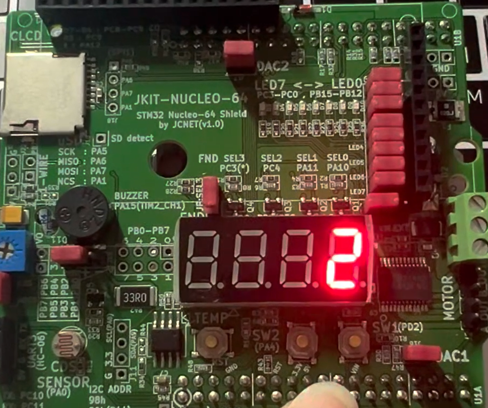
    </td>
    <td align="center">
      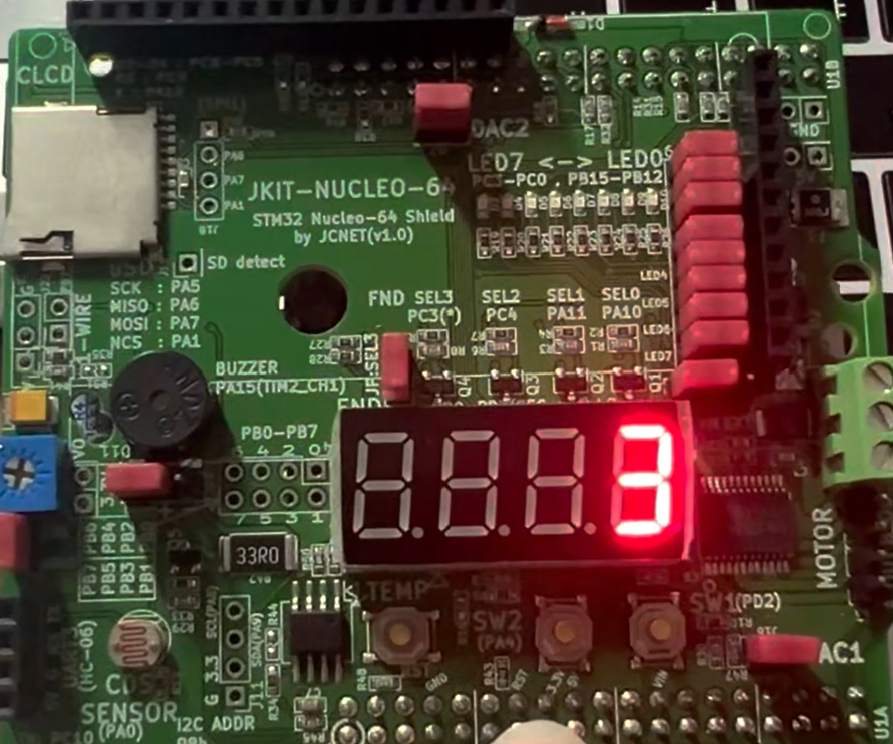
    </td>
  </tr>
  <tr>
    <td align="center">(c) Prob1_7seg_2</td>
    <td align="center">(d) Prob1_7seg_3</td>
  </tr>
  <tr>
    <td align="center">
      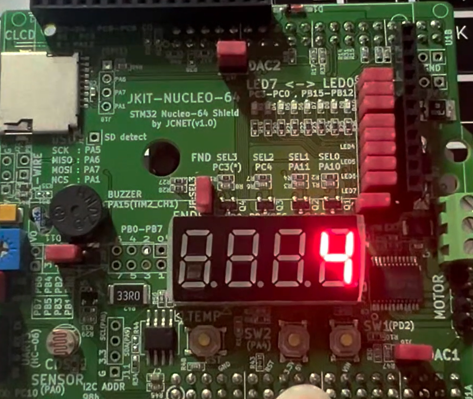
    </td>
    <td align="center">
      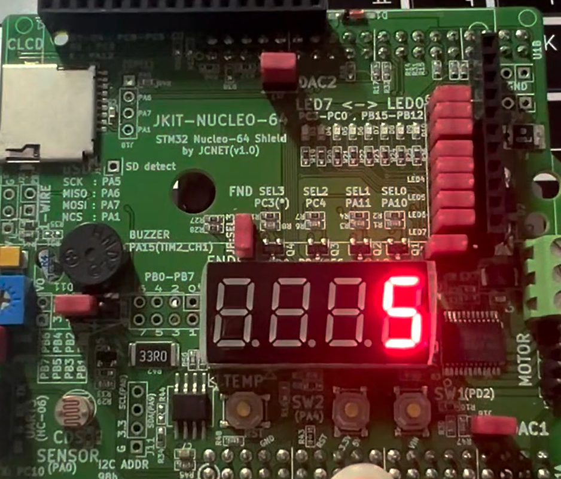
    </td>
  </tr>
  <tr>
    <td align="center">(e) Prob1_7seg_4</td>
    <td align="center">(f) Prob1_7seg_5</td>
  </tr>
  <tr>
    <td align="center">
      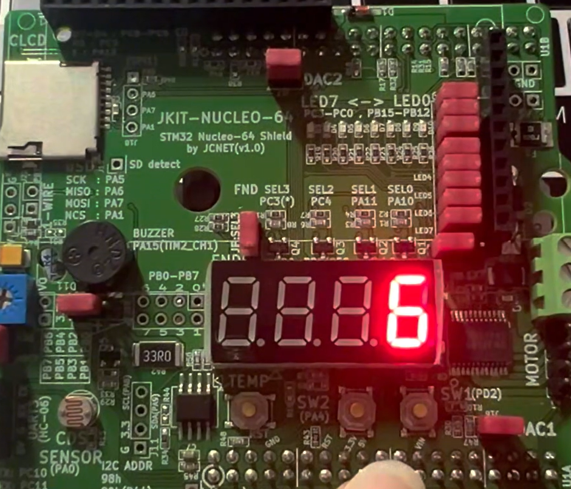
    </td>
    <td align="center">
      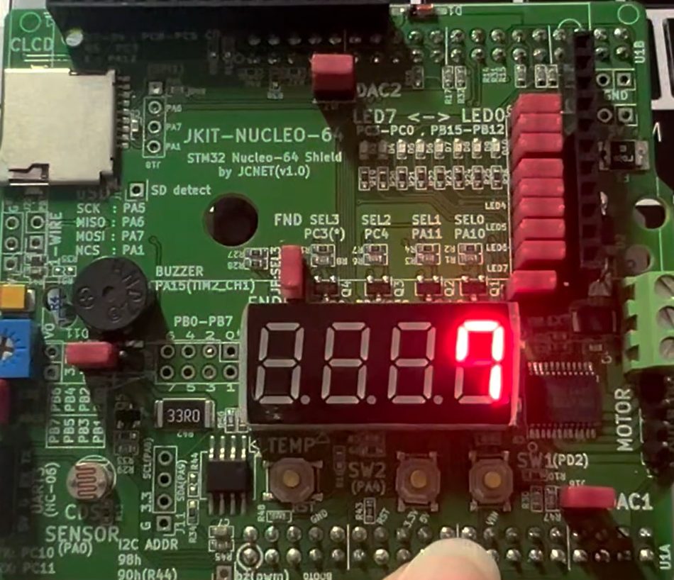
    </td>
  </tr>
  <tr>
    <td align="center">(g) Prob1_7seg_6</td>
    <td align="center">(h) Prob1_7seg_7</td>
  </tr>
  <tr>
    <td align="center">
      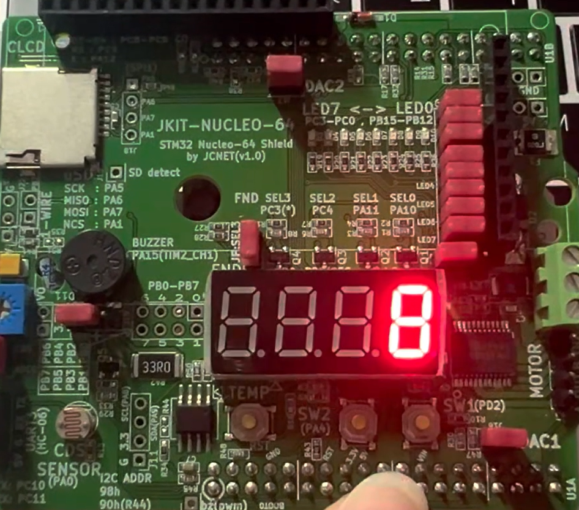
    </td>
    <td align="center">
      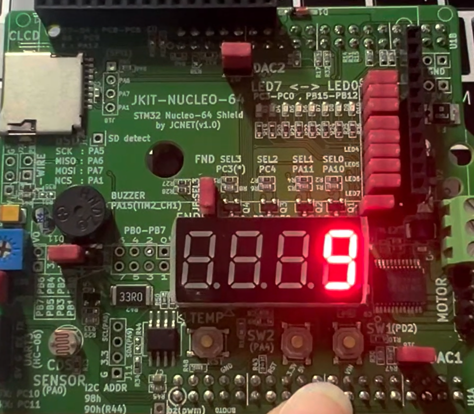
    </td>
  </tr>
  <tr>
    <td align="center">(i) Prob1_7seg_8</td>
    <td align="center">(j) Prob1_7seg_9</td>
  </tr>
  <tr>
    <td colspan="2" align="center"><b>Prob1: Counter on 7-segment display using EXTI</b></td>
  </tr>
</table>

- Demo Video: [demo video link](https://youtu.be/e9Rxjhfbl_I)

#### Discussion

1. Analyze the result and explain any other necessary discussion.
2. We can use two different methods to detect an external signal: polling and interrupt. What are the advantages and disadvantages of each approach?

3. What would happen if the EXTI interrupt handler does not clear the interrupt pending flag? Check with your code

### Reference

Complete list of all references used (github, blog, paper, etc)

```

```

### Troubleshooting

(Option) You can write a Troubleshooting section