# LAB: Timer & PWM

**Date:** 2026-11-04

**Author/Partner:** Won Bitna

**Demo Video:** https://youtu.be/PeiMpBj11Tg

**Github:** https://github.com/bitna-cmd/EC-STM32F4-22400462/blob/main/README.md

## Introduction

In this lab, I created a simple program that control a servo motor and a DC motor with PWM output.

### Requirement

**Hardware**

* MCU
  * NUCLEO-F411RE (disconnected JKIT Eval Board)
* Actuator/Sensor/Others:
  * RC Servo Motor (SG90)
  * DC motor (5V)
  * DC motor driver(LS9110s or L298N)

**Software**

* PlatformIO, CMSIS, EC\_HAL library

***

## Prelab: Timer Out Register

I declared and defined the following functions in my library. 

**Function Definitions**

- ecTIM2.h

```c
#ifndef __EC_TIM2_H
#define __EC_TIM2_H

#include "stm32f411xe.h"
#include "ecPinNames.h"
#include "ecRCC2.h"
#include "ecGPIO2.h"
#include "math.h"

#ifdef __cplusplus
 extern "C" {
#endif /* __cplusplus */


//////////////////////////////////////////////
/* Timer Update Interrupt Configuration     */
//////////////////////////////////////////////

// Timer Update Interrupt Initialization
void TIM_UI_init(TIM_TypeDef* TIMx, uint32_t msec);     // 16-bit  msec < 65,530 msec 
void TIM_UI_init_us(TIM_TypeDef* TIMx, uint32_t usec);  // 16-bit  usec < 65,530 usec 

// Timer Update Interrupt On/OFf
void TIM_UI_enable(TIM_TypeDef* TIMx);
void TIM_UI_disable(TIM_TypeDef* TIMx);

// Timer Update Interrupt Flag
uint32_t is_UIF(TIM_TypeDef *TIMx);
void clear_UIF(TIM_TypeDef *TIMx);


////////////////////////////////////////////////////////////////
/* Timer Counter Initialization                              */
////////////////////////////////////////////////////////////////

// Timer Counter Initialization
void TIM_init(TIM_TypeDef *TIMx, uint32_t msec); 
void TIM_init_us(TIM_TypeDef *TIMx, uint32_t usec); 

// Timer Counter Period Config
void TIM_period(TIM_TypeDef* TIMx, uint32_t msec);		
void TIM_period_us(TIM_TypeDef* TIMx, uint32_t usec);  	

// Timer Counter Auxiliary Functions
uint32_t get_TIM_IRQn(TIM_TypeDef* TIMx);
void TIM_clock_enable(TIM_TypeDef* TIMx);


#ifdef __cplusplus
}
#endif /* __cplusplus */

#endif // __EC_TIM2_H 
```

- ecTIM2.c
```c
#include "ecTIM2.h"

//////////////////////////////////////////////
/* Timer Update Interrupt Configuration     */
//////////////////////////////////////////////

// Initialize timer and enable update interrupt (NVIC priority: 2)
// TIMx: Timer to use / msec: Interrupt period in millisec
void TIM_UI_init(TIM_TypeDef* TIMx, uint32_t msec){
// 1. Initialize Timer	
	TIM_init(TIMx,msec);

// 2. Enable Update Interrupt
	TIM_UI_enable(TIMx);	

// 3. NVIC Setting
	uint32_t IRQn_reg = get_TIM_IRQn(TIMx);
	NVIC_EnableIRQ(IRQn_reg);				
	NVIC_SetPriority(IRQn_reg,2);
}

// Initialize timer and enable update interrupt (NVIC priority: 2)
// TIMx: Timer to use / usec: Interrupt period in microsec
void TIM_UI_init_us(TIM_TypeDef* TIMx, uint32_t usec){
// 1. Initialize Timer	
	TIM_init_us(TIMx,usec);
	
// 2. Enable Update Interrupt
	TIM_UI_enable(TIMx);
	
// 3. NVIC Setting
	uint32_t IRQn_reg = get_TIM_IRQn(TIMx);
	NVIC_EnableIRQ(IRQn_reg);				
	NVIC_SetPriority(IRQn_reg,2);
}


// Enable Timer Update Interrupt		
void TIM_UI_enable(TIM_TypeDef* TIMx){
	TIMx->SR = ~TIM_SR_UIF;
	TIMx->DIER |= TIM_DIER_UIE;				
}

// Disable Timer Update Interrupt
void TIM_UI_disable(TIM_TypeDef* TIMx){
	TIMx->DIER &= ~(TIM_DIER_UIE);					
}

// Check whether the update interrupt flag (UIF) is set.
// return: non-zero if set, 0 otherwise.
uint32_t is_UIF(TIM_TypeDef *TIMx){
	return TIMx->SR & TIM_SR_UIF;
}

// Clear the update interrupt flag (UIF)
void clear_UIF(TIM_TypeDef *TIMx){
	TIMx->SR &= ~TIM_SR_UIF;
}

////////////////////////////////////////////////////////////////
/* Timer Counter Initialization                              */
////////////////////////////////////////////////////////////////

// Timer Counter Initialization
// Default : f_cnt =  10kHz, msec= 1 to 6,553 msec 
void TIM_init(TIM_TypeDef* TIMx, uint32_t msec){ 
// 1. Enable Timer CLOCK
	TIM_clock_enable(TIMx);

// 2. Set CNT period
	TIM_period(TIMx, msec); 			

// 3. COUNTER Direction
	// Up-Counter	
	TIMx->CR1 &= ~TIM_CR1_DIR;  // ~(0x1UL<<4);
	
	// Down-Counter
	//TIMx->CR1 |= TIM_CR1_DIR;

// 4. Enable Timer Counter
	TIMx->CR1 |= TIM_CR1_CEN;		
}


// Timer Counter Initialization
// Default : f_cnt =  1 MHz, usec= 1 to 65,530 usec
void TIM_init_us(TIM_TypeDef* TIMx, uint32_t usec){ 
// 1. Enable Timer CLOCK
	TIM_clock_enable(TIMx);
// 2. Set CNT period
	TIM_period_us(TIMx, usec); 

// 3. CNT Direction
	TIMx->CR1 &= ~TIM_CR1_DIR;		// up-counter
// 4. Enable Timer Counter
	TIMx->CR1 |= TIM_CR1_CEN;
}


// Limits    : 16-bit ARR -> f_cnt =  10kHz, msec= 1 to 6,553 msec (ARR < 0xFFFF)
void TIM_period(TIM_TypeDef* TIMx, uint32_t msec){

	uint32_t Sys_CLK = EC_SYSCLK;					// 84MHz (PLL) or 16MHz (HSI)

	// Counter Frequency (f_cnt) 
	uint32_t f_cnt   =  10000UL;					// 16-bit CNT: f_cnt=10kHz (default)
	
	// Prescaler Value
	uint32_t PSCval = Sys_CLK / f_cnt;				// 84MHz -> 10 kHz (PSC=8400)
	TIMx->PSC = PSCval - 1;

	// Reload Value (ARR) for msec unit
	uint32_t ARRval = (f_cnt / 1000UL) * msec;		// Reload values needed for msec 	
	TIMx->ARR = ARRval - 1;
}


// Limits    : 16-bit ARR -> f_cnt =  1 MHz, usec= 1 to 65,530 usec (ARR < 0xFFFF)
void TIM_period_us(TIM_TypeDef* TIMx, uint32_t usec){

	uint32_t Sys_CLK = EC_SYSCLK;					// 84MHz (PLL) or 16MHz (HSI)
	uint32_t ARRval=0;

	// Counter Frequency (f_cnt) 
	uint32_t f_cnt   =  1000000UL;					// 16-bit CNT: f_cnt=1MHz (default)
	
	// Prescaler Value
	uint32_t PSCval = Sys_CLK / f_cnt;				// 84MHz -> 1 MHz (PSC=84)
	TIMx->PSC = PSCval - 1;

	// Reload Value (ARR) for usec unit
	ARRval = (f_cnt / 1000000UL) * usec;
	TIMx->ARR = ARRval - 1;
}


// Enable the peripheral clock for a timer
void TIM_clock_enable(TIM_TypeDef* TIMx){ 
	if(TIMx ==TIM1) RCC->APB2ENR |= RCC_APB2ENR_TIM1EN;
	else if(TIMx ==TIM2) RCC->APB1ENR |= RCC_APB1ENR_TIM2EN;
	else if(TIMx ==TIM3) RCC->APB1ENR |= RCC_APB1ENR_TIM3EN;
	else if(TIMx ==TIM4) RCC->APB1ENR |= RCC_APB1ENR_TIM4EN;
	else if(TIMx ==TIM5) RCC->APB1ENR |= RCC_APB1ENR_TIM5EN;
	else if(TIMx ==TIM9) RCC->APB2ENR |= RCC_APB2ENR_TIM9EN;
	else if(TIMx ==TIM10) RCC->APB2ENR |= RCC_APB2ENR_TIM10EN;
	else if(TIMx ==TIM11) RCC->APB2ENR |= RCC_APB2ENR_TIM11EN;	
}

// Get the timer's IRQ number for NVIC configuration
uint32_t get_TIM_IRQn(TIM_TypeDef* TIMx){
	uint32_t IRQn_reg = 0x00000000;
	if(TIMx == TIM1)       IRQn_reg = TIM1_UP_TIM10_IRQn;
	else if(TIMx == TIM2)  IRQn_reg = TIM2_IRQn;
	else if(TIMx == TIM3)  IRQn_reg = TIM3_IRQn;
	else if(TIMx == TIM4)  IRQn_reg = TIM4_IRQn;
	else if(TIMx == TIM5)  IRQn_reg = TIM5_IRQn;
	else if(TIMx == TIM9)  IRQn_reg = TIM1_BRK_TIM9_IRQn;
	else if(TIMx == TIM10) IRQn_reg = TIM1_UP_TIM10_IRQn;
	else if(TIMx == TIM11) IRQn_reg = TIM1_TRG_COM_TIM11_IRQn;
	return IRQn_reg;	
}
```


- ecPWM2.h
```c
#ifndef __EC_PWM2_STUDENT_H
#define __EC_PWM2_STUDENT_H

#include "math.h"
#include "stm32f411xe.h"
#include "ecGPIO2.h"
#include "ecTIM2.h"

#ifdef __cplusplus
 extern "C" {
#endif /* __cplusplus */

/* PWM Output Mode : OCxM field in CCMRx (3 bits) */
#define EC_PWM_MODE1	0	// output active while CNT <  CCR  (default)
#define EC_PWM_MODE2	1	// output active while CNT >= CCR  (inverted)


// Stete number of Velocity of motor fan (for duty)
#define VEL_S0      0.0f
#define VEL_S1      0.5f
#define VEL_S2      1.0f

// State number of DC motor Fan
typedef enum {
	FAN_S0, FAN_S1, FAN_S2
} StateFan_e;

// State number of LED
typedef enum {
    LED_OFF, LED_ON, LED_BLINK
} StateLED_e;

// 
typedef struct {
    float V;       // Velocity output for PWM duty
    StateLED_e L;       // LED output for mode
} OutputFan_t;

// DC motor States of DC motor Fan
// Input combination (BUTTON,IR) is like : (0,F), (0,T), (1,F), (1,T)
typedef struct {
    StateFan_e next[4];  // Next state depanding on inputs
    OutputFan_t out[4];    // Output signals depanding on inputs
} StateFan_t;

// Internal Helper function: for PWM Initialization
void PWM_init_config(PinName_t pinName, uint32_t usec);
// Duty ratio 0~1.0
void PWM_duty(PinName_t pinName, float duty);


///////////////////////////////////////////////////
/* 				PWM Initialization                */
///////////////////////////////////////////////////

//  Low Frequency PWM initialization in msec. (below 1kHz)
// 	Default: 		50% duty ratio. PWM_mode1, Period in msec.
//  TIM2/TIM5 		(32-bit ARR) : msec 1 ~ 4,294,967
//  TIM1/TIM3/TIM4 	(16-bit ARR) : msec 1 ~ 6,553   
void PWM_init(PinName_t pinName, uint32_t msec);	// 1 to 6,553 msec (16-bit)

//  High-Frequency PWM initialization in usec (1kHz to 100 kHz)
// 	Default: 		50% duty ratio.  PWM_mode1, Period in usec.
//  TIM2/TIM5 		(32-bit ARR) : 	usec 1 ~ 4,294,967
//  TIM1/TIM3/TIM4 	(16-bit ARR) : 	usec 1 ~ 6,553   
void PWM_init_us(PinName_t pinName, uint32_t usec);	// 10 usec and up


///////////////////////////////////////////////////
/* 				DUTY RATIO SETUP                 */
///////////////////////////////////////////////////

// Set Pulse width in msec
void PWM_pulsewidth(PinName_t pinName, uint32_t pulse_width_ms);

// Set Pulse width in usec
void PWM_pulsewidth_us(PinName_t pinName, uint32_t pulse_width_us);


////////////////////////////////////////////////////////////////
/* Internal Helper Functions - GIVEN. DO NOT MODIFY           */
////////////////////////////////////////////////////////////////

// Internal function for PWM output mode : EC_PWM_MODE1 or EC_PWM_MODE2
void PWM_mode_config(TIM_TypeDef *TIMx, int chN, uint32_t mode);
// Internal Helper function for PWM Pin Matching
void PWM_pinmap(PinName_t pinName, TIM_TypeDef **TIMx, int *chN);


#ifdef __cplusplus
}
#endif /* __cplusplus */

#endif // __EC_PWM2_STUDENT_H

```

- ecPWM2.c

```c
#include "ecPWM2.h"

// Internal Helper function: for PWM Initialization
void PWM_init_config(PinName_t pinName, uint32_t usec){
	// 0. Match TIMx from given Port_y and Pin_x
	GPIO_TypeDef *port;
	unsigned int pin;
	ecPinmap(pinName, &port, &pin);
	TIM_TypeDef *TIMx;
	int chN;
	PWM_pinmap(pinName, &TIMx, &chN);

	// 1. Initialize GPIO port and pin as AF
	GPIO_init(pinName, AF);  

	// 2. Configure GPIO AFR by Pin x num.
	//  AFR[0] holds pin 0~7, AFR[1] holds pin 8~15 : 4 bits per pin
	uint32_t afrIdx   = pin >> 3;				// same as (pin/8)
	uint32_t afrShift = 4 * (pin % 8);
	uint32_t afNum    = 0;

	//  AF1 for TIM1,TIM2     AF2 for TIM3,TIM4
	if((TIMx == TIM1)||(TIMx == TIM2))		afNum = 1;	// AF1
	else if(TIMx== TIM3 || TIMx == TIM4)	afNum = 2;	// AF2
	// You can add more  for TIM5 to TIM11, if necessary!	


	// Set AFR register for the pin
	port->AFR[afrIdx] &= ~(0xFUL << afrShift);	// 4 bits per pin	
	port->AFR[afrIdx] |= (afNum <<afrShift);


	// 3. Initialize Timer : select CLK_CNT according to PWM period 
	//   TIM2/TIM5 			(32-bit ARR) : 1 < usec < 2^32 usec 	-> TIM_init_us() 
	//   TIM1/TIM3/TIM4    	(16-bit ARR) : 1 < usec <=65,536 usec 	-> TIM_init_us() 
	//                            			65 < msec <65,536 msec	-> TIM_init() 
	if((TIMx == TIM2) || (TIMx == TIM5) || (usec <= 65536)){
		TIM_init_us(TIMx, usec);					
	}
	else {
		uint32_t msec = usec / 1000;
		if(msec > 6553) msec = 6553;			// 16-bit ARR has limit of 6.5sec
		TIM_init(TIMx, msec);					// 65 < msec <65,536 msec	-> TIM_init() 	
	}
	// 4. Configure Timer Output mode as PWM
	// Default: PWM Mode 1, active high, duty ratio = 50%
	PWM_mode_config(TIMx, chN, EC_PWM_MODE1);

	// 5. Enable Timer Counter
	// For TIM1 ONLY
	if(TIMx == TIM1) TIMx->BDTR |= TIM_BDTR_MOE;					// Main output enable (MOE): 0 = Disable, 1 = Enable		
	// All Timer: First, Clear the counter and Clear UI Flag
	TIMx->EGR |= TIM_EGR_UG;					
	TIMx->SR   = ~TIM_SR_UIF;					
	// Enable timers
	TIMx->CR1  |= TIM_CR1_CEN;  	
}

// Duty Ratio:  from 0.0 to 1.0
void PWM_duty(PinName_t pinName, float duty){
// 0. Match TIMx from  Port and Pin
	GPIO_TypeDef *port;
	unsigned int pin;
	ecPinmap(pinName, &port, &pin);
	TIM_TypeDef *TIMx;
	int chN;
	PWM_pinmap(pinName, &TIMx, &chN);

// 1. Check the duty ratio range from 0.0 to 1.0
	if (duty < 0.0f)	duty = 0.0f;
	if (duty > 1.0f)	duty = 1.0f;

// 2. Duty ratio -> CCR counts.  Assume PWM mode 1 :
	uint32_t CCvalue = (TIMx->ARR + 1) * duty;
	
	if(chN == 1)      { TIMx->CCR1 = CCvalue; }	//set channel
	else if(chN == 2) { TIMx->CCR2 = CCvalue; }
	else if(chN == 3) { TIMx->CCR3 = CCvalue; }
	else if(chN == 4) { TIMx->CCR4 = CCvalue; }
}

///////////////////////////////////////////////////
/* 				PWM Initialization               */
///////////////////////////////////////////////////

//  Low Frequency PWM initialization in msec. (below 1kHz)
// 	Default: 		50% duty ratio. PWM_mode1, Period in msec.
//  TIM2/TIM5 		(32-bit ARR) : msec 1 ~ 4,294,967
//  TIM1/TIM3/TIM4 	(16-bit ARR) : msec 1 ~ 6,553   
void PWM_init(PinName_t pinName, uint32_t msec){
	if(msec == 0) msec = 1;		// minimum 1 msec
	PWM_init_config(pinName, msec * 1000);		
}

//  High-Frequency PWM initialization in usec (1kHz to 100 kHz)
// 	Default: 		50% duty ratio.  PWM_mode1, Period in usec.
//  TIM2/TIM5 		(32-bit ARR) : 	usec 1 ~ 4,294,967
//  TIM1/TIM3/TIM4 	(16-bit ARR) : 	usec 1 ~ 6,553   
void PWM_init_us(PinName_t pinName, uint32_t usec){	
	if(usec < 10) usec = 10;  // Minimum 10us (100kHz) 
	PWM_init_config(pinName, usec);
}

///////////////////////////////////////////////////
/* 				DUTY RATIO SETUP                 */
///////////////////////////////////////////////////

// Set Pulse width in msec
// pulse_width_ms: HIGH duration in millisec
void PWM_pulsewidth(PinName_t pinName, uint32_t pulse_width_ms){
// 0. Match TIMx from  Port and Pin 	
	GPIO_TypeDef *port;
	unsigned int pin;	
	ecPinmap(pinName, &port, &pin);	
	TIM_TypeDef *TIMx;
	int chN;		
	PWM_pinmap(pinName, &TIMx, &chN);

	float duty=0.0f;
	uint32_t f_cnt =0;

	
// 1. Counter clock : CK_CNT = EC_SYSCLK / (PSC+1)
	f_cnt = (uint32_t)EC_SYSCLK / (TIMx->PSC + 1);		// [Hz]

// 2. Convert Pulse_width [msec] -> duty ratio (0~1.0) 
	uint32_t counts = (uint32_t)(((uint64_t)f_cnt * pulse_width_ms) / 1000UL);
	duty = (float)counts / (float)(TIMx->ARR + 1);

// 3. Set duty ratio
	PWM_duty(pinName, duty);
}

// Set Pulse width in usec
// pulse_width_us: HIGH duration in microsec
void PWM_pulsewidth_us(PinName_t pinName, uint32_t pulse_width_us){
// 0. Match TIMx from  Port and Pin 	
	GPIO_TypeDef *port;
	unsigned int pin;	
	ecPinmap(pinName, &port, &pin);	
	TIM_TypeDef *TIMx;
	int chN;		
	PWM_pinmap(pinName, &TIMx, &chN);
	
	float duty=0.0f;
	
// 1. Counter clock : CK_CNT = EC_SYSCLK / (PSC+1)
	uint32_t f_cnt = (uint32_t)EC_SYSCLK / (TIMx->PSC + 1);		// [Hz]

// 2. Convert Pulse_width [usec] -> duty ratio (0~1.0) 
	// Exercise for Students
	uint32_t counts = (uint32_t)(((uint64_t)f_cnt * pulse_width_us) / 1000000UL);
	duty = (float)counts / (float)(TIMx->ARR + 1);

// 3. Set duty ratio
	PWM_duty(pinName, duty);
}

////////////////////////////////////////////////////////////////
/* Internal Helper Functions - GIVEN. DO NOT MODIFY           */
////////////////////////////////////////////////////////////////

// Internal Helper function for PWM output configuration
void PWM_mode_config(TIM_TypeDef *TIMx, int chN, uint32_t PWMmode){
	
	int mode=0x6; // default value for PWM mode 1
	if (PWMmode == EC_PWM_MODE2)	mode=0x7;  
	
	uint32_t ccVal = TIMx->ARR/2;  // default value  CC=ARR/2
	if(chN == 1){
		TIMx->CCMR1 &= ~TIM_CCMR1_OC1M;                     // Clear ouput compare mode bits for channel 1
		TIMx->CCMR1 |= ((mode << TIM_CCMR1_OC1M_Pos) & TIM_CCMR1_OC1M);   // OCxM = 110 (PWM1) / 111 (PWM2) on ch1
		TIMx->CCMR1	|= TIM_CCMR1_OC1PE;                     // Output 1 preload enable (make CCR1 value changable)
		TIMx->CCR1  = ccVal; 								// Output Compare Register for channel 1 (default duty ratio = 50%)		
		TIMx->CCER &= ~TIM_CCER_CC1P;                       // select output polarity: active high	
		TIMx->CCER  |= TIM_CCER_CC1E;						// Enable output for ch1
	}
	else if(chN == 2){
		TIMx->CCMR1 &= ~TIM_CCMR1_OC2M;                     // Clear ouput compare mode bits for channel 2
		TIMx->CCMR1 |= ((mode << TIM_CCMR1_OC2M_Pos) & TIM_CCMR1_OC2M);   // OCxM = 110 (PWM1) / 111 (PWM2) on ch2
		TIMx->CCMR1	|= TIM_CCMR1_OC2PE;                     // Output 1 preload enable (make CCR1 value changable)	
		TIMx->CCR2  = ccVal; 								// Output Compare Register for channel 2 (default duty ratio = 50%)		
		TIMx->CCER &= ~TIM_CCER_CC2P;                       // select output polarity: active high	
		TIMx->CCER |= TIM_CCER_CC2E;						// Enable output for ch2
	}
	else if(chN == 3){
		TIMx->CCMR2 &= ~TIM_CCMR2_OC3M;                     // Clear ouput compare mode bits for channel 3
		TIMx->CCMR2 |= ((mode << TIM_CCMR2_OC3M_Pos) & TIM_CCMR2_OC3M);   // OCxM = 110 (PWM1) / 111 (PWM2) on ch3
		TIMx->CCMR2	|= TIM_CCMR2_OC3PE;                     // Output 1 preload enable (make CCR1 value changable)	
		TIMx->CCR3  = ccVal; 								// Output Compare Register for channel 3 (default duty ratio = 50%)		
		TIMx->CCER &= ~TIM_CCER_CC3P;                       // select output polarity: active high	
		TIMx->CCER  |= TIM_CCER_CC3E;						// Enable output for ch3
	}
	else if(chN == 4){
		TIMx->CCMR2 &= ~TIM_CCMR2_OC4M;                     // Clear ouput compare mode bits for channel 4
		TIMx->CCMR2 |= ((mode << TIM_CCMR2_OC4M_Pos) & TIM_CCMR2_OC4M);   // OCxM = 110 (PWM1) / 111 (PWM2) on ch4
		TIMx->CCMR2	|= TIM_CCMR2_OC4PE;                     // Output 1 preload enable (make CCR1 value changable)
		TIMx->CCR4  = ccVal;			 					// Output Compare Register for channel 4 (default duty ratio = 50%)				
		TIMx->CCER &= ~TIM_CCER_CC4P;                       // select output polarity: active high	
		TIMx->CCER  |= TIM_CCER_CC4E;						// Enable output for ch4
	}	
}

// Internal Helper function for PWM Pin Matching
void PWM_pinmap(PinName_t pinName, TIM_TypeDef **TIMx, int *chN)
{
	GPIO_TypeDef *port;
	unsigned int pin;
	ecPinmap(pinName, &port, &pin);

  	// Only  TIM1 to TIM4 are defined.
	// TIM5, 9 to 11 needs to be added, if necessary
  if(port == GPIOA) {
      switch(pin){
         case 0 : *TIMx = TIM2; *chN	= 1; break;
         case 1 : *TIMx = TIM2; *chN = 2; break;
         case 5 : *TIMx = TIM2; *chN = 1; break;
         case 6 : *TIMx = TIM3; *chN = 1; break;
         //case 7: TIMx = TIM1; *chN = 1N; break;
         case 8 : *TIMx = TIM1; *chN = 1; break;
         case 9 : *TIMx = TIM1; *chN = 2; break;
         case 10: *TIMx = TIM1; *chN = 3; break;
         case 15: *TIMx = TIM2; *chN = 1; break;
         default: break;
      }
   }
   else if(port == GPIOB) {
      switch(pin){
         //case 0: TIMx = TIM1; *chN = 2N; break;
         //case 1: TIMx = TIM1; *chN = 3N; break;
         case 3 : *TIMx = TIM2; *chN = 2; break;
         case 4 : *TIMx = TIM3; *chN = 1; break;
         case 5 : *TIMx = TIM3; *chN = 2; break;
         case 6 : *TIMx = TIM4; *chN = 1; break;
         case 7 : *TIMx = TIM4; *chN = 2; break;
         case 8 : *TIMx = TIM4; *chN = 3; break;
         case 9 : *TIMx = TIM4; *chN = 4; break;
         case 10: *TIMx = TIM2; *chN = 3; break;
         default: break;
      }
   }
   else if(port == GPIOC) {
      switch(pin){
         case 6 : *TIMx = TIM3; *chN = 1; break;
         case 7 : *TIMx = TIM3; *chN = 2; break;
         case 8 : *TIMx = TIM3; *chN = 3; break;
         case 9 : *TIMx = TIM3; *chN = 4; break;
         default: break;
      }
   }
	// TIM5, 9, 11 needs to be added, if used.
	// if necessary
}
```

***

## Tutorial: DC Motor Driver

I learned how to connect a DC motor to the LS9110s motor driver

<https://ykkim.gitbook.io/ec/ec-course/tutorial/tutorial-dcmotor-motor-driver-connection>

***

## Problem 0: STM-Arduino

I created a simple program to control a DC motor using a PWM input signal.

* Connect the DC motor to the DC motor driver
* Pressing the user button will turn on the DC motor

### Procedure

1. Create a new project under the directory **`lab\`**
2. Open *Arduino IDE* and Create a new program named as ‘**TU\_arduino\_PWM.ino**’.
3. Write the following code.
4. Upload and Run

```c
const int pwmPin = 11;   // PWM pin
const int buttonPin = 3;  // button pin

int buttonState = HIGH;

void setup() {
  pinMode(pwmPin, OUTPUT);
 
 // initialize the pushbutton pin as an input:
  pinMode(buttonPin, INPUT_PULLUP);
  attachInterrupt(digitalPinToInterrupt(buttonPin), motorOperation, CHANGE);
}

void loop() {

  if (buttonState == LOW){
    for (int i = 0; i < 10; i++){
      analogWrite(pwmPin, 100 + 10*i);
      delay(100);
    }
  
    for (int i = 10; i > 0; i--){
      analogWrite(pwmPin, 100 + 10*i);
      delay(100);
    }
  }
  else{
    analogWrite(pwmPin, 0);
  }
}

void motorOperation(){
  buttonState = digitalRead(buttonPin);
}
```

***

## Problem 1: RC servo motor

An RC servo motor is a lightweight motor with high output power. It is used to control rotation angles of approximately 180 degrees (90 degrees in each direction) and is commonly applied in RC cars and small-scale robots. The angle of the motor can be controlled by the pulse width (duty ratio) of a PWM signal. The PWM period should be set to 20ms (or 50Hz). Refer to the datasheet of the RC servo motor for detailed specifications


I made a program that changes the angle of the RC servo motor that rotates back and forth from 0 deg to 180 degree within a given period of time.

The procedure is as below.

* Connect the RC servo motor to MCU pin (PA1) , VCC and GND
  * Use Port A Pin 1 as PWM output pin for TIM2\_CH2.
  * Use Timer interrupt of period 500msec.
* Increase the angle of RC servo motor from 0° to 180° with a step of 10° every 500msec.
* After reaching 180°, decrease the angle back to 0°.
  * Use timer interrupt IRQ.
* When the user button (PC\_13) is pressed, it should reset to the angle 0° and start over.
  * Use EXT interrupt.

> The oscilloscope measurement will be checked separately by TA later when oscilloscope can be used.

### Procedure

1. Create a new project under the directory `EC\lab\`

* Enviornment: “**LAB\_PWM\_RC”.**
* Source File: “**LAB\_PWM\_RC.c”**


2. Write source code

#### Configuration

| Type                       | Port - Pin      | Configuration                                  |
| -------------------------- | --------------- | ---------------------------------------------- |
| **Button**                 | (PC13)          | DIN, Pull-Up                                   |
| **PWM**                    | TIM2\_CH2 (PA1) | TIM2 (PWM) period: 20msec, Duty : 0.5\~2.5msec |
| **Timer Update Interrupt** | TIM3            | TIM3: Timer Interrupt of 500 msec              |

#### Main Functions

```c
//  Low Frequency PWM initialization in msec. (below 1kHz)
// 	Default: 		50% duty ratio. PWM_mode1, Period in msec.
//  TIM2/TIM5 		(32-bit ARR) : msec 1 ~ 4,294,967
//  TIM1/TIM3/TIM4 	(16-bit ARR) : msec 1 ~ 6,553   
void PWM_init(PinName_t pinName, uint32_t msec);	// 1 to 6,553 msec (16-bit)

// Set Pulse width in usec
void PWM_pulsewidth_us(PinName_t pinName, uint32_t pulse_width_us);

// Timer Update Interrupt Initialization
void TIM_UI_init(TIM_TypeDef* TIMx, uint32_t msec);     // 16-bit  msec < 65,530 msec 

// Initialize EXTI with trigger type and interrupt priority
// trig_type: trigger type (FALL(0), RISE(1), BOTH(2))
// priority: Priorities for handling
void EXTI_init(PinName_t pinName, uint32_t trig_type,uint32_t priority);

// TIM3 update interrupt: change angle by 10 deg every 500ms
void TIM3_IRQHandler(void);

// Button EXTI interrupt: reset target angle and restart timer
void EXTI15_10_IRQHandler(void);
```


#### Code

```c
#include "ecSTM32F4v2.h"

#define BUTTON      PC_13

// Serve motor pulse width(HIGH duration) in microsec
#define SERVO_MIN_US  500
#define SERVO_MAX_US  2500
#define SERVO_MAX_ANGLE 180

volatile int32_t angle = 0;             // Angle of servo motor
volatile int32_t dir = 1;               // Direction of servo motor
volatile int32_t pulse_width = 0;       // HIGH duration in microsec

void setup(void){
    RCC_PLL_init();

    // Button pin initialization
    GPIO_init(BUTTON, INPUT);
    GPIO_pupd(BUTTON, PULL_UP);

    // PWM: TIM2_CH2, period = 20ms
    PWM_init(PA_1, 20);
    PWM_pulsewidth_us(PA_1, SERVO_MIN_US);      // Set initial pulse width
    // PWM_pulsewidth_us(PA_1, 1500);           // Fixed pulse width for testing

    // TIM3: Interrupt every 500ms
    TIM_UI_init(TIM3, 500);

    // Initialize button EXTI: falling edge
    EXTI_init(BUTTON, FALL, 1);
}

int main(void){
    setup();
    while(1){
        // Servo PWM is generated by TIM2
        // Angle update and button reset are handled by TIM3 and EXTI
    }
}

// TIM3 update interrupt: change angle by 10 deg every 500ms
void TIM3_IRQHandler(void){
    if(is_UIF(TIM3)){
        // Reverse direction at the angle limits (0 to 180 deg)
        if(angle<=0)
            dir = 1;
        else if(angle>=180)
            dir = -1;

        // Increase or decrease target angle by 10 deg
        angle += 10 * dir;

        // Update pulse width to change angle of servo motor
        pulse_width = SERVO_MIN_US + angle * (SERVO_MAX_US - SERVO_MIN_US) / SERVO_MAX_ANGLE;
        PWM_pulsewidth_us(PA_1, pulse_width);

        clear_UIF(TIM3);
    }
}

// Button EXTI interrupt: reset target angle and restart timer
void EXTI15_10_IRQHandler(void){
    if(is_pending_EXTI(BUTTON)){
        // Reset target angle and direction
        angle = 0;
        dir = 1;

        // Return servo to the initial target position
        PWM_pulsewidth_us(PA_1, SERVO_MIN_US);
        TIM3->CNT = 0;      // Restart 500ms timer instantly
        
        clear_pending_EXTI(BUTTON);
    }
}
```


#### Results

| 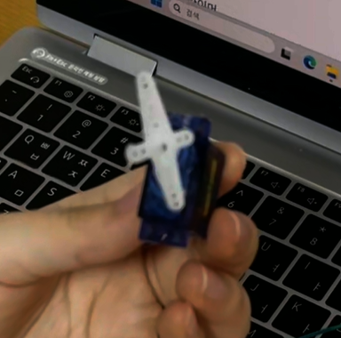 | 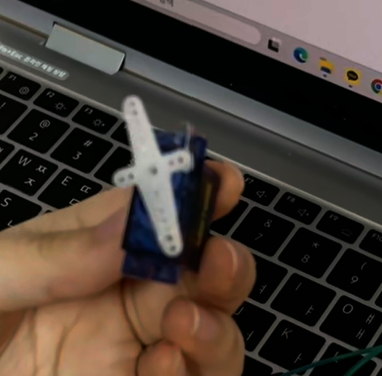 |
| :-------------------------------: | :-----------------------------------: |
|    (a) Minimum PWM pulse width    |      (b) Maximum PWM pulse width      |
<p align="center">Figure 1. Servo Motor Rotation Results</p>

[demo video link](https://youtu.be/PeiMpBj11Tg)

#### Discussion

1. Derive a simple logic to calculate CCR and ARR values to generate x[Hz] and y[%] duty ratio of PWM. How can you read the values of input clock frequency and PSC?

> PWM frequency is determined by the timer input clock, prescaler (PSC), and auto-reload register (ARR).
>$$
> f_{PWM} = \frac{f_{TIM}}{(PSC+1)(ARR+1)}
>$$
> Therefore, CCR and ARR can be calculated as below.
> $$
> ARR = \frac{f_{TIM}}{(PSC+1)f_{PWM}}-1
> $$
>
> $$
> CCR = (ARR+1)\times Duty
> $$
>
> In this experiment, TIM2 uses an 84 MHz input clock. With PSC = 83, the counter frequency becomes 1 MHz. To generate a 50 Hz PWM signal, ARR is set to 19999. For a pulse width of 1500 µs, CCR2 is set to 1500.
>
> The timer input clock frequency can be determined from the RCC clock configuration and APB1 prescaler. The PSC value can be read directly from the TIM2->PSC register. The ARR and CCR values can also be checked using TIM2->ARR and TIM2->CCR2.

2. What is the smallest and highest PWM frequency that can be generated for Q1?

 > The PWM frequency depends on the timer input clock frequency, PSC, and ARR values.
 >
 > Minimum PWM frequency:
 >
 > The minimum frequency is obtained by setting PSC and ARR to their maximum values. Since TIM2 has a 16-bit PSC and a 32-bit ARR:
 >
 > $$
 > f_{min}=\frac{84\times10^6}{65536\times4294967296}
 > =2.984\times10^{-7}\ \text{Hz}
 > $$
 >Maximum PWM frequency:
 > 
 >The maximum frequency for a nonconstant PWM waveform is obtained with PSC = 0 and ARR = 1.
 > 
 >$$
 > f_{max}=\frac{84\times10^6}{1\times2}=42\ \text{MHz}
 > $$
 > These are theoretical hardware limits. The actual frequency range may be smaller due to software library settings and hardware limitations.

***

## Problem 2: DC motor

> **you MUST read** [Tutorial: DC motor driver connection](https://ykkim.gitbook.io/ec/ec-course/tutorial/tutorial-dcmotor-motor-driver-connection)

### Problem

The program needs to design a smart mini-fan device that runs only when the face is near the fan. Otherwise stops the fan from running.

* As the button **B1** is pressed, change the fan velocity Mode.
* The velocity MODE(states) are
  * MODE(state): **OFF(0%), MID(50%), HIGH(100%)**
* PAUSE: When the object(face) is detected neraby, it automatically pauses the fan temporarily.
  * PAUSE: the MODE should NOT be changed if the button **B1** is pressed
* RESUME: When the object(face) is away, it automatically resumes the fan running
  * It must maintain return to the previous MODE run at the speed of the current MODE
* LED
  * MODE=OFF, LED=OFF
  * MODE=MID, HIGH, LED=ON
  * PAUSE, LED=Blinking 1 sec
* Serial Display
  * Print the Mode, PWM duty ratio and other necessary information every 2seconds
* I used FSM to design the code
  * FSM(finite-state-machine) table and state diagram is as below.

​    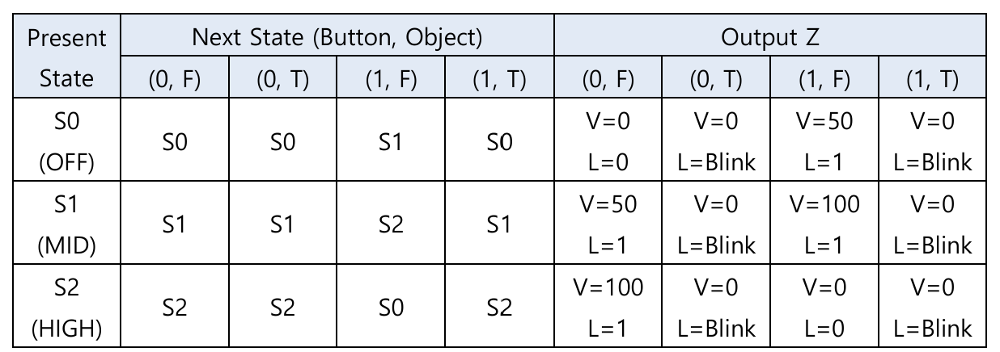

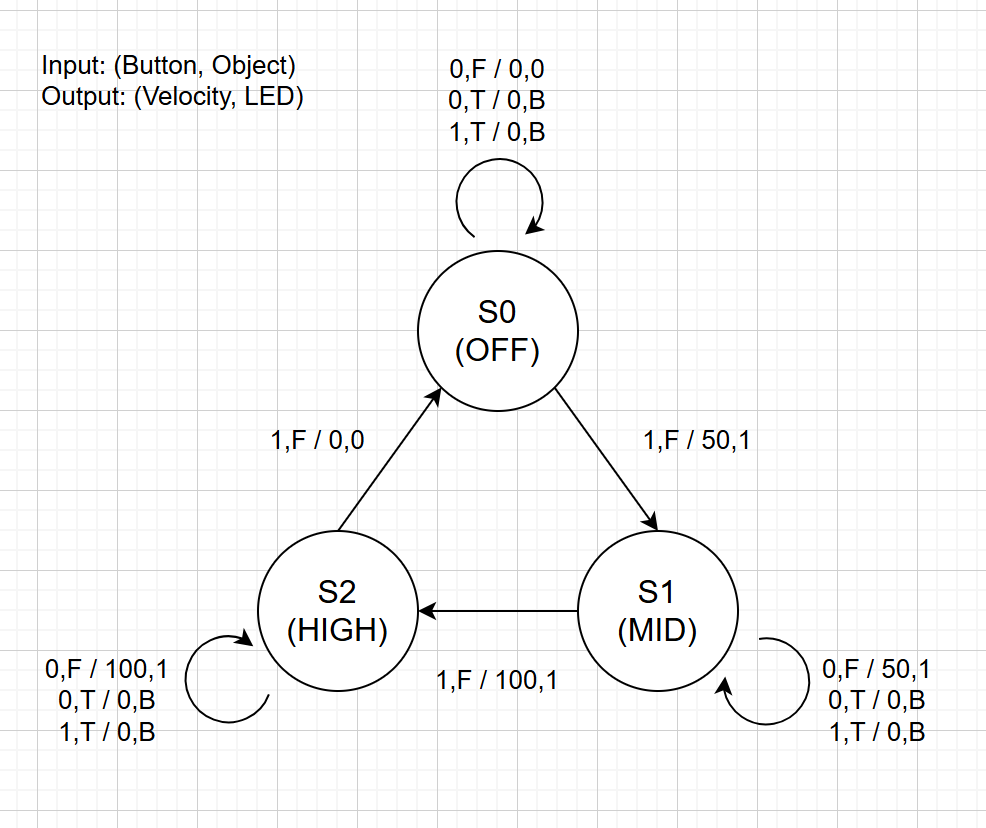

### Procedure

1. Create a new environment

* Environment: “**LAB\_PWM\_DC”**
* Source FIle: “**LAB\_PWM\_DC.c”**

2. Write the source code

#### Configuration

| Function                   | Port - Pin        | Configuration                       |
| -------------------------- | ----------------- | ----------------------------------- |
| **Button**                 | PC13              | DIN, Pull-Up                        |
| **Direction Pin**          | PC2               | DOUT, Push-Pull                     |
| **PWM Timer**              | TIM2\_CH1 (PA\_0) | TIM2 (PWM) period: **1msec (1kHz)** |
| **Timer Update Interrupt** | TIM3              | TIM3: Timer Interrupt of 500 msec   |
| **LED**                    | PA5               | DOUT                                |
| **IR Proximity Sensor**    | PA4               | DIN, Pull-Up, Active-Low            |

#### Circuit Diagram

**DC Motor Connection**

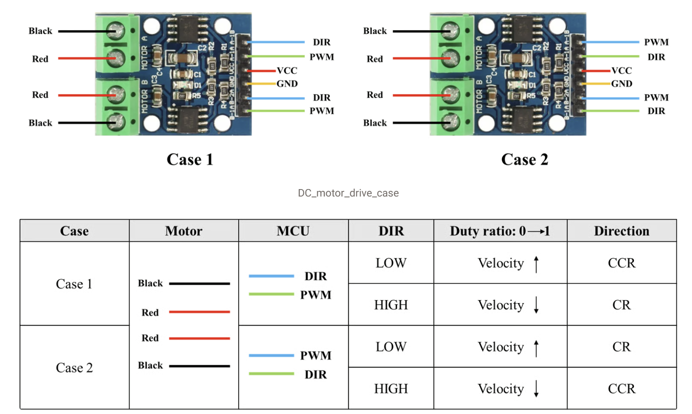      

<p align="center">Figure 2. Connection between NUCLEO-F411RE, L9110S motor driver, and DC motor


#### Main Functions

```c
//  Low Frequency PWM initialization in msec. (below 1kHz)
// 	Default: 		50% duty ratio. PWM_mode1, Period in msec.
//  TIM2/TIM5 		(32-bit ARR) : msec 1 ~ 4,294,967
//  TIM1/TIM3/TIM4 	(16-bit ARR) : msec 1 ~ 6,553   
void PWM_init(PinName_t pinName, uint32_t msec);	// 1 to 6,553 msec (16-bit)

// Duty ratio 0~1.0
void PWM_duty(PinName_t pinName, float duty);

// Read and return the input value through the pin
uint32_t GPIO_read(PinName_t pinName);

// Write output on the pin (output: HIGH, LOW)
void GPIO_write(PinName_t pinName, uint32_t Output);

// toggle the led
void led_toggle(PinName_t pinName);

// Initialize EXTI with trigger type and interrupt priority
// trig_type: trigger type (FALL(0), RISE(1), BOTH(2))
// priority: Priorities for handling
void EXTI_init(PinName_t pinName, uint32_t trig_type,uint32_t priority);

// TIM3 update interrupt: executed every 500ms
void TIM3_IRQHandler(void);

// Button interrupt: change the motor mode
void EXTI15_10_IRQHandler(void);
    
// Configuration UART 2 using default settings
void USART2_init(void);
```


#### Code

```c
#include "ecSTM32F4v2.h"

// Pin definitions
#define BUTTON_PIN      PC_13   // USER button (B1)
#define DIR_PIN         PC_2    // DC motor direction control
#define IR_PIN          PA_4    // IR proximity sensor (Digital Output)
#define PWM_PIN         PA_0    // DC motor PWM output (TIM2_CH1)
#define LED_PIN         PA_5    // On-board LED (LD2)

volatile int8_t state = 0;              // Current FSM state (S0: OFF, S1: MID, S2: HIGH)
volatile float duty = 0;                // Current PWM duty ratio (0.0 ~ 1.0)
volatile int8_t uart_flag = 0;          // flag for displaying on serial monitor
static int8_t uart_count = 0;           // count for serial monitor timing
volatile uint8_t button_lock = 0;       // Prevent bouncing

// FSM States for DC motor fan (S0~S2)
// Input combination (BUTTON,IR) is like : (0,F), (0,T), (1,F), (1,T)
// Output combination is (Velocity(duty), LED(mode))
static const StateFan_t fsm_FAN[3] = {	
 	{{FAN_S0,FAN_S0,FAN_S1,FAN_S0},{ 
		{VEL_S0, LED_OFF}, {VEL_S0, LED_BLINK}, {VEL_S1, LED_ON}, {VEL_S0, LED_BLINK}}},	// S0: OFF
	{{FAN_S1,FAN_S1,FAN_S2,FAN_S1},{
		{VEL_S1, LED_ON}, {VEL_S0, LED_BLINK}, {VEL_S2, LED_ON}, {VEL_S0, LED_BLINK}}},	    // S1: MID
	{{FAN_S2,FAN_S2,FAN_S0,FAN_S2},{
		{VEL_S2, LED_ON}, {VEL_S0, LED_BLINK}, {VEL_S0, LED_OFF}, {VEL_S0, LED_BLINK}}},	// S2: HIGH
};

void setup(void){
    RCC_PLL_init();

    // Initialize button pin as input
    GPIO_init(BUTTON_PIN, INPUT);
    GPIO_pupd(BUTTON_PIN, PULL_UP);

    // Initialize direction pin as output, push-pull
    GPIO_init(DIR_PIN, OUTPUT);
    GPIO_otype(DIR_PIN, PUSH_PULL);
    GPIO_write(DIR_PIN, LOW);

    // Initialize IR pin as input
    GPIO_init(IR_PIN, INPUT);
    GPIO_pupd(IR_PIN, PULL_UP);

    // Initialize LED pin as output
    GPIO_init(LED_PIN, OUTPUT);
    GPIO_write(LED_PIN, LOW);   // Initial LED state: OFF

    // PWM: TIM2_CH1, period = 1ms
    PWM_init(PWM_PIN, 1);
    PWM_duty(PWM_PIN, 0.0f);     // Initial duty: 0 (OFF)

    // TIM3: Interrupt every 500ms
    TIM_UI_init(TIM3, 500);

    // Initialize button pin interrupt (trigger: falling edge)
    EXTI_init(BUTTON_PIN, FALL, 1);

    // Initialize USART2
    USART2_init();  // USART2: 9600 baud
}

int main(void){
    setup();
    while(1){
        // this can make code easier to read
        // uint8_t input = (GPIO_read(IR_PIN) == HIGH)? 0 : 1;
        // OutputFan_t output = fsm_FAN[state].out[input];

        // Check IR sensor continuously using GPIO polling
        if(GPIO_read(IR_PIN) == HIGH){      // object not deteched
            // Apply PWM duty according to the current FSM state
            // out[0] corresponds to (BUTTON=0, IR=F)
            duty = fsm_FAN[state].out[0].V;
            PWM_duty(PWM_PIN, duty);   // assume not button pressed. button pressed is about EXTI handler.

            // Control LED according to the current FSM output
            if(fsm_FAN[state].out[0].L == LED_OFF){
                GPIO_write(LED_PIN, LOW);
            } else {
                GPIO_write(LED_PIN, HIGH);
            }
        } else {
            // Stop the motor without changing the current FSM state
            // out[1] corresponds to (BUTTON=0, IR=T)
            duty = fsm_FAN[state].out[1].V;
            PWM_duty(PWM_PIN, duty);
            // toggle action is in TIM3_IRQHandler. because it depands on timer interrupt
        }

        // Display the current mode and PWM duty every 2 seconds
        if(uart_flag){
            // clear UART flag after detecting the request
            uart_flag = 0;

            // Display PAUSE mode when the object is detected
            if(GPIO_read(IR_PIN) == LOW)
                printf("MODE: PAUSE, duty: %.2f\r\n", duty);
            // Display OFF mode
            else if(state == FAN_S0)
                printf("MODE: OFF, duty: %.2f\r\n", duty);
            // Display MID mode
            else if(state == FAN_S1)
                printf("MODE: MID, duty: %.2f\r\n", duty);
            // Display HIGH mode
            else if(state == FAN_S2)
                printf("MODE: HIGH, duty: %.2f\r\n", duty);
        }
    }
}

// TIM3 update interrupt: executed every 500ms
void TIM3_IRQHandler(void){
    if(is_UIF(TIM3)){
        clear_UIF(TIM3);

        // button input can be accepted after TIM3 check
        // debounce: unlock after release
        if(button_lock && GPIO_read(BUTTON_PIN) == HIGH){
            button_lock = 0;
        }

        // blink LED during PAUSE
        // toggle every 500ms -> blinking period = 1 second
        if(GPIO_read(IR_PIN) == LOW){
            led_toggle(LED_PIN);    // if object is deteched, LED blink
        }

        // update count TIM3 interrupt for UART output
        uart_count++;

        // 500 * 4 = 2 sec
        if(uart_count >= 4){
            uart_count = 0;
            uart_flag = 1;      // request to display serial monitor
        }
    }
}

// Button interrupt: change the motor mode
void EXTI15_10_IRQHandler(void){
    if(is_pending_EXTI(BUTTON_PIN)){
        clear_pending_EXTI(BUTTON_PIN);

        // Object is not deteched and button is not locked
        if(GPIO_read(IR_PIN) == HIGH && button_lock == 0){
            // Lock button input to prevent repeated state transitions
            button_lock = 1;
            // Input index 2 corresponds to (BUTTON=1, IR=F)
            state = fsm_FAN[state].next[2];     // state update
        }
    }
}
```

#### Results


| 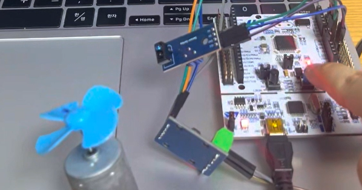 | 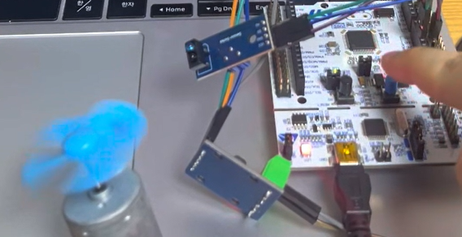 |
|:---:|:---:|
| (a) OFF Mode | (b) MID Mode |
| 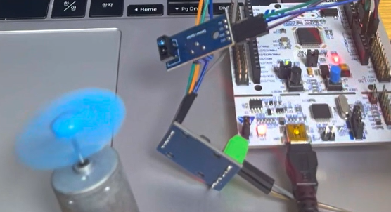 | 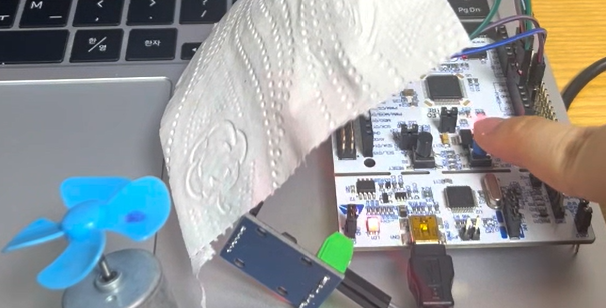 |
| (c) HIGH Mode | (d) PAUSE – LED OFF |
| 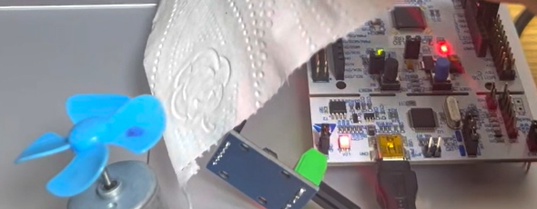 | 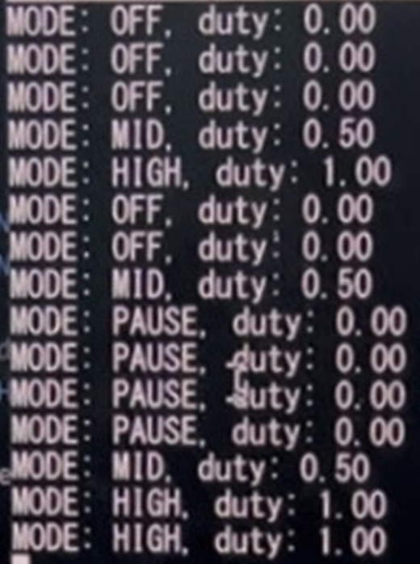 |
| (e) PAUSE – LED ON | (f) Serial Monitor Output |

<p align="center">Figure 3. Motor Speed Control and IR Sensor Detection</p>

The motor operated in OFF, MID, and HIGH modes according to the button input. When an object was detected, the motor stopped and the LED blinked. After the object was removed, the motor resumed its previous mode. The Serial Monitor also displayed the current mode and PWM duty ratio.

[demo video link](https://youtu.be/PeiMpBj11Tg)

## Troubleshooting

#### 1. motor PWM duty ratio for different DIR

The PWM duty ratio should be adjusted depending on the motor direction (DIR). When DIR = 0, the PWM duty ratio is equal to the target duty ratio. However, when DIR = 1, the PWM duty ratio must be inverted to maintain the same effective motor drive ratio in the opposite direction.

For example, when the target duty ratio is 0.8, the PWM output is 0.8 for DIR = 0 and 0.2 for DIR = 1.

```c
float targetPWM;	// pwm for motor input 
float duty = fabsf(DIR - targetPWM);	// duty with consideration of DIR=1 or 0
PWM_duty(PWM_PIN, duty);
```

In this experiment, the motor rotated in only one direction, so DIR was fixed to LOW. Therefore, the PWM duty ratio could be directly controlled without this compensation.

#### 2. Motor does not run under duty 0.5

> The lab advises to increase the PWM frequency above 1 kHz if the motor does not rotate at low duty ratio. However, the PWM frequency was set to 1 kHz, and the motor operated properly at a duty ratio of 0.5. Therefore, no additional adjustment was necessary.

#### 3. Check and give different Interrupt Priority

> The NVIC priorities were checked by NVIC_GetPriority(). EXTI15_10 and USART2 had priority 1, and TIM3 had priority 2. 

#### 4. IR Proximity Sensor Malfunction

> LED continued blinking even when no object was detected, and the USER button did not change the motor mode.
> At first, I assumed the IR sensor as Active-High. However, the sensor required Active-Low logic, where LOW indicates object detection and HIGH indicates no detection.
> Even after correcting the problem, the problem continued. Therefore, a hardware problem was suspected. After replacing other IR sensor, the motor and LED operated correctly.
> This experience showed the importance of checking both the sensor output logic and the hardware when troubleshooting.

#### 5. Button Bouncing and Debouncing

> Pressing the USER button once often caused the FSM to skip a state. For example, the motor mode occasionally changed from OFF to HIGH instead of MID.
> This problem was likely caused by bouncing, which can generate multiple interrupts from a single button press.
> To solve this problem, a button_lock flag was added to prevent additional state changes after a button press. The TIM3 interrupt checks whether the button has been released and then clears the lock.
>After applying this method, the state transitions became more stable, and the motor modes changed in the intended order.