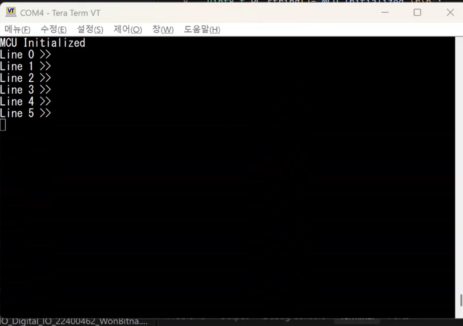
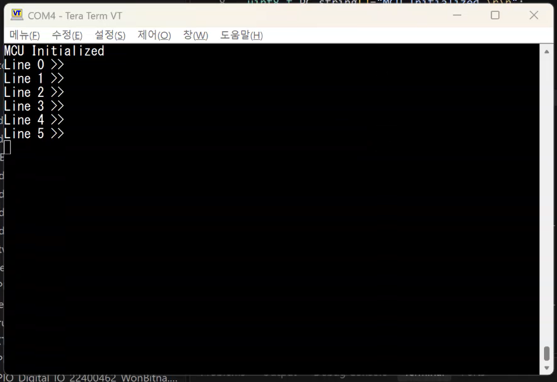
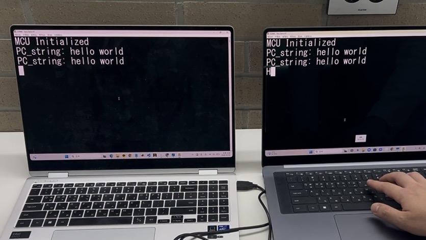
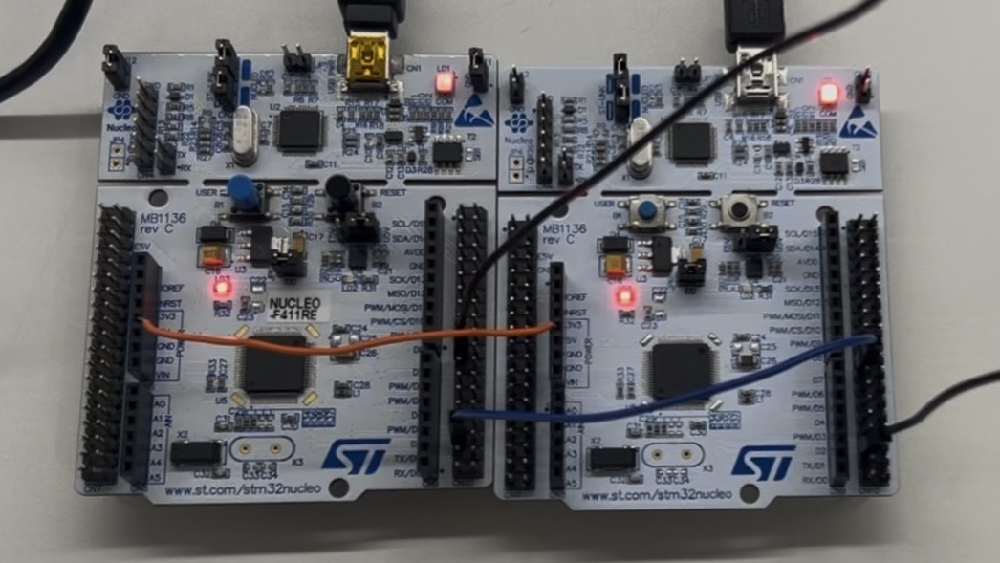
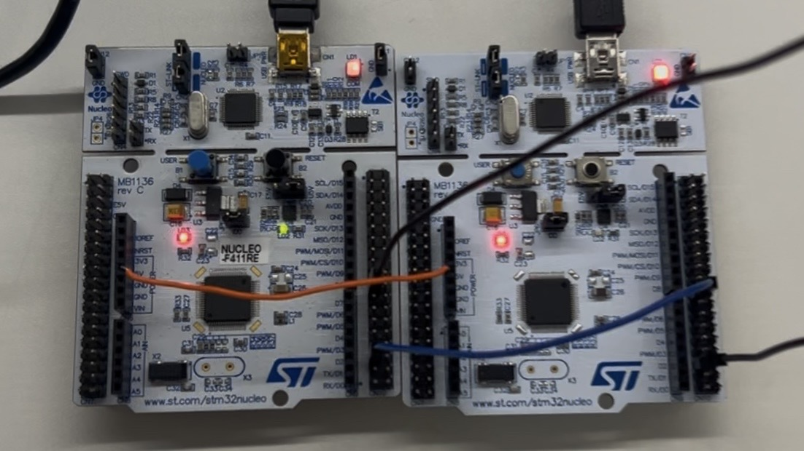
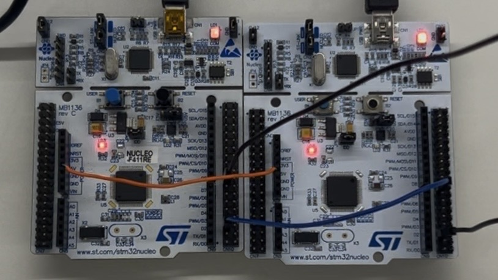
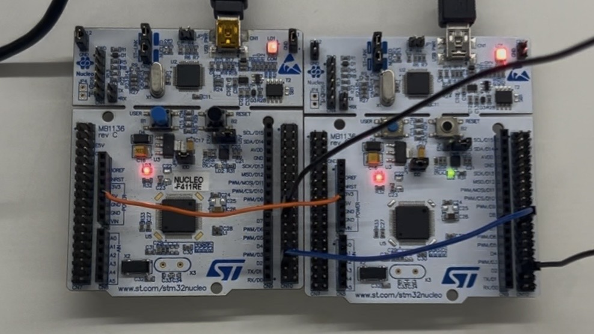
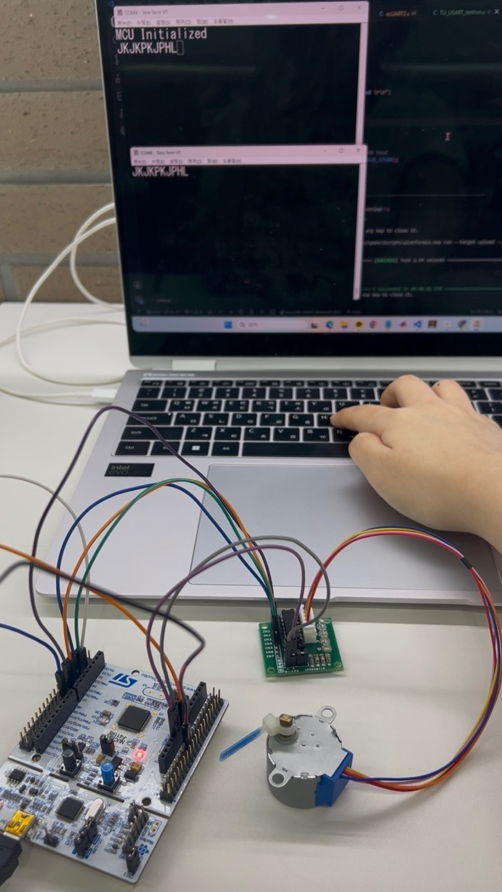
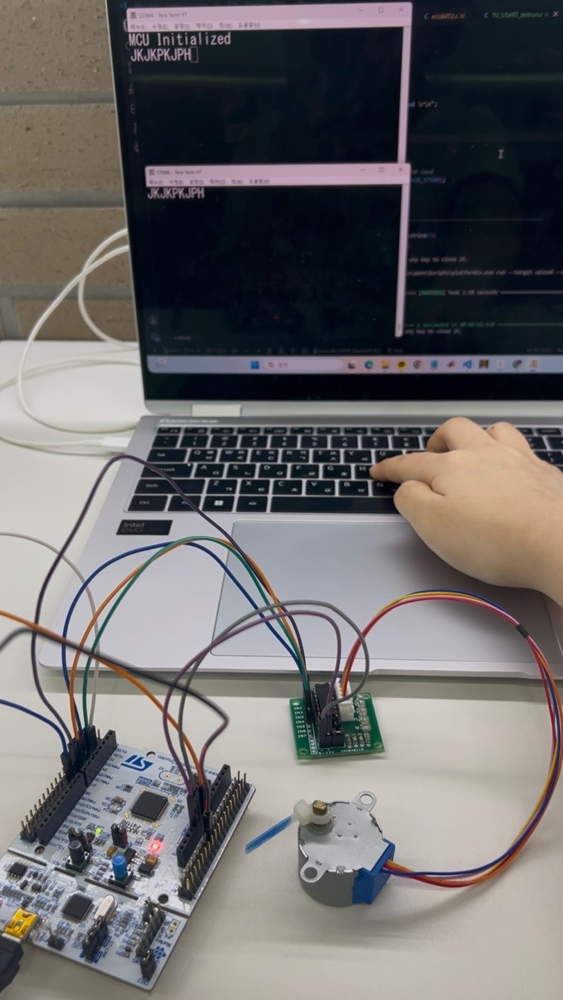

# LAB: USART - Bluetooth

**Date:** 2026-10-16

**Author:** Won Bitna

**Github:** https://github.com/bitna-cmd/EC-STM32F4-22400462/blob/main/README.md

**Demo Video:** https://youtu.be/EgN6FT9ZU4Q


## Introduction

In this lab, I learned how to configure and use ‘USART(Universal synchronous asynchronous receiver transmitter)’ of MCU. Then, I learned how to communicate between my PC and MCU and MCU to another MCU with wired serial communication.

* **Mission 1**: Control LED(LD2) of other MCU using wired serial communication
* **Mission 2**: Control a stepper motor with wireless Bluetooth communication


### Requirement

#### Hardware

* MCU
  * NUCLEO-F411RE
* Actuator/Sensor/Others:
  * DC motor, DC motor driver(L9110s),
  * Bluetooth Module(HC-06),

#### Software

* Keil uVision, CMSIS, EC\_HAL library


## Problem 0: USART library

I completed the following 2 libraries.

* ecUART2.c
* ecUART2.h

### Procedure

1. Complete in the library files.&#x20;
2. Then, run the test code in different baud rate to validate code. &#x20;

   \* Tera-Term Terminal:   (1) Baud 9600,  (2) Baud 57600

**ecUART2.h**

```cpp
#ifndef __EC_USART2_STUDENT_H
#define __EC_USART2_STUDENT_H

#include <stdio.h>
#include <math.h>
#include "stm32f411xe.h"
#include "ecGPIO2.h"
#include "ecRCC2.h"


#define POL 0
#define INT 1

// You can modify this
#define BAUD_9600	9600
#define BAUD_19200	19200
#define BAUD_38400  38400
#define BAUD_57600	57600
#define BAUD_115200 115200
#define BAUD_921600 921600


// ********************** USART 2 (USB) ***************************
	// PA_2 = USART2_TX
	// PA_3 = USART2_RX
	// Alternate function(AF7), High Speed, Push pull, Pull up
	// APB1
// **********************************************************

// ********************** USART 1 ***************************
	// PA_9 = USART1_TX (default)	// PB_6  (option)
	// PA_10 = USART1_RX (default)	// PB_3 (option)
	// APB2
// **********************************************************

// ********************** USART 6 ***************************
	// PA_11 = USART6_TX (default)	// PC_6  (option)
	// PA_12 = USART6_RX (default)	// PC_7 (option)
	// APB2
// **********************************************************


/*================ EXERCISE Functions ================*/
/*================ General Configuration ================*/
// General configuration
void USART_init(USART_TypeDef* USARTx, PinName_t pin_GPIO_TX, PinName_t pin_GPIO_RX, uint32_t baud);	// copy of USART_setting
void USART_baud(USART_TypeDef* USARTx, uint32_t baud);
void USART_pins(USART_TypeDef* USARTx, PinName_t pin_GPIO_TX, PinName_t pin_GPIO_RX);

void USART1_baud(uint32_t baud);
void USART2_baud(uint32_t baud);


/*================ PROVIDED Functions ================*/
/*================ Configuration for each USART ================*/
// Configuration UART 1, 2 using default settings
void USART1_init(void);
void USART2_init(void);

// USART write & read
void USART1_write(uint8_t* buffer, uint32_t nBytes);
void USART2_write(uint8_t* buffer, uint32_t nBytes);
uint8_t USART1_read(void);										
uint8_t USART2_read(void);	

// RX Inturrupt Flag USART1,2
uint32_t is_USART1_RXNE(void);
uint32_t is_USART2_RXNE(void);


/*================ General Configuration ================*/
void USART_clock_enable(USART_TypeDef* USARTx);
void USART_write(USART_TypeDef* USARTx, uint8_t* buffer, uint32_t nBytes);
uint8_t USART_read(USART_TypeDef * USARTx);										
uint32_t is_USART_RXNE(USART_TypeDef * USARTx);
void USART_delay(uint32_t us);  

								

#endif // __EC_USART2_STUDENT_H
```

**Completed Functions (in ecUART2.c)**

```c
// Initialize the selected USART configuration of TX, RX, and baud rate
// (baud: BAUD_xxxx)
void USART_init(USART_TypeDef* USARTx, PinName_t pin_GPIO_TX, PinName_t pin_GPIO_RX, uint32_t baud){
    //1. GPIO Pin for TX and RX
	USART_pins(USARTx, pin_GPIO_TX, pin_GPIO_RX);

	//2. USARTx (x=2,1,6) configuration
	USART_clock_enable(USARTx);

	// Disable USARTx.
	USARTx->CR1 &= ~USART_CR1_UE; 	// USART disable

	// No Parity / 8-bit word length / Oversampling x16 / Stop bit =1
	USARTx->CR1 &= ~(1UL<<10);		// No parity
	USARTx->CR1 &= ~(1UL<<12);		// 8-bit word length
	USARTx->CR1 &= ~(1UL<<15);		// Oversampling x16
	USARTx->CR2 &= ~(3UL<<12);		// Stop bit = 1

	// Set baud rate using the corresponding APB clock
	// USART1/6: APB2 (84 MHz), USART2: APB1 (42 MHz)
	// If oversampling by 16, Tx/Rx baud = f_CK / (16*USARTDIV),
	// If oversampling by 8,  Tx/Rx baud = f_CK / (8*USARTDIV)
	USART_baud(USARTx, baud);

	// Enable TX, RX, and USARTx
	USARTx->CR1 |= (USART_CR1_RE | USART_CR1_TE);   	// Transmitter and Receiver enable
	USARTx->CR1 |= USART_CR1_UE; 						          // USART enable

	// 3. RX interrupt (data ready to be read)
    // Enable RXNE interrupt
	USARTx->CR1 |= USART_CR1_RXNEIE;
    // USART_IRQn
	uint32_t USART_IRQ = USART2_IRQn;
    // Set the priority and enable interrupt
	if(USARTx == USART1)
		USART_IRQ = USART1_IRQn;
	else if(USARTx == USART6)
		USART_IRQ = USART6_IRQn;
	
	// Give the RX interrupt priority and enable it
	NVIC_SetPriority(USART_IRQ, 1);
	NVIC_EnableIRQ(USART_IRQ);

}

// Set the baud rate of USARTx (baud: BAUD_xxxx)
void USART_baud(USART_TypeDef* USARTx, uint32_t baud){
	// Disable USARTx.
	USARTx->CR1  &= ~USART_CR1_UE; 						// USART disable
	USARTx->BRR = 0;

	// Configure Baud-rate
	float fCK = EC_SYSCLK;                                   // if(USARTx==USART1 || USARTx==USART6), APB2
	                                                         // (84MHz after RCC_PLL_init(), 16MHz after RCC_HSI_init())
	if(USARTx == USART2) fCK =fCK/2;      // APB1
    float USARTDIV = (float) fCK/16.0/baud;

	// Method 1 : build the two BRR fields explicitly
	//   BRR[15:4] = DIV_Mantissa (integer part of USARTDIV)
	//   BRR[3:0]  = DIV_Fraction (counts 1/16 steps -> multiply the fraction by 16)
	USARTx->BRR |= ((uint32_t)USARTDIV<<4);			// mastissa
	USARTx->BRR |= (uint32_t)round((USARTDIV-(uint32_t)USARTDIV) * 16);	// fraction
  
	// Enable TX, RX, and USARTx
	USARTx->CR1 |= USART_CR1_UE;
}


// GPIO pin setup for USARTx TX/RX (any of USART1, USART2, USART6)
void USART_pins(USART_TypeDef* USARTx, PinName_t pin_GPIO_TX, PinName_t pin_GPIO_RX){
	GPIO_TypeDef *GPIO_TX;
	unsigned int pinTX;
	ecPinmap(pin_GPIO_TX, &GPIO_TX, &pinTX);

	GPIO_TypeDef *GPIO_RX;
	unsigned int pinRX;
	ecPinmap(pin_GPIO_RX, &GPIO_RX, &pinRX);

	// Alternate Function, Push-Pull, No Pull-up/down, High speed
	GPIO_init(pin_GPIO_TX, AF);
	GPIO_otype(pin_GPIO_TX, PUSH_PULL);
	GPIO_pupd(pin_GPIO_TX, NO_PUPD);
	GPIO_ospeed(pin_GPIO_TX, HIGH_SPEED);

	GPIO_init(pin_GPIO_RX, AF);
	GPIO_otype(pin_GPIO_RX, PUSH_PULL);
	GPIO_pupd(pin_GPIO_RX, NO_PUPD);
	GPIO_ospeed(pin_GPIO_RX, HIGH_SPEED);

	// Set Alternate Function Register for USARTx
	//   AF7 - USART1, USART2
	//   AF8 - USART6
	uint32_t AF_num = (USARTx == USART6) ? 8 : 7;
	if (pinTX < 8) { 
		GPIO_TX->AFR[0] &= ~(0xFUL << (4*pinTX));     
		GPIO_TX->AFR[0] |= AF_num << (4*pinTX); 
	} else { 
		GPIO_TX->AFR[1] &= ~(0xFUL << (4*(pinTX-8))); 
		GPIO_TX->AFR[1] |= AF_num << (4*(pinTX-8)); 
	}
	
 	if (pinRX < 8) {
		GPIO_RX->AFR[0] &= ~(15UL<<(pinRX*4));
		GPIO_RX->AFR[0] |= (AF_num<<(pinRX*4));
    } else {
		GPIO_RX->AFR[1] &= ~(15UL<<((pinRX-8)*4));
		GPIO_RX->AFR[1] |= (AF_num<<((pinRX-8)*4));
    }

}

// Set baud rate of USART1 (baud: BAUD_xxxx)
void USART1_baud(uint32_t baud){
	USART_baud(USART1, baud);
}
// Set baud rate of USART2 (baud: BAUD_xxxx)
void USART2_baud(uint32_t baud){
	USART_baud(USART2, baud);
}
```


#### Main Functions Description

```c
// Configure the GPIO pins for USART TX/RX
// USARTx: USART1/2/6, pin_GPIO_TX/RX: TX/RX pins
void USART_pins(USART_TypeDef* USARTx, PinName_t pin_GPIO_TX, PinName_t pin_GPIO_RX);

// Enable the clock of the selected USART
// USARTx: USART1/2/6
void USART_clock_enable(USART_TypeDef* USARTx);

// Set the baud rate of the selected USART
// USARTx: USART1/2/6, baud: baud rate (bps)
void USART_baud(USART_TypeDef* USARTx, uint32_t baud);
```


**TU\_USART\_testrun.c**

```cpp
#include <stdio.h>
#include "ecRCC2.h"
#include "ecGPIO2.h"
#include "ecSysTick2.h"
#include "ecUART2.h"


uint8_t PC_string[]="MCU Initialized \r\n";

// Initialiization 
void setup(void)
{
	// MCU_init();
    RCC_PLL_init();
    SysTick_init();
    // USART2: PA_2=TX, PA_3=RX, 57600 baud
    USART_init(USART2, PA_2, PA_3, BAUD_57600);	
}


int main(void) {
	// Initialiization --------------------------------------------------------
	setup();
  USART2_write(PC_string, sizeof(PC_string));
	
  uint32_t lineNumber = 0;
  // Inifinite Loop ----------------------------------------------------------
	while (1){
        printf("Line %lu >>\r\n", lineNumber);
        delay_ms(2000);
        lineNumber++;
    }
}
```

#### Result

<table>
  <tr>
    <td align="center" width="50%">
      
    </td>
    <td align="center" width="50%">
      
    </td>
  </tr>
  <tr>
    <td align="center">(a) USART2 communication at 9600 bps</td>
    <td align="center">(b) USART2 communication at 57600 bps</td>
  </tr>
  <tr>
    <td colspan="2" align="center">
      <strong>Figure 1. USART2 library test at different baud rates</strong>
    </td>
  </tr>
</table>
[demo video link](https://youtu.be/EgN6FT9ZU4Q) [0:00~0:18]

#### **Discussion**

I tested USART communication successfully at both 9600 bps and 57600 bps. In both cases, the transmitted characters were displayed correctly in TeraTerm when the baud rates of the MCU and TeraTerm were matched. Although 57600 bps provides a data transmission rate six times higher than 9600 bps, no significant difference was observed. I think it is because only a small amount of data was transmitted. These results confirmed that the implemented USART_init() and USART_baud() functions could configure USART communication at different baud rates. Therefore, I understood the importance of matching the baud rate settings between transmitting and receiving devices.

## Problem 1: Communicate MCU1-MCU2 using RS-232


### Procedure

1\. Create source code "LAB_USART_LED.c" and modify environment in "platformio.ini"

2\. Update "ecSTM32F4v2.h"

3\. Connect each MCUs to each PC with **USART 2** via USB cable (ST-Link)

* MCU1 to PC1
* MCU2 to PC2

4\. Connect MCU1 to MCU2 with **USART 1**

* Connect RX/TX pins externally with jumper wires as
  * MCU1\_TX to MCU2\_RXD
  * MCU1\_RX to MCU2\_TX

5. Connect **GND pins** between MCU1-MCU2

6. Send a message from PC\_1 by typing keys on Teraterm.&#x20;

> The message should appear when "Enter" is pressed to end the message.

7. The received message by MCU\_2 should be displayed on PC\_2.
8. Turn other MCU's LED(LD2) ON/OFF by :

* Press key "**L**" to Turn OFF LED
* Press key "**H**" to Turn ON LED

### Configuration

| Function                        | Port - Pin                   | Configuration                                                |
| ------------------------------- | ---------------------------- | ------------------------------------------------------------ |
| System Clock                    |                              | PLL 84MHz                                                    |
| USART2 : USB cable (ST-Link)    |                              | <p>No Parity, 8-bit Data,<br>1-bit Stop bit,<br>9600 baud-rate</p> |
| USART1 : MCU1,  MCU2            | <p>TXD: PA9<br>RXD: PA10</p> | <p>No Parity, 8-bit Data,<br>1-bit Stop bit,<br>9600 baud-rate</p> |
| <p>Digital Out: LD2<br><br></p> | <p>PA5<br><br></p>           |                                                              |

#### Main Functions Description
```c
// Initialize the selected USART with TX/RX pins and baud rate
// USARTx: USART1/2/6, pin_GPIO_TX/RX: TX/RX pins, baud: baud rate (bps)
void USART_init(USART_TypeDef* USARTx, PinName_t pin_GPIO_TX, PinName_t pin_GPIO_RX, uint32_t baud);

// Send data through USART1
// buffer: data to send, nBytes: number of bytes
void USART1_write(uint8_t* buffer, uint32_t nBytes){
    USART_write(USART1, buffer, nBytes);
}

// Send data through USART2
// buffer: data to send, nBytes: number of bytes
void USART2_write(uint8_t* buffer, uint32_t nBytes){
    USART_write(USART2, buffer, nBytes);
}

// Read one received character from USART1
// Return: received 8-bit data
uint8_t USART1_read(void){
    return USART_read(USART1);
}

// Read one received character from USART2
// Return: received 8-bit data
uint8_t USART2_read(void){
    return USART_read(USART2);
}

// Check whether new data has been received through USART1
// Return: 1 if data is ready, otherwise 0
uint32_t is_USART1_RXNE(void){
    return is_USART_RXNE(USART1);
}

// Check whether new data has been received through USART2
// Return: 1 if data is ready, otherwise 0
uint32_t is_USART2_RXNE(void){
    return is_USART_RXNE(USART2);
}

// Write output on the pin
// pinName: GPIO pin, Output: HIGH or LOW
void GPIO_write(PinName_t pinName, uint32_t Output);
```


### Example Code

Example codes for communicating between two MCUs

**Example 1 :** RX/TX **one character** at a time

* Receive (Interrupt), Send (Polling)
* USART2:&#x20;
  * Sending a character from PC\_keyboard to MCU
  * Sending a character from MCU to PC serial monitor (**Echo keyboard type**)
* USART1:
  * Send and Receive a character from other MCU
* To Display the received message on PC monitor
  * MCU\_2:USART1 -> MCU\_1:USART1 -> MCU\_1:USART2-> Serial monitor\_1

```c
#include "ecSTM32F4v2.h"

static volatile uint8_t PC_Data = 0;
static volatile uint8_t BT_Data = 0;
uint8_t PC_string[]="Loop:\r\n";

void setup(void){
	RCC_PLL_init();
	SysTick_init();
	
	// USART2: USB serial init
	USART2_init();  // default 9600
	//USART2_baud(BAUD_38400);
	
	// USART1: MCU2 serial init 
	USART1_init(); // default 9600
	//USART1_baud(BAUD_38400);
}

int main(void){	
	setup();
	printf("MCU Initialized\r\n");	
	while(1){
		// USART Receive: Use Interrupt only
		// USART Transmit: Polling
		//USART2_write(PC_string, 7);
		delay_ms(2000);        
	}
}

void USART2_IRQHandler(){       // USART2 RX Interrupt 
	if(is_USART2_RXNE()){
		PC_Data = USART2_read();		// RX from UART2 (PC)
		USART2_write(&PC_Data,1);		// TX to USART2	 (PC)	 Echo of keyboard typing
		USART1_write(&PC_Data,1);	  // TX to Other MCU
	}
}

void USART1_IRQHandler(){          	// USART2 RX Interrupt
	if(is_USART1_RXNE()){
		BT_Data = USART1_read();				// RX from other MCU UART1		
		printf("RX: %c \r\n",BT_Data); 	// TX to USART2(PC)
	}
}
```

**Example 2 :** **RX/TX** **a string**

```cpp
#include "ecSTM32F4v2.h" 

#define MAX_BUF 10
#define END_CHAR 13

static volatile uint8_t buffer[MAX_BUF]={0, };
static volatile uint8_t PC_string[MAX_BUF]={0, };
static volatile uint8_t PC_data = 0;

static volatile int idx = 0;
static volatile int bReceive =0;

void setup(void){
    RCC_PLL_init();
    SysTick_init();

    // USART2: USB serial init
    USART2_init();
    //USART2_baud(BAUD_38400);
    // USART1: MCU2 serial init
    USART1_init();
    //USART1_baud(BAUD_38400);
}

int main(void){
    setup();
    printf("MCU Initialized\r\n");

    while(1){
        if (bReceive == 1){
            printf("PC_string: %s\r\n", PC_string);
            bReceive = 0;
        }
    }
}

void USART2_IRQHandler(){       // USART2 RX Interrupt
    if(is_USART2_RXNE()){
        PC_data = USART2_read();     // RX from UART2 (PC)
        USART2_write(&PC_data,1);    // TX to USART2 (PC) Echo of keyboard typing

        // Creates a String from received serial character
        if(PC_data != END_CHAR && (idx < MAX_BUF)){
            buffer[idx] = PC_data;
            idx++;
        }
        else if (PC_data== END_CHAR) {
            bReceive = 1;
            // reset PC_string
            memset(PC_string, 0, sizeof(char) * MAX_BUF);
            // copy to PC_string
            memcpy(PC_string, buffer, sizeof(char) * idx);
            // reset buffer
            memset(buffer, 0, sizeof(char) * MAX_BUF);
            idx = 0;
        }
        else{       // if(idx >= MAX_BUF)
            idx = 0;
            // reset PC_string
            memset(PC_string, 0, sizeof(char) * MAX_BUF);
            // reset buffer
            memset(buffer, 0, sizeof(char) * MAX_BUF);
            printf("ERROR : Too long string\r\n");
        }
    }
}

// Added: receive a string from the other MCU through PA9/PA10.
void USART1_IRQHandler(){
    if(is_USART1_RXNE()){
        PC_data = USART1_read();
        USART2_write(&PC_data,1); // Echo received character to local PC

        if(PC_data != END_CHAR && (idx < MAX_BUF)){
            buffer[idx] = PC_data;
            idx++;
        }
        else if (PC_data == END_CHAR){
            bReceive = 1;
            memset(PC_string, 0, sizeof(char) * MAX_BUF);
            memcpy(PC_string, buffer, sizeof(char) * idx);
            memset(buffer, 0, sizeof(char) * MAX_BUF);
            idx = 0;
        }
        else{
            idx = 0;
            memset(PC_string, 0, sizeof(char) * MAX_BUF);
            memset(buffer, 0, sizeof(char) * MAX_BUF);
            printf("ERROR : Too long string\r\n");
        }
    }
}

```

#### Code

```c++
#include "ecSTM32F4v2.h"

#define MAX_BUF 32          // maximum size of buffer
#define END_CHAR 13         // this means enter. ASCII 13: \r

static volatile uint8_t buffer[MAX_BUF]={0, };          // temporarily store the recieved letters
static volatile uint8_t PC_string[MAX_BUF+1]={0, };       // store the completed letters
static volatile uint8_t PC_data = 0;                    // store one recieved character 

static volatile int idx = 0;            // index for next letter
static volatile int bReceive =0;        // flag for check if the string is completed

void setup(void){
    RCC_PLL_init();
    SysTick_init();

	GPIO_init(PA_5, OUTPUT);
	GPIO_write(PA_5, LOW);

    // USART2: USB serial init
	USART_init(USART2, PA_2, PA_3, 9600);
    //USART2_baud(BAUD_38400);
    // USART1: MCU2 serial init
	USART_init(USART1, PA_9, PA_10, 9600);
    //USART1_baud(BAUD_38400);
}

int main(void){
    setup();
    printf("MCU Initialized\r\n");

	// Print string only after recieved "enter"
    while(1){
        if (bReceive == 1){
            printf("PC_string: %s\r\n", PC_string);
            bReceive = 0;		// Clear the flag for the next string
        }
    }
}


// Handle characters typed on PC through USART2
// The character is echoed to PC and the other MCU
void USART2_IRQHandler(){       // USART2 RX Interrupt
    if(is_USART2_RXNE()){
        PC_data = USART2_read();     // RX from UART2 (PC)
        USART2_write(&PC_data,1);    // TX to USART2 (PC) Echo of keyboard typing
        USART1_write(&PC_data, 1);   // TX to USART1 (other MCU)

        // Creates a String from received serial character
        if(PC_data != END_CHAR && (idx < MAX_BUF)){
            buffer[idx] = PC_data;
            idx++;
        }
        else if (PC_data== END_CHAR) {
            bReceive = 1;
            // reset PC_string
            memset(PC_string, 0, sizeof(char) * MAX_BUF);
            // copy to PC_string
            memcpy(PC_string, buffer, sizeof(char) * idx);
            // reset buffer
            memset(buffer, 0, sizeof(char) * MAX_BUF);
            idx = 0;
        }
        else{       // if(idx >= MAX_BUF)
            idx = 0;
            // reset PC_string
            memset(PC_string, 0, sizeof(char) * MAX_BUF);
            // reset buffer
            memset(buffer, 0, sizeof(char) * MAX_BUF);
            printf("ERROR : Too long string\r\n");
        }
    }
}

// Receive a string from the other MCU through PA9/PA10
// Handle characters sent by the other MCU through USART1
void USART1_IRQHandler(){
    if(is_USART1_RXNE()){
        PC_data = USART1_read();
        //USART2_write(&PC_data,1); // Echo received character to local PC

		// if other MCU get 'H' or 'L' from my PC, its LED(PA_5) will change
		if(PC_data == 'H')
			GPIO_write(PA_5, HIGH);
		else if (PC_data == 'L')
			GPIO_write(PA_5, LOW);

		// Collect other MCU's characters into a string until recieve "enter"
        if (PC_data != END_CHAR && (idx < MAX_BUF)) {
            buffer[idx] = PC_data;
            idx++;
        } else if (PC_data == END_CHAR) {
            bReceive = 1;		// completed string
            memset(PC_string, 0, sizeof(char) * MAX_BUF);
            memcpy(PC_string, buffer, sizeof(char) * idx);
            memset(buffer, 0, sizeof(char) * MAX_BUF);
            idx = 0;
        } else {	// Discard an overlength string and reset the temporary buffer.
            idx = 0;
            memset(PC_string, 0, sizeof(char) * MAX_BUF);
            memset(buffer, 0, sizeof(char) * MAX_BUF);
            printf("ERROR : Too long string\r\n");
        }
    }
}
```

#### Result

|      |     |
| :-----------------------------------------------------: | :------------------------------------------------------: |
|        (a) Serial communication between two MCUs        |                  (b) LED OFF on my MCU                   |
|     |  |
|                  (c) LED ON on my MCU                   |               (d) LED OFF on the other MCU               |
|  |                                                          |
|               (e) LED ON on the other MCU               |                                                          |

<p align="center"><strong>Figure 2. USART communication and LED control between two MCUs</strong></p>

[demo video link](https://youtu.be/EgN6FT9ZU4Q) [0:19~0:45]

#### **Discussion**

I implemented serial communication between two MCUs successfully using USART1 and USART2. USART2 was used for communication between each MCU and its connected PC, while USART1 was used for communication between the two MCUs. When a string was entered and the Enter key was pressed, the completed string was displayed in TeraTerm. In addition, pressing 'H' or 'L' controlled the LED on the other MCU. This was possible because each character was handled immediately in the USART1. These results demonstrated that USART communication can be used for string transmission. 

However, the current implementation uses shared variables for string reception in both interrupt handlers, which could cause data interference if characters are received from both interfaces simultaneously.

***

## Problem 2: Control Stepper Motor via Bluetooth


### Tutorial: Bluetooth

This tutorial is for Bluetooth setting.

[Tutorial: Bluetooth](https://ykkim.gitbook.io/ec/ec-course/tutorial/tutorial-bluetooth)

Connection to USART1


### Procedure

1. Create a source code "**LAB_USART_Bluetooth.c**" and modify &#x20;environment in "platformio.ini"

2. Update "ecSTM32F4v2.h"

3. Connect the MCU-BT module. Use USART 1

* Connect RX/TX pins as
  * **MCU\_TX to  BT\_RX**
  * **MCU\_ RX to BT\_TX**

4.  Connect the BT module (HC-06) to the PC (My BT is HC-06(13).)

5. Check the Bluetooth connection by turning MCU's LED(LD2) ON/OFF by sending text of "**L**" or "**H**" from the PC (serial terminal)
6. Connect a stepper motor to MCU  (refer last Lab: Stepper)&#x20;
7. Control Step motor by the Keyboard inputs

* Rotate the stepper motor 2 revolutions with an appropriate speed&#x20;
* Press 'J' : To run CW direction&#x20;
* Press 'K' : To run CCW direction
* Press 'P' : Emergency STOP


### Configuration

| Function                                         | Port - Pin                   | Configuration                                                |
| ------------------------------------------------ | ---------------------------- | ------------------------------------------------------------ |
| **System Clock**                                 |                              | PLL 84MHz                                                    |
| **USART1 : MCU -Bluetooth**                      | <p>TXD: PA9<br>RXD: PA10</p> | <p>No Parity, 8-bit Data,<br>1-bit Stop bit,<br>9600 baud-rate</p> |
| <p><strong>Digital Out: LD2</strong><br><br></p> | <p>PA5<br><br></p>           |                                                              |
| **Motor Pin A, B, A', B'**                       | PB10, PB4, PB5, PB3          | DOUT                                                         |


#### Main Functions Description

```c
// Send data through USART1
// buffer: data to send, nBytes: number of bytes
void USART1_write(uint8_t* buffer, uint32_t nBytes){
    USART_write(USART1, buffer, nBytes);
}

// Send data through USART2
// buffer: data to send, nBytes: number of bytes
void USART2_write(uint8_t* buffer, uint32_t nBytes){
    USART_write(USART2, buffer, nBytes);
}

// Read one received character from USART1
// Return: received 8-bit data
uint8_t USART1_read(void){
    return USART_read(USART1);
}

// Write output on the pin
// pinName: GPIO pin, Output: HIGH or LOW
void GPIO_write(PinName_t pinName, uint32_t Output);
```


#### Code

```c++
#include "ecSTM32F4v2.h"

#define REV     2           // revolution to rotate

static volatile uint8_t PC_data = 0;                    // store one recieved character 

uint32_t steps = STEP_PER_REV * REV;        // total steps of stepper motor
static volatile uint8_t motor_act = 0;                      // actions mode of motor (J(CW),K(CCW),P(Pause))

int main(void){
    MCU_init();   // Initialize MCU 
    printf("MCU Initialized\r\n");

    while(1){
        if(motor_act == 'J') {
            motor_act = 0;      // Clear the action flag before starting rotation
            stepper_step(steps, DIR_CW, DELAY_UNIT);       // Rotate CW for 2 revolutions.
        } else if(motor_act == 'K') {
            motor_act = 0;
            stepper_step(steps, DIR_CCW, DELAY_UNIT);      // Rotate CCW for 2 revolutions.
        } // when motor_act is other case, then just skip
    }
}


// USART1 (RX interrupt) : Handle characters received from bluetooth (PA10: RX)
// USART2 is connected to PC through STM port
void USART1_IRQHandler(void){
    if(is_USART1_RXNE()){   
        PC_data = USART1_read();    // Read one character from USART1->DR

        // Echo the received character to both serial terminals
        // USART2 -> STM PC terminal & USART1 -> Bluetooth terminal
        USART2_write(&PC_data,1);   // Echo received character to local PC
        USART1_write(&PC_data,1);   // show recieved character to Tera Term

		// Control the LED High or Low commands which are received through Bluetooth
		if(PC_data == 'H')
			GPIO_write(PA_5, HIGH);     // H: LED ON
		else if (PC_data == 'L')
			GPIO_write(PA_5, LOW);      // L: LED OFF

        // Update the motor action flag
        // stepper_stop() sets the current step count to zero, 
        // so the current stepper_step() can finish and main() can process new action
        if (PC_data == 'J') {
            motor_act = 'J';        // Set motor action flag CW rotation
            stepper_stop();         // if recieved other key, it can change the motor action immediately
        }
        else if (PC_data == 'K') {
            motor_act = 'K';        // Set motor action flag CCW rotation
            stepper_stop();
        }
        else if (PC_data == 'P') {
            motor_act = 0;        // Set motor action flag as stop
            stepper_stop();
        }
    }
}
```

#### Result

<table>
  <tr>
    <td align="center" width="50%">
      
    </td>
    <td align="center" width="50%">
      
    </td>
  </tr>
  <tr>
    <td align="center">(a) LED OFF by Bluetooth command 'L'</td>
    <td align="center">(b) LED ON by Bluetooth command 'H'</td>
  </tr>
  <tr>
    <td colspan="2" align="center">
      <strong>Figure 3. LED control using Bluetooth communication</strong>
    </td>
  </tr>
</table>
[demo video link](https://youtu.be/EgN6FT9ZU4Q) [0:46~1:28]

#### **Discussion**

I tested bluetooth communication between the PC and MCU successfully using HC-06(13) and USART1. The 'H' and 'L' commands controlled the LED, while the 'J' and 'K' commands rotated the stepper motor two revolutions in the clockwise and counterclockwise directions, respectively. The 'P' command was used to stop the motor during rotation. To allow commands to be received while the motor was operating, motor rotation was executed in the main loop, while incoming commands were handled by the USART1 receive interrupt.

A slight delay was observed between entering a command in TeraTerm and the corresponding response. A similar delay was also observed when the received character was displayed in TeraTerm through the echo function. I think this delay may have been caused by bluetooth communication, UART transmission. Despite this short delay, the LED and stepper motor were successfully controlled through bluetooth communication.


## Troubleshooting

- During Problem 0, the received characters were displayed incorrectly in TeraTerm. The problem was caused by a mismatch between the baud rate configured in the MCU and the serial port speed selected in TeraTerm. After changing the TeraTerm serial port speed to match the MCU baud rate, the characters were displayed correctly. This confirmed that matching baud rate settings is essential for reliable USART communication.

- During Problem 2, the Bluetooth commands and stepper motor did not initially operate as expected. While reviewing the initialization code and pin assignments, overlapping GPIO pins were found between the FND pin array and the stepper motor pin array. Since both devices were assigned to some of the same pins, their GPIO configurations could interfere with each other.

  To resolve this issue, the unnecessary FND initialization code was disabled because the FND was not used in this experiment. After removing the conflicting initialization, the Bluetooth commands and stepper motor operated correctly. This experience demonstrated the importance of checking GPIO pin assignments when multiple peripherals are used in an embedded system.

- During Problem 2, the stepper motor did not work when 'J' or 'K' was entered. The `motor_act` variable was changed in the USART interrupt and checked in the main() function. However, without volatile, the compiler may assume that the variable does not change and continue using its previous value. To solve this problem, the volatile keyword was added to motor_act. This makes the program read the variable from memory whenever main() checks it, allowing the updated value from the interrupt to be detected. After this change, the motor operated correctly.

  Another problem occurred when a new command was entered while the motor was rotating. The motor continued its current rotation because the stepper_step() function did not finish until all the steps were completed. To solve this problem, the stepper_stop() function was called whenever a new motor command was received. This allowed the motor to stop its current rotation and respond to the new command.